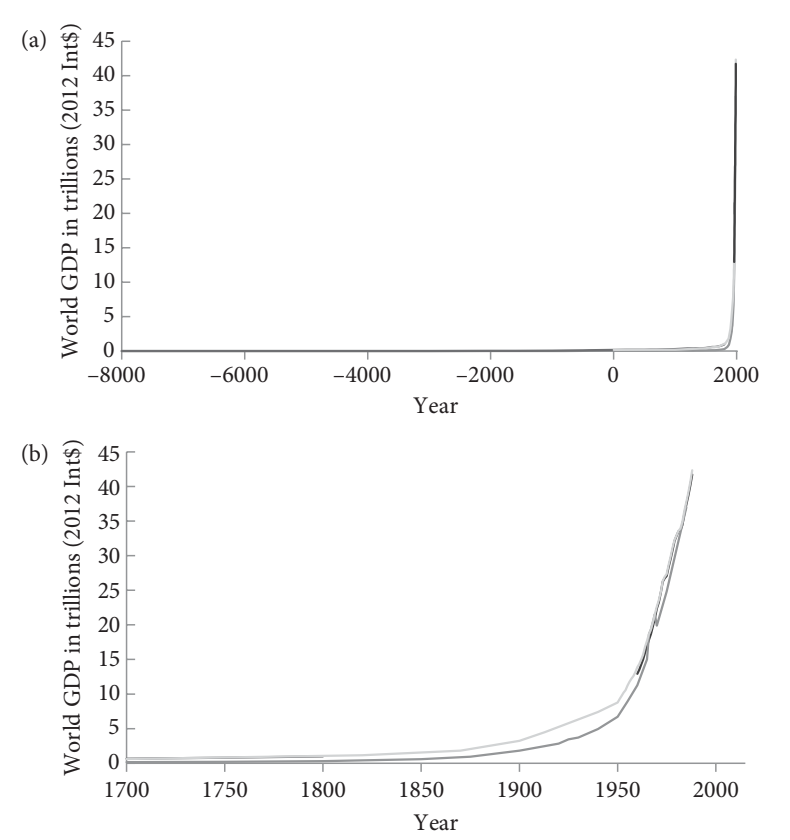
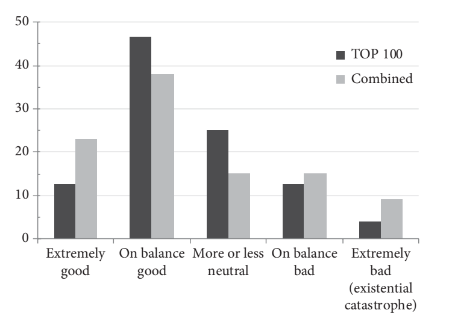

# Chapter 1｜第一章

# Past developments and present capabilities
# 過往發展與現有能力

Nick Bostrom 著｜英繁對照翻譯初稿

> 編排說明：本章「目前」「近年」與未來預測均保留 2014 年原著的時代背景，不代表今日現況。英文在前，繁體中文在後。圖像取自原 PDF，表 1 改為逐項對照以利閱讀；表 2、3 保留表格。原作者註號保留，註釋另附英繁對照檔。

**English**

We begin by looking back. History, at the largest scale, seems to exhibit a sequence of distinct growth modes, each much more rapid than its predecessor. This pattern has been taken to suggest that another (even faster) growth mode might be possible. However, we do not place much weight on this observation—this is not a book about “technological acceleration” or “exponential growth” or the miscellaneous notions sometimes gathered under the rubric of “the singularity.” Next, we review the history of artificial intelligence. We then survey the field’s current capabilities. Finally, we glance at some recent expert opinion surveys, and contemplate our ignorance about the timeline of future advances.

**繁體中文**

我們先回顧過去。從最宏觀的尺度來看，歷史似乎呈現出一連串不同的成長模式，而每一種都比前一種快得多。有人據此認為，另一種——甚至更快的——成長模式也許是可能的。不過，我們並不特別倚重這項觀察：本書探討的不是「科技加速」、「指數成長」，也不是有時被歸在「奇點」名下的各種概念。接著，我們回顧人工智慧的歷史，再概覽這個領域目前的能力。最後，我們略看幾項近期的專家意見調查，並思考：對於未來進展的時間表，我們其實所知甚少。

---

## Growth modes and big history｜成長模式與大歷史

---

**English**

A mere few million years ago our ancestors were still swinging from the branches in the African canopy. On a geological or even evolutionary timescale, the rise of Homo sapiens from our last common ancestor with the great apes happened swiftly. We developed upright posture, opposable thumbs, and—crucially—some relatively minor changes in brain size and neurological organization that led to a great leap in cognitive ability. As a consequence, humans can think abstractly, communicate complex thoughts, and culturally accumulate information over the generations far better than any other species on the planet.

**繁體中文**

僅僅幾百萬年前，我們的祖先還在非洲森林的樹冠間攀盪。以地質、甚至演化的時間尺度來看，智人從我們與其他大型類人猿的最後共同祖先演變而來，是相當迅速的。我們發展出直立姿勢、能與其他手指對握的拇指，以及——最關鍵的——腦部大小與神經組織上一些相對微小的變化，卻因此帶來認知能力的大幅躍升。於是，人類在抽象思考、傳達複雜思想，以及透過文化讓資訊世代累積等方面，都遠遠勝過地球上的其他物種。

---

**English**

These capabilities let humans develop increasingly efficient productive technologies, making it possible for our ancestors to migrate far away from the rainforest and the savanna. Especially after the adoption of agriculture, population densities rose along with the total size of the human population. More people meant more ideas; greater densities meant that ideas could spread more readily and that some individuals could devote themselves to developing specialized skills. These developments increased the rate of growth of economic productivity and technological capacity. Later developments, related to the Industrial Revolution, brought about a second, comparable step change in the rate of growth.

**繁體中文**

這些能力讓人類發展出效率日益提高的生產技術，使祖先得以遷徙到遠離雨林與稀樹草原的地方。尤其在採用農業之後，人口密度與人類總人口一同增加。更多的人意味著更多的想法；更高的密度則意味著想法能更容易傳播，也讓一些人可以專心發展特定技能。這些發展提高了經濟生產力與技術能力的成長速度。之後，與工業革命相關的發展，又使成長速度出現第二次幅度相當的躍升。

---

**English**

Such changes in the rate of growth have important consequences. A few hundred thousand years ago, in early human (or hominid) prehistory, growth was so slow that it took on the order of one million years for human productive capacity to increase sufficiently to sustain an additional one million individuals living at subsistence level. By 5000 bc, following the Agricultural Revolution, the rate of growth had increased to the point where the same amount of growth took just two centuries. Today, following the Industrial Revolution, the world economy grows on average by that amount every ninety minutes.〔[註 1](./01-第一章-註釋-英繁對照.md#note-1)〕

**繁體中文**

成長速度的這類變化會帶來重大影響。數十萬年前，在人類（或人科祖先）的早期史前時代，成長極其緩慢：人類的生產能力要增加到足以讓額外一百萬人維持最低生存水準，大約需要一百萬年。到了農業革命之後的西元前 5000 年，成長速度已提高到只需兩個世紀，就能達到相同的增長量。如今，在工業革命之後，全球經濟平均每九十分鐘就增加這麼多。〔[註 1](./01-第一章-註釋-英繁對照.md#note-1)〕

---

**English**

Even the present rate of growth will produce impressive results if maintained for a moderately long time. If the world economy continues to grow at the same pace as it has over the past fifty years, then the world will be some 4.〔[註 8](./01-第一章-註釋-英繁對照.md#note-8)〕 times richer by 2050 and about 34 times richer by 2100 than it is today.〔[註 2](./01-第一章-註釋-英繁對照.md#note-2)〕

**繁體中文**

即使只是維持目前的成長速度，只要持續一段相當長的時間，也會產生驚人的成果。如果全球經濟繼續以過去五十年的速度成長，那麼到了 2050 年，全球的富裕程度將約為今日的 4.8 倍；到了 2100 年，則約為今日的 34 倍。〔[註 2](./01-第一章-註釋-英繁對照.md#note-2)〕

---

**English**

Yet the prospect of continuing on a steady exponential growth path pales in comparison to what would happen if the world were to experience another step change in the rate of growth comparable in magnitude to those associated with the Agricultural Revolution and the Industrial Revolution. The economist Robin Hanson estimates, based on historical economic and population data, a characteristic world economy doubling time for Pleistocene hunter–gatherer society of 224,000 years; for farming society, 909 years; and for industrial society, 6.〔[註 3](./01-第一章-註釋-英繁對照.md#note-3)〕 years.〔[註 3](./01-第一章-註釋-英繁對照.md#note-3)〕 (In Hanson’s model, the present epoch is a mixture of the farming and the industrial growth modes—the world economy as a whole is not yet growing at the 6.3-year doubling rate.) If another such transition to a different growth mode were to occur, and it were of similar magnitude to the previous two, it would result in a new growth regime in which the world economy would double in size about every two weeks.

**繁體中文**

然而，如果世界的成長速度再次出現與農業革命、工業革命相當的躍升，那麼持續沿著穩定指數成長軌跡發展的前景，相形之下便黯然失色。經濟學家 Robin Hanson 根據歷史經濟與人口資料估計：更新世狩獵採集社會的全球經濟，典型的規模倍增時間為 224,000 年；農業社會為 909 年；工業社會則為 6.3 年。〔[註 3](./01-第一章-註釋-英繁對照.md#note-3)〕（在 Hanson 的模型中，我們目前的時代混合了農業與工業兩種成長模式；全球經濟整體尚未達到每 6.3 年倍增的速度。）如果再次轉換到另一種成長模式，而且轉變幅度與前兩次相近，就會進入一種新的成長狀態：全球經濟規模大約每兩週就翻一倍。

---

**English**

Such a growth rate seems fantastic by current lights. Observers in earlier epochs might have found it equally preposterous to suppose that the world economy would one day be doubling several times within a single lifespan. Yet that is the extraordinary condition we now take to be ordinary.

**繁體中文**

以今日的眼光來看，這樣的成長速度似乎不可思議。早期時代的觀察者若聽說，全球經濟有一天會在一個人的一生之內翻上好幾倍，可能也會覺得同樣荒唐。然而，我們如今視為平常的，正是這種非比尋常的情況。

---

**English**

The idea of a coming technological singularity has by now been widely popularized, starting with Vernor Vinge’s seminal essay and continuing with the writings of Ray Kurzweil and others.〔[註 4](./01-第一章-註釋-英繁對照.md#note-4)〕 The term “singularity,” however, has been used confusedly in many disparate senses and has accreted an unholy (yet almost millenarian) aura of techno-utopian connotations.〔[註 5](./01-第一章-註釋-英繁對照.md#note-5)〕 Since most of these meanings and connotations are irrelevant to our argument, we can gain clarity by dispensing with the “singularity” word in favor of more precise terminology.

**繁體中文**

從 Vernor Vinge 那篇具有開創性的文章，到 Ray Kurzweil 等人後來的著作，科技奇點即將到來的觀念，如今已廣為流傳。〔[註 4](./01-第一章-註釋-英繁對照.md#note-4)〕 不過，「奇點」（singularity）一詞一直被混亂地用來指稱許多截然不同的事物，還附著了一層古怪、卻又近乎千禧年救世信仰的科技烏托邦色彩。〔[註 5](./01-第一章-註釋-英繁對照.md#note-5)〕 由於其中大部分意義與聯想都與我們的論證無關，捨棄「奇點」一詞，改用更精確的術語，反而有助於釐清問題。

---

**English**

The singularity-related idea that interests us here is the possibility of an intelligence explosion, particularly the prospect of machine superintelligence. There may be those who are persuaded by growth diagrams like the ones in Figure 1 that another drastic change in growth mode is in the cards, comparable to the Agricultural or Industrial Revolution. These folk may then reflect that it is hard to conceive of a scenario in which the world economy’s doubling time shortens to mere weeks that does not involve the creation of minds that are much faster and more efficient than the familiar biological kind. However, the case for taking seriously the prospect of a machine intelligence revolution need not rely on curve-fitting exercises or extrapolations from past economic growth. As we shall see, there are stronger reasons for taking heed.

**繁體中文**

在與奇點相關的觀念中，我們在此關心的是智慧爆炸的可能性，尤其是機器超級智慧可能出現這件事。有些人也許會被圖 1 這類成長曲線說服，認為另一場足以媲美農業革命或工業革命的成長模式劇變，很可能正在醞釀。他們或許會進一步想到：很難設想全球經濟規模的倍增時間縮短到僅僅幾週，卻沒有創造出某種比我們熟悉的生物心智快得多、也有效率得多的心智。不過，主張應認真看待機器智慧革命的前景，並不必倚賴曲線擬合或從過去經濟成長所作的外推。如我們稍後將看到的，有更有力的理由值得我們留意。

---

**English**

Figure 1 Long-term history of world GDP. Plotted on a linear scale, the history of the world economy looks like a flat line hugging the x-axis, until it suddenly spikes vertically upward. (a) Even when we zoom in on the most recent 10,000 years, the pattern remains essentially one of a single 90° angle. (b) Only within the past 100 years or so does the curve lift perceptibly above the zero-level. (The different lines in the plot correspond to different data sets, which yield slightly different estimates.〔[註 6](./01-第一章-註釋-英繁對照.md#note-6)〕)

**繁體中文**

圖 1　全球 GDP 的長期歷史。以線性尺度繪圖時，全球經濟的歷史看起來就像一條緊貼橫軸的平線，直到突然近乎垂直地向上竄升。（a）即使把視野縮小到最近一萬年，圖形基本上仍只有一個直角。（b）只有在最近約一百年之內，曲線才明顯離開零值水平。（圖中的不同曲線對應不同資料集，所得估計略有差異。〔[註 6](./01-第一章-註釋-英繁對照.md#note-6)〕）

圖中文字：Year＝年份；World GDP in trillions (2012 Int$)＝全球 GDP，單位為兆（2012 年國際元）。

---

## Great expectations｜遠大的期望

---

**English**

Machines matching humans in general intelligence—that is, possessing common sense and an effective ability to learn, reason, and plan to meet complex information-processing challenges across a wide range of natural and abstract domains—have been expected since the invention of computers in the 1940s. At that time, the advent of such machines was often placed some twenty years into the future.〔[註 7](./01-第一章-註釋-英繁對照.md#note-7)〕 Since then, the expected arrival date has been receding at a rate of one year per year; so that today, futurists who concern themselves with the possibility of artificial general intelligence still often believe that intelligent machines are a couple of decades away.〔[註 8](./01-第一章-註釋-英繁對照.md#note-8)〕

**繁體中文**

自 1940 年代電腦發明以來，人們便一直期待出現能在通用智慧上匹敵人類的機器：也就是具備常識，並能有效學習、推理與規劃，從而應付廣泛的自然及抽象領域中複雜資訊處理挑戰的機器。當時，人們往往認為這類機器會在約二十年後問世。〔[註 7](./01-第一章-註釋-英繁對照.md#note-7)〕 從那時起，預期的問世日期便以每過一年就往後推一年的速度移動；因此，直到今日，關注通用人工智慧（artificial general intelligence）可能性的未來學家，仍經常相信智慧機器距離我們還有二十年左右。〔[註 8](./01-第一章-註釋-英繁對照.md#note-8)〕

---

**English**

Two decades is a sweet spot for prognosticators of radical change: near enough to be attention-grabbing and relevant, yet far enough to make it possible to suppose that a string of breakthroughs, currently only vaguely imaginable, might by then have occurred. Contrast this with shorter timescales: most technologies that will have a big impact on the world in five or ten years from now are already in limited use, while technologies that will reshape the world in less than fifteen years probably exist as laboratory prototypes. Twenty years may also be close to the typical duration remaining of a forecaster’s career, bounding the reputational risk of a bold prediction.

**繁體中文**

對預測劇烈變革的人而言，二十年是個恰到好處的時間跨度：近到足以吸引注意、讓人覺得切身相關；又遠到足以讓人相信，目前只能模糊想像的一連串突破，到時可能已經發生。相比之下，較短的時間跨度就不同了：未來五到十年內會對世界造成重大影響的技術，大多已在有限範圍內使用；而不到十五年內就會重塑世界的技術，很可能已經有了實驗室原型。二十年也可能接近預測者職業生涯通常剩下的長度，從而限制了大膽預言可能帶來的聲譽風險。

---

**English**

From the fact that some individuals have overpredicted artificial intelligence in the past, however, it does not follow that AI is impossible or will never be developed.〔[註 9](./01-第一章-註釋-英繁對照.md#note-9)〕 The main reason why progress has been slower than expected is that the technical difficulties of constructing intelligent machines have proved greater than the pioneers foresaw. But this leaves open just how great those difficulties are and how far we now are from overcoming them. Sometimes a problem that initially looks hopelessly complicated turns out to have a surprisingly simple solution (though the reverse is probably more common).

**繁體中文**

不過，有些人過去對人工智慧的預測過度樂觀，並不能由此推論 AI 不可能實現，或永遠不會被開發出來。〔[註 9](./01-第一章-註釋-英繁對照.md#note-9)〕 進展比預期緩慢，主要是因為建造智慧機器的技術困難，比先驅者原先設想的更大。但這仍未回答：那些困難究竟有多大？我們如今距離克服它們還有多遠？有時，一個起初看來複雜到無望的問題，最後竟有出人意料的簡單解法——儘管相反的情況大概更常見。

---

**English**

In the next chapter, we will look at different paths that may lead to human-level machine intelligence. But let us note at the outset that however many stops there are between here and human-level machine intelligence, the latter is not the final destination. The next stop, just a short distance farther along the tracks, is superhuman-level machine intelligence. The train might not pause or even decelerate at Humanville Station. It is likely to swoosh right by.

**繁體中文**

下一章將探討可能通往人類水準機器智慧的不同路徑。但我們一開始就要指出：無論從現在到人類水準機器智慧之間還有多少站，後者都不是終點。沿著軌道再往前走不遠，下一站就是超越人類水準的機器智慧。這班列車可能不會在「人類村站」停靠，甚至連減速都不會。它很可能會呼嘯而過。

---

**English**

The mathematician I. J. Good, who had served as chief statistician in Alan Turing’s code-breaking team in World War II, might have been the first to enunciate the essential aspects of this scenario. In an oft-quoted passage from 1965, he wrote:

**繁體中文**

數學家 I. J. Good 在第二次世界大戰期間，曾擔任 Alan Turing 密碼破譯團隊的首席統計學家。他也許是最早闡明這種情境核心輪廓的人。在 1965 年一段經常被引用的文字中，他寫道：

---

**English**

Let an ultraintelligent machine be defined as a machine that can far surpass all the intellectual activities of any man however clever. Since the design of machines is one of these intellectual activities, an ultraintelligent machine could design even better machines; there would then unquestionably be an “intelligence explosion,” and the intelligence of man would be left far behind. Thus the first ultraintelligent machine is the last invention that man need ever make, provided that the machine is docile enough to tell us how to keep it under control.〔[註 10](./01-第一章-註釋-英繁對照.md#note-10)〕

**繁體中文**

讓我們把超高智慧機器定義為：無論一個人多麼聰明，都能在其所有智力活動上遠遠超越他的機器。既然設計機器也是這些智力活動之一，超高智慧機器就能設計出更好的機器；於是，毫無疑問地，將會出現一場「智慧爆炸」，人類的智慧會被遠遠拋在後頭。因此，第一部超高智慧機器將是人類最後一項需要完成的發明——前提是，這部機器足夠溫順，願意告訴我們如何讓它保持在控制之下。〔[註 10](./01-第一章-註釋-英繁對照.md#note-10)〕

---

**English**

It may seem obvious now that major existential risks would be associated with such an intelligence explosion, and that the prospect should therefore be examined with the utmost seriousness even if it were known (which it is not) to have but a moderately small probability of coming to pass. The pioneers of artificial intelligence, however, notwithstanding their belief in the imminence of human-level AI, mostly did not contemplate the possibility of greater-than-human AI. It is as though their speculation muscle had so exhausted itself in conceiving the radical possibility of machines reaching human intelligence that it could not grasp the corollary—that machines would subsequently become superintelligent.

**繁體中文**

如今看來，這樣的智慧爆炸會伴隨重大的存續性風險（existential risks），似乎是顯而易見的。因此，即使已知它發生的機率相當小——而我們其實並不知道——仍應極其嚴肅地審視這種可能性。然而，人工智慧的先驅們雖然相信人類水準的 AI 即將到來，大多卻沒有思考超越人類的 AI 是否可能出現。他們彷彿為了想像「機器能達到人類智慧」這種激進的可能性，就已把思辨的力氣耗盡，以至於無法再掌握隨之而來的推論：機器之後將會成為超級智慧。

---

**English**

The AI pioneers for the most part did not countenance the possibility that their enterprise might involve risk.〔[註 11](./01-第一章-註釋-英繁對照.md#note-11)〕 They gave no lip service—let alone serious thought—to any safety concern or ethical qualm related to the creation of artificial minds and potential computer overlords: a lacuna that astonishes even against the background of the era’s not-so-impressive standards of critical technology assessment.〔[註 12](./01-第一章-註釋-英繁對照.md#note-12)〕 We must hope that by the time the enterprise eventually does become feasible, we will have gained not only the technological proficiency to set off an intelligence explosion but also the higher level of mastery that may be necessary to make the detonation survivable.

**繁體中文**

人工智慧的先驅們，大多沒有正視這項事業可能帶來風險。〔[註 11](./01-第一章-註釋-英繁對照.md#note-11)〕 對於創造人工心智與潛在的電腦統治者所涉及的安全疑慮或倫理不安，他們連口頭上的關切都沒有，更不用說認真思考。即使考慮到當時對科技進行批判性評估的標準本來就不怎麼高，這樣的缺漏仍令人驚訝。〔[註 12](./01-第一章-註釋-英繁對照.md#note-12)〕 我們只能希望，等到這項事業終於可行時，我們掌握的不只是引發智慧爆炸的技術本領，也包括可能必須具備的更高層次掌控能力，讓人類得以在這場引爆中生存。

---

**English**

But before we turn to what lies ahead, it will be useful to take a quick glance at the history of machine intelligence to date.

**繁體中文**

不過，在轉向未來之前，先迅速回顧機器智慧迄今的歷史，會有所幫助。

---

## Seasons of hope and despair｜希望與失望的交替

---

**English**

In the summer of 1956 at Dartmouth College, ten scientists sharing an interest in neural nets, automata theory, and the study of intelligence convened for a six-week workshop. This Dartmouth Summer Project is often regarded as the cockcrow of artificial intelligence as a field of research. Many of the participants would later be recognized as founding figures. The optimistic outlook among the delegates is reflected in the proposal submitted to the Rockefeller Foundation, which provided funding for the event:

**繁體中文**

1956 年夏天，十位對神經網路、自動機理論與智慧研究有共同興趣的科學家，齊聚達特茅斯學院，參加為期六週的工作坊。這項達特茅斯夏季研究計畫，常被視為人工智慧作為研究領域的破曉雞鳴。許多參與者後來都被公認為創始人物。與會者的樂觀態度，反映在他們向活動資助者洛克斐勒基金會提交的計畫書中：

---

**English**

We propose that a 2 month, 10 man study of artificial intelligence be carried out. . . . The study is to proceed on the basis of the conjecture that every aspect of learning or any other feature of intelligence can in principle be so precisely described that a machine can be made to simulate it. An attempt will be made to find how to make machines that use language, form abstractions and concepts, solve kinds of problems now reserved for humans, and improve themselves. We think that a significant advance can be made in one or more of these problems if a carefully selected group of scientists work on it together for a summer.

**繁體中文**

我們提議進行一項為期兩個月、由十人參與的人工智慧研究……研究將以下列猜想為基礎：學習的每一個面向，或智慧的任何其他特徵，原則上都能被描述得足夠精確，以至於可以製造出機器來模擬它。我們將嘗試找出方法，讓機器使用語言、形成抽象概念、解決目前只有人類能處理的各類問題，並且改進自身。我們認為，只要一群精心挑選的科學家共同投入一個夏天，就能在上述一個或多個問題上取得重大進展。

---

**English**

In the six decades since this brash beginning, the field of artificial intelligence has been through periods of hype and high expectations alternating with periods of setback and disappointment.

**繁體中文**

自這個意氣風發的起點算起，六十年來，人工智慧領域歷經了炒作與高度期待，以及挫折與失望相互交替的時期。

---

**English**

The first period of excitement, which began with the Dartmouth meeting, was later described by John McCarthy (the event’s main organizer) as the “Look, Ma, no hands!” era. During these early days, researchers built systems designed to refute claims of the form “No machine could ever do X!” Such skeptical claims were common at the time. To counter them, the AI researchers created small systems that achieved X in a “microworld” (a well-defined, limited domain that enabled a pared-down version of the performance to be demonstrated), thus providing a proof of concept and showing that X could, in principle, be done by machine. One such early system, the Logic Theorist, was able to prove most of the theorems in the second chapter of Whitehead and Russell’s Principia Mathematica, and even came up with one proof that was much more elegant than the original, thereby debunking the notion that machines could “only think numerically” and showing that machines were also able to do deduction and to invent logical proofs.〔[註 13](./01-第一章-註釋-英繁對照.md#note-13)〕 A follow-up program, the General Problem Solver, could in principle solve a wide range of formally specified problems.〔[註 14](./01-第一章-註釋-英繁對照.md#note-14)〕 Programs that could solve calculus problems typical of first-year college courses, visual analogy problems of the type that appear in some IQ tests, and simple verbal algebra problems were also written.〔[註 15](./01-第一章-註釋-英繁對照.md#note-15)〕 The Shakey robot (so named because of its tendency to tremble during operation) demonstrated how logical reasoning could be integrated with perception and used to plan and control physical activity.〔[註 16](./01-第一章-註釋-英繁對照.md#note-16)〕 The ELIZA program showed how a computer could impersonate a Rogerian psychotherapist.〔[註 17](./01-第一章-註釋-英繁對照.md#note-17)〕 In the mid-seventies, the program SHRDLU showed how a simulated robotic arm in a simulated world of geometric blocks could follow instructions and answer questions in English that were typed in by a user.〔[註 18](./01-第一章-註釋-英繁對照.md#note-18)〕 In later decades, systems would be created that demonstrated that machines could compose music in the style of various classical composers, outperform junior doctors in certain clinical diagnostic tasks, drive cars autonomously, and make patentable inventions.〔[註 19](./01-第一章-註釋-英繁對照.md#note-19)〕 There has even been an AI that cracked original jokes.〔[註 20](./01-第一章-註釋-英繁對照.md#note-20)〕 (Not that its level of humor was high—“What do you get when you cross an optic with a mental object? An eye-dea”—but children reportedly found its puns consistently entertaining.)

**繁體中文**

從達特茅斯會議開始的第一波熱潮，後來被活動的主要籌辦者 John McCarthy 稱為「媽，你看，不用手！」的時代。在那些早期歲月，研究者打造系統，目的在反駁「機器永遠不可能做到 X！」這類當時很常見的懷疑論斷。為了回應，AI 研究者創造出能在「微型世界」中完成 X 的小型系統。所謂微型世界，是一個定義明確、範圍有限的領域，可以展示某項能力的簡化版本；這便提供了概念驗證，表明機器原則上能做到 X。其中一個早期系統「邏輯理論家」（Logic Theorist），能證明 Whitehead 與 Russell《數學原理》第二章中的大部分定理，甚至提出了一個比原證明優雅得多的證明。這推翻了機器「只能進行數值思考」的觀念，顯示機器也能進行演繹推理、發明邏輯證明。〔[註 13](./01-第一章-註釋-英繁對照.md#note-13)〕 後續的「通用問題求解器」（General Problem Solver），原則上能解決各種以形式語言指定的問題。〔[註 14](./01-第一章-註釋-英繁對照.md#note-14)〕 研究者也寫出了能解大學一年級典型微積分題、某些智力測驗中的視覺類比題，以及簡單代數應用題的程式。〔[註 15](./01-第一章-註釋-英繁對照.md#note-15)〕 Shakey 機器人——因運作時容易發抖而得名——展示了如何把邏輯推理與感知整合，用來規劃和控制實體活動。〔[註 16](./01-第一章-註釋-英繁對照.md#note-16)〕 ELIZA 程式則展示了電腦如何模仿羅傑斯學派的心理治療師。〔[註 17](./01-第一章-註釋-英繁對照.md#note-17)〕 1970 年代中期，SHRDLU 程式展示了模擬機械手臂，如何在由幾何積木構成的模擬世界中，遵從使用者以英文輸入的指令並回答問題。〔[註 18](./01-第一章-註釋-英繁對照.md#note-18)〕 在之後的幾十年，其他系統又展示了機器能模仿不同古典作曲家的風格譜曲、在某些臨床診斷工作上勝過資淺醫師、自動駕車，以及作出可以取得專利的發明。〔[註 19](./01-第一章-註釋-英繁對照.md#note-19)〕 甚至還有會自創笑話的 AI。〔[註 20](./01-第一章-註釋-英繁對照.md#note-20)〕（它的幽默水準倒不算高——「把視覺器官與心智中的東西結合，會得到什麼？An eye-dea〔『眼睛』eye 與『想法』idea 的諧音雙關〕。」不過，據說孩子們總覺得它的雙關語很有趣。）

---

**English**

The methods that produced successes in the early demonstration systems often proved difficult to extend to a wider variety of problems or to harder problem instances. One reason for this is the “combinatorial explosion” of possibilities that must be explored by methods that rely on something like exhaustive search. Such methods work well for simple instances of a problem, but fail when things get a bit more complicated. For instance, to prove a theorem that has a 5-line long proof in a deduction system with one inference rule and 5 axioms, one could simply enumerate the 3,125 possible combinations and check each one to see if it delivers the intended conclusion. Exhaustive search would also work for 6- and 7-line proofs. But as the task becomes more difficult, the method of exhaustive search soon runs into trouble. Proving a theorem with a 50-line proof does not take ten times longer than proving a theorem that has a 5-line proof: rather, if one uses exhaustive search, it requires combing through 550 ≈ 8.〔[註 9](./01-第一章-註釋-英繁對照.md#note-9)〕 × 1034 possible sequences—which is computationally infeasible even with the fastest supercomputers.

**繁體中文**

早期展示系統所採用的成功方法，往往難以擴展到更多種類的問題，或同類問題中更困難的實例。其中一個原因是，依賴窮舉搜尋之類方法時，必須探索的可能性會出現「組合爆炸」（combinatorial explosion）。這些方法處理簡單實例時相當有效，但事情稍微複雜一些就會失靈。例如，在一個具有一條推理規則和五條公理的演繹系統裡，若某個定理有一份長度為五行的證明，只要列舉 3,125 種可能組合，逐一檢查能否得出預期結論即可。窮舉搜尋也能處理六行或七行的證明。但隨著任務變難，這個方法很快就會遇上麻煩。證明一個需要五十行證明的定理，所需時間並不是五行證明的十倍；如果使用窮舉搜尋，必須檢查的可能序列多達 5⁵⁰ ≈ 8.9 × 10³⁴ 個——即使用最快的超級電腦，計算上也不可行。

---

**English**

To overcome the combinatorial explosion, one needs algorithms that exploit structure in the target domain and take advantage of prior knowledge by using heuristic search, planning, and flexible abstract representations—capabilities that were poorly developed in the early AI systems. The performance of these early systems also suffered because of poor methods for handling uncertainty, reliance on brittle and ungrounded symbolic representations, data scarcity, and severe hardware limitations on memory capacity and processor speed. By the mid-1970s, there was a growing awareness of these problems. The realization that many AI projects could never make good on their initial promises led to the onset of the first “AI winter”: a period of retrenchment, during which funding decreased and skepticism increased, and AI fell out of fashion.

**繁體中文**

要克服組合爆炸，就需要能利用目標領域結構的演算法，透過啟發式搜尋（heuristic search）、規劃與靈活的抽象表徵來運用既有知識；而早期 AI 系統在這些能力上的發展都很不足。此外，處理不確定性的方法不佳、倚賴脆弱且缺乏實際基礎的符號表徵、資料稀少，以及記憶體容量和處理器速度受到嚴重的硬體限制，也都拖累了這些早期系統的表現。到了 1970 年代中期，人們逐漸意識到這些問題。當大家發現許多 AI 計畫根本無法兌現最初的承諾，第一次「AI 寒冬」便隨之而來：資源緊縮、經費減少、懷疑增加，人工智慧也不再時髦。

---

**English**

A new springtime arrived in the early 1980s, when Japan launched its Fifth-Generation Computer Systems Project, a well-funded public–private partnership that aimed to leapfrog the state of the art by developing a massively parallel computing architecture that would serve as a platform for artificial intelligence. This occurred at peak fascination with the Japanese “post-war economic miracle,” a period when Western government and business leaders anxiously sought to divine the formula behind Japan’s economic success in hope of replicating the magic at home. When Japan decided to invest big in AI, several other countries followed suit.

**繁體中文**

1980 年代初期，日本推出第五代電腦系統計畫，迎來了新的春天。這是一項資金充裕的公私協力計畫，目標是發展大規模平行運算架構，作為人工智慧的平台，藉此大幅超越當時的技術水準。那時正值人們對日本「戰後經濟奇蹟」最為著迷的時期，西方政府與企業領袖急切地想找出日本經濟成功的祕訣，好在本國複製這番奇蹟。當日本決定大舉投資 AI，其他幾個國家也相繼跟進。

---

**English**

The ensuing years saw a great proliferation of expert systems. Designed as support tools for decision makers, expert systems were rule-based programs that made simple inferences from a knowledge base of facts, which had been elicited from human domain experts and painstakingly hand-coded in a formal language. Hundreds of these expert systems were built. However, the smaller systems provided little benefit, and the larger ones proved expensive to develop, validate, and keep updated, and were generally cumbersome to use. It was impractical to acquire a standalone computer just for the sake of running one program. By the late 1980s, this growth season, too, had run its course.

**繁體中文**

接下來的幾年，專家系統（expert systems）大量湧現。專家系統是為決策者設計的輔助工具，採用規則式程式，從事實知識庫作出簡單推論。知識庫的內容來自各領域的人類專家，再以人工費力地編碼成形式語言。這類系統建造了數百套。然而，小型系統效益有限，大型系統的開發、驗證及持續更新又相當昂貴，而且通常使用不便。只為執行一套程式而購置一部獨立電腦，並不切實際。到了 1980 年代末，這一波成長期也走到了盡頭。

---

**English**

The Fifth-Generation Project failed to meet its objectives, as did its counterparts in the United States and Europe. A second AI winter descended. At this point, a critic could justifiably bemoan “the history of artificial intelligence research to date, consisting always of very limited success in particular areas, followed immediately by failure to reach the broader goals at which these initial successes seem at first to hint.”〔[註 21](./01-第一章-註釋-英繁對照.md#note-21)〕 Private investors began to shun any venture carrying the brand of “artificial intelligence.” Even among academics and their funders, “AI” became an unwanted epithet.〔[註 22](./01-第一章-註釋-英繁對照.md#note-22)〕

**繁體中文**

第五代電腦計畫未能達成目標，美國與歐洲的對應計畫也是如此。第二次 AI 寒冬於是降臨。此時，批評者確實有理由感嘆：「人工智慧研究迄今的歷史，總是在個別領域取得極有限的成功後，隨即無法達成那些最初看似由局部成功所預示的更廣泛目標。」〔[註 21](./01-第一章-註釋-英繁對照.md#note-21)〕 私人投資者開始避開任何掛著「人工智慧」招牌的事業。即使在學術界及其資助者之間，「AI」也成了令人避之唯恐不及的標籤。〔[註 22](./01-第一章-註釋-英繁對照.md#note-22)〕

---

**English**

Technical work continued apace, however, and by the 1990s, the second AI winter gradually thawed. Optimism was rekindled by the introduction of new techniques, which seemed to offer alternatives to the traditional logicist paradigm (often referred to as “Good Old-Fashioned Artificial Intelligence,” or “GOFAI” for short), which had focused on high-level symbol manipulation and which had reached its apogee in the expert systems of the 1980s. The newly popular techniques, which included neural networks and genetic algorithms, promised to overcome some of the shortcomings of the GOFAI approach, in particular the “brittleness” that characterized classical AI programs (which typically produced complete nonsense if the programmers made even a single slightly erroneous assumption). The new techniques boasted a more organic performance. For example, neural networks exhibited the property of “graceful degradation”: a small amount of damage to a neural network typically resulted in a small degradation of its performance, rather than a total crash. Even more importantly, neural networks could learn from experience, finding natural ways of generalizing from examples and finding hidden statistical patterns in their input.〔[註 23](./01-第一章-註釋-英繁對照.md#note-23)〕 This made the nets good at pattern recognition and classification problems. For example, by training a neural network on a data set of sonar signals, it could be taught to distinguish the acoustic profiles of submarines, mines, and sea life with better accuracy than human experts—and this could be done without anybody first having to figure out in advance exactly how the categories were to be defined or how different features were to be weighted.

**繁體中文**

不過，技術工作仍持續推進，到了 1990 年代，第二次 AI 寒冬逐漸解凍。新技術的引入重新點燃了樂觀情緒，因為它們似乎提供了傳統邏輯主義典範之外的選擇。傳統典範常被稱為「老派人工智慧」（Good Old-Fashioned Artificial Intelligence，簡稱 GOFAI），著重高階符號操作，並在 1980 年代的專家系統中達到高峰。新近流行的技術，包括神經網路（neural networks）和遺傳演算法（genetic algorithms），有望克服 GOFAI 的某些缺點，尤其是古典 AI 程式特有的「脆弱性」：程式設計者哪怕只作出一個稍有偏差的假設，程式往往就會產出一派胡言。新技術的表現則更像有機系統。例如，神經網路呈現「平緩退化」（graceful degradation）的特性：網路受到少量損傷，通常只會使表現略微下降，而不會全盤崩潰。更重要的是，神經網路能從經驗中學習，自然地由範例歸納，並找出輸入資料中隱藏的統計規律。〔[註 23](./01-第一章-註釋-英繁對照.md#note-23)〕 這讓神經網路擅長模式辨識與分類問題。例如，使用一組聲納訊號資料來訓練神經網路，就能教它區分潛艇、水雷與海洋生物的聲學特徵，而且準確度可以高於人類專家；事先並不需要有人弄清楚各類別究竟應如何定義，或不同特徵該給予多大權重。

---

**English**

While simple neural network models had been known since the late 1950s, the field enjoyed a renaissance after the introduction of the backpropagation algorithm, which made it possible to train multi-layered neural networks.〔[註 24](./01-第一章-註釋-英繁對照.md#note-24)〕 Such multilayered networks, which have one or more intermediary (“hidden”) layers of neurons between the input and output layers, can learn a much wider range of functions than their simpler predecessors.〔[註 25](./01-第一章-註釋-英繁對照.md#note-25)〕 Combined with the increasingly powerful computers that were becoming available, these algorithmic improvements enabled engineers to build neural networks that were good enough to be practically useful in many applications.

**繁體中文**

雖然簡單的神經網路模型早在 1950 年代末便已為人所知，這個領域卻是在反向傳播演算法（backpropagation algorithm）引入後才迎來復興，因為它使多層神經網路的訓練成為可能。〔[註 24](./01-第一章-註釋-英繁對照.md#note-24)〕 這類多層網路在輸入層與輸出層之間，具有一個或多個中介的神經元「隱藏層」，能學會的函數範圍，遠比先前較簡單的模型廣泛。〔[註 25](./01-第一章-註釋-英繁對照.md#note-25)〕 這些演算法上的改進，加上日益強大的電腦，使工程師得以打造在許多應用中已足夠實用的神經網路。

---

**English**

The brain-like qualities of neural networks contrasted favorably with the rigidly logic-chopping but brittle performance of traditional rule-based GOFAI systems—enough so to inspire a new “-ism,” connectionism, which emphasized the importance of massively parallel sub-symbolic processing. More than 150,000 academic papers have since been published on artificial neural networks, and they continue to be an important approach in machine learning.

**繁體中文**

神經網路類似大腦的特質，與傳統規則式 GOFAI 系統拘泥於邏輯、卻又脆弱的表現，形成了有利的對比；這甚至催生出一種新的「主義」——連結主義（connectionism），強調大規模平行的次符號處理之重要性。此後，人工神經網路相關的學術論文已發表超過十五萬篇，而它們至今仍是機器學習的重要方法。

---

**English**

Evolution-based methods, such as genetic algorithms and genetic programming, constitute another approach whose emergence helped end the second AI winter. It made perhaps a smaller academic impact than neural nets but was widely popularized. In evolutionary models, a population of candidate solutions (which can be data structures or programs) is maintained, and new candidate solutions are generated randomly by mutating or recombining variants in the existing population. Periodically, the population is pruned by applying a selection criterion (a fitness function) that allows only the better candidates to survive into the next generation. Iterated over thousands of generations, the average quality of the solutions in the candidate pool gradually increases. When it works, this kind of algorithm can produce efficient solutions to a very wide range of problems— solutions that may be strikingly novel and unintuitive, often looking more like natural structures than anything that a human engineer would design. And in principle, this can happen without much need for human input beyond the initial specification of the fitness function, which is often very simple. In practice, however, getting evolutionary methods to work well requires skill and ingenuity, particularly in devising a good representational format. Without an efficient way to encode candidate solutions (a genetic language that matches latent structure in the target domain), evolutionary search tends to meander endlessly in a vast search space or get stuck at a local optimum. Even if a good representational format is found, evolution is computationally demanding and is often defeated by the combinatorial explosion.

**繁體中文**

以演化為基礎的方法，例如遺傳演算法與遺傳程式設計（genetic programming），是另一條有助於終結第二次 AI 寒冬的路線。它在學術上的影響或許不及神經網路，卻受到廣泛宣傳。在演化模型中，系統維持一群候選解——可以是資料結構或程式——並透過讓現有群體中的變體發生突變或重新組合，隨機產生新的候選解。系統定期使用某種篩選準則，也就是適應度函數（fitness function），淘汰部分個體，只讓較好的候選解存活到下一代。如此反覆數千代後，候選解群體的平均品質就會逐漸提高。這種演算法若能奏效，就可以為極其廣泛的問題產生高效率的解法；這些解法可能新奇得驚人、違反直覺，看起來往往更像自然界的結構，而非人類工程師會設計出來的東西。原則上，除了最初指定通常十分簡單的適應度函數之外，整個過程不太需要人類介入。然而，實際上，要讓演化方法運作良好，仍需要技巧與巧思，尤其是設計良好的表徵格式。若沒有有效編碼候選解的方法——也就是一種能契合目標領域潛在結構的遺傳語言——演化搜尋往往會在龐大的搜尋空間中無止境地徘徊，或卡在局部最佳解。即使找到了良好的表徵格式，演化過程仍然耗費大量運算，而且常常敗給組合爆炸。

---

**English**

Neural networks and genetic algorithms are examples of methods that stimulated excitement in the 1990s by appearing to offer alternatives to the stagnating GOFAI paradigm. But the intention here is not to sing the praises of these two methods or to elevate them above the many other techniques in machine learning. In fact, one of the major theoretical developments of the past twenty years has been a clearer realization of how superficially disparate techniques can be understood as special cases within a common mathematical framework. For example, many types of artificial neural network can be viewed as classifiers that perform a particular kind of statistical calculation (maximum likelihood estimation).〔[註 26](./01-第一章-註釋-英繁對照.md#note-26)〕 This perspective allows neural nets to be compared with a larger class of algorithms for learning classifiers from examples—“decision trees,” “logistic regression models,” “support vector machines,” “naive Bayes,” “k-nearest-neighbors regression,” among others.〔[註 27](./01-第一章-註釋-英繁對照.md#note-27)〕 In a similar manner, genetic algorithms can be viewed as performing stochastic hill-climbing, which is again a subset of a wider class of algorithms for optimization. Each of these algorithms for building classifiers or for searching a solution space has its own profile of strengths and weaknesses which can be studied mathematically. Algorithms differ in their processor time and memory space requirements, which inductive biases they presuppose, the ease with which externally produced content can be incorporated, and how transparent their inner workings are to a human analyst.

**繁體中文**

神經網路與遺傳演算法，是 1990 年代曾激起熱潮的方法中的兩個例子，因為它們看似能取代停滯的 GOFAI 典範。但這裡並不是要頌揚這兩種方法，也不是要把它們置於機器學習的其他許多技術之上。事實上，過去二十年間的一項重大理論進展，就是更清楚地理解：表面上各不相同的技術，其實可以視為共同數學架構中的特殊情形。例如，許多類型的人工神經網路，可以視為執行某種特定統計計算——最大概似估計（maximum likelihood estimation）——的分類器。〔[註 26](./01-第一章-註釋-英繁對照.md#note-26)〕 從這個角度，就能把神經網路與更廣泛的一類演算法比較：這些演算法都從範例學習如何分類，包括「決策樹」、「邏輯斯迴歸模型」、「支援向量機」、「樸素貝氏」與「k 最近鄰迴歸」等等。〔[註 27](./01-第一章-註釋-英繁對照.md#note-27)〕 同樣地，遺傳演算法可以視為在進行隨機爬山搜尋，而這又屬於更廣泛的最佳化演算法之一。每一種用來建構分類器或搜尋解空間的演算法，都有自身的優缺點，且可以用數學方式研究。它們在處理器時間與記憶體空間的需求、預設的歸納偏置（inductive biases）、納入外部產生內容的難易度，以及內部運作對人類分析者的透明程度上，都有所不同。

---

**English**

Behind the razzle-dazzle of machine learning and creative problem-solving thus lies a set of mathematically well-specified tradeoffs. The ideal is that of the perfect Bayesian agent, one that makes probabilistically optimal use of available information. This ideal is unattainable because it is too computationally demanding to be implemented in any physical computer (see Box 1). Accordingly, one can view artificial intelligence as a quest to find shortcuts: ways of tractably approximating the Bayesian ideal by sacrificing some optimality or generality while preserving enough to get high performance in the actual domains of interest.

**繁體中文**

因此，機器學習與創意問題求解令人眼花撩亂的表現背後，其實是一組可以用數學明確描述的取捨。理想的典範，是一個能以機率上最優的方式利用現有資訊的完美貝氏行動者（Bayesian agent）。這個理想無法實現，因為所需運算太過龐大，任何實體電腦都無法完成（見專欄 1）。因此，可以把人工智慧視為一場尋找捷徑的探索：犧牲部分最優性或通用性，以計算上可行的方式逼近貝氏理想，同時保留足夠能力，在實際關心的領域中取得優異表現。

---

**English**

A reflection of this picture can be seen in the work done over the past couple of decades on probabilistic graphical models, such as Bayesian networks. Bayesian networks provide a concise way of representing probabilistic and conditional independence relations that hold in some particular domain. (Exploiting such independence relations is essential for overcoming the combinatorial explosion, which is as much of a problem for probabilistic inference as it is for logical deduction.) They also provide important insight into the concept of causality.〔[註 28](./01-第一章-註釋-英繁對照.md#note-28)〕

**繁體中文**

過去二十多年對機率圖模型（probabilistic graphical models），例如貝氏網路（Bayesian networks）的研究，便反映了這種圖景。貝氏網路提供一種簡潔的方法，用來表達特定領域中的機率關係與條件獨立關係。（善用這類獨立關係，是克服組合爆炸的關鍵；對機率推論而言，組合爆炸與在邏輯演繹中同樣棘手。）這些模型也為因果關係的概念提供了重要洞見。〔[註 28](./01-第一章-註釋-英繁對照.md#note-28)〕

---

**English**

One advantage of relating learning problems from specific domains to the general problem of Bayesian inference is that new algorithms that make Bayesian inference more efficient will then yield immediate improvements across many different areas. Advances in Monte Carlo approximation techniques, for example, are directly applied in computer vision, robotics, and computational genetics. Another advantage is that it lets researchers from different disciplines more easily pool their findings. Graphical models and Bayesian statistics have become a shared focus of research in many fields, including machine learning, statistical physics, bioinformatics, combinatorial optimization, and communication theory.〔[註 35](./01-第一章-註釋-英繁對照.md#note-35)〕 A fair amount of the recent progress in machine learning has resulted from incorporating formal results originally derived in other academic fields. (Machine learning applications have also benefitted enormously from faster computers and greater availability of large data sets.)

**繁體中文**

把特定領域的學習問題與一般性的貝氏推論問題連結起來，其中一項好處是：只要新演算法能提高貝氏推論的效率，就能立刻改善許多不同領域的表現。例如，蒙地卡羅近似技術（Monte Carlo approximation techniques）的進展，可直接應用於電腦視覺、機器人學與計算遺傳學。另一項好處，是讓不同學科的研究者更容易整合彼此的發現。圖模型與貝氏統計已成為許多領域共同的研究焦點，包括機器學習、統計物理、生物資訊學、組合最佳化與通訊理論。〔[註 35](./01-第一章-註釋-英繁對照.md#note-35)〕 近年機器學習相當一部分的進展，來自吸收其他學科最先推導出的形式化成果。（更快速的電腦，以及更容易取得的大型資料集，也讓機器學習的應用受益極大。）

---

## Box 1 An optimal Bayesian agent｜專欄 1　最優貝氏行動者

---

**English**

An ideal Bayesian agent starts out with a “prior probability distribution,” a function that assigns probabilities to each “possible world” (i.e. to each maximally specific way the world could turn out to be).〔[註 29](./01-第一章-註釋-英繁對照.md#note-29)〕 This prior incorporates an inductive bias such that simpler possible worlds are assigned higher probabilities. (One way to formally define the simplicity of a possible world is in terms of its “Kolmogorov complexity,” a measure based on the length of the shortest computer program that generates a complete description of the world.〔[註 30](./01-第一章-註釋-英繁對照.md#note-30)〕) The prior also incorporates any background knowledge that the programmers wish to give to the agent.

**繁體中文**

理想的貝氏行動者，起初具有一個「先驗機率分布」（prior probability distribution）：這是一個函數，為每個「可能世界」——也就是世界可能呈現的每一種最完整、最具體的情形——指定機率。〔[註 29](./01-第一章-註釋-英繁對照.md#note-29)〕 這個先驗分布包含一種歸納偏置，讓較簡單的可能世界獲得較高的機率。（形式化定義一個可能世界有多簡單的方法之一，是使用它的「柯爾莫哥洛夫複雜度」（Kolmogorov complexity）：以能生成該世界完整描述的最短電腦程式之長度，作為衡量標準。〔[註 30](./01-第一章-註釋-英繁對照.md#note-30)〕）先驗分布也包含程式設計者希望提供給行動者的任何背景知識。

---

**English**

As the agent receives new information from its sensors, it updates its probability distribution by conditionalizing the distribution on the new information according to Bayes’ theorem.〔[註 31](./01-第一章-註釋-英繁對照.md#note-31)〕 Conditionalization is the mathematical operation that sets the new probability of those worlds that are inconsistent with the information received to zero and renormalizes the probability distribution over the remaining possible worlds. The result is a “posterior probability distribution” (which the agent may use as its new prior in the next time step). As the agent makes observations, its probability mass thus gets concentrated on the shrinking set of possible worlds that remain consistent with the evidence; and among these possible worlds, simpler ones always have more probability.

**繁體中文**

當行動者透過感測器接收到新資訊，就依照貝氏定理，以這些新資訊為條件，更新它的機率分布。〔[註 31](./01-第一章-註釋-英繁對照.md#note-31)〕 條件化是一種數學運算：將與收到的資訊不相容之世界的機率設為零，再對其餘可能世界的機率分布重新正規化。所得結果稱為「後驗機率分布」（posterior probability distribution），行動者可以在下一個時間步驟，把它當成新的先驗分布。隨著行動者持續觀察，機率質量便集中到愈來愈小、仍與證據相容的一組可能世界上；而在這些可能世界之中，較簡單者始終具有較高的機率。

---

**English**

Metaphorically, we can think of a probability as sand on a large sheet of paper. The paper is partitioned into areas of various sizes, each area corresponding to one possible world, with larger areas corresponding to simpler possible worlds. Imagine also a layer of sand of even thickness spread across the entire sheet: this is our prior probability distribution. Whenever an observation is made that rules out some possible worlds, we remove the sand from the corresponding areas of the paper and redistribute it evenly over the areas that remain in play. Thus, the total amount of sand on the sheet never changes, it just gets concentrated into fewer areas as observational evidence accumulates. This is a picture of learning in its purest form. (To calculate the probability of a hypothesis, we simply measure the amount of sand in all the areas that correspond to the possible worlds in which the hypothesis is true.)

**繁體中文**

打個比方，我們可以把機率想成一大張紙上的沙子。紙被分成大小不一的區域，每個區域代表一個可能世界，較大的區域對應較簡單的可能世界。再想像整張紙均勻鋪著一層厚度相同的沙子：這就是我們的先驗機率分布。每當一項觀察排除了某些可能世界，我們就把對應區域的沙子移走，均勻地重新撒到那些仍未被排除的區域。因此，紙上的沙子總量始終不變，只是隨著觀察證據累積，愈來愈集中在少數區域。這就是學習最純粹的樣貌。（要計算某項假說的機率，只需量出所有使該假說為真的可能世界所對應區域中的沙子總量。）

---

**English**

So far, we have defined a learning rule. To get an agent, we also need a decision rule. To this end, we endow the agent with a “utility function” which assigns a number to each possible world. The number represents the desirability of that world according to the agent’s basic preferences. Now, at each time step, the agent selects the action with the highest expected utility.〔[註 32](./01-第一章-註釋-英繁對照.md#note-32)〕 (To find the action with the highest expected utility, the agent could list all possible actions. It could then compute the conditional probability distribution given the action— the probability distribution that would result from conditionalizing its current probability distribution on the observation that the action had just been taken. Finally, it could calculate the expected value of the action as the sum of the value of each possible world multiplied by the conditional probability of that world given the action.〔[註 33](./01-第一章-註釋-英繁對照.md#note-33)〕)

**繁體中文**

到目前為止，我們定義了一條學習規則。要得到一個行動者，還需要一條決策規則。為此，我們賦予行動者一個「效用函數」（utility function），為每個可能世界指定一個數值。這個數值依據行動者的基本偏好，表示該世界有多值得追求。接著，在每個時間步驟，行動者都選擇預期效用（expected utility）最高的行動。〔[註 32](./01-第一章-註釋-英繁對照.md#note-32)〕（為了找出這個行動，行動者可以先列出所有可能的行動，再計算給定各項行動時的條件機率分布：也就是把「剛剛採取了該行動」當作觀察結果，對目前機率分布作條件化後得到的分布。最後，它可以把每個可能世界的價值，乘上在給定該行動下該世界的條件機率，再全部加總，算出該行動的預期價值。〔[註 33](./01-第一章-註釋-英繁對照.md#note-33)〕）

---

**English**

The learning rule and the decision rule together define an “optimality notion” for an agent. (Essentially the same optimality notion has been broadly used in artificial intelligence, epistemology, philosophy of science, economics, and statistics.〔[註 34](./01-第一章-註釋-英繁對照.md#note-34)〕) In reality, it is impossible to build such an agent because it is computationally intractable to perform the requisite calculations. Any attempt to do so succumbs to a combinatorial explosion just like the one described in our discussion of GOFAI. To see why this is so, consider one tiny subset of all possible worlds: those that consist of a single computer monitor floating in an endless vacuum. The monitor has 1,000 × 1,000 pixels, each of which is perpetually either on or off. Even this subset of possible worlds is enormously large: the 2^(1,000 × 1,000) possible monitor states outnumber all the computations expected ever to take place in the observable universe. Thus, we could not even enumerate all the possible worlds in this tiny subset of all possible worlds, let alone perform more elaborate computations on each of them individually.

**繁體中文**

學習規則與決策規則共同定義了行動者的一種「最優性概念」。（本質上相同的最優性概念，已廣泛用於人工智慧、知識論、科學哲學、經濟學與統計學。〔[註 34](./01-第一章-註釋-英繁對照.md#note-34)〕）實際上，這樣的行動者不可能建造出來，因為所需的計算在運算上不可處理。任何嘗試都會陷入組合爆炸，正如先前討論 GOFAI 時所描述的情況。要理解原因，只需考慮所有可能世界中的一個極小子集：每個世界都只有一臺漂浮在無盡真空中的電腦螢幕。螢幕有 1,000 × 1,000 個像素，每個像素永遠不是亮著，就是暗著。即使只是這個可能世界的子集，也已大得驚人：2^(1,000 × 1,000) 種可能的螢幕狀態，數量比可觀測宇宙中預計曾經及將會發生的所有計算還多。因此，我們連這個極小子集中的所有可能世界都無法一一列出，更別說對每一個分別進行更複雜的計算。

---

**English**

Optimality notions can be of theoretical interest even if they are physically unrealizable. They give us a standard by which to judge heuristic approximations, and sometimes we can reason about what an optimal agent would do in some special case. We will encounter some alternative optimality notions for artificial agents in Chapter 12.

**繁體中文**

即使最優性概念在物理上無法實現，仍可能具有理論意義。它們提供評判啟發式近似方法的標準，而且有時我們可以推論，最優行動者在某種特殊情況下會怎麼做。第十二章將介紹人工行動者的另一些最優性概念。

---

## State of the art｜技術現況

---

**English**

Artificial intelligence already outperforms human intelligence in many domains. Table 1 surveys the state of game-playing computers, showing that AIs now beat human champions in a wide range of games.〔[註 36](./01-第一章-註釋-英繁對照.md#note-36)〕

**繁體中文**

人工智慧在許多領域的表現，已經超越人類智慧。表 1 概覽了電腦玩遊戲的現況，顯示 AI 如今在多種遊戲中都能擊敗人類冠軍。〔[註 36](./01-第一章-註釋-英繁對照.md#note-36)〕

---

## Table 1 Game-playing AI｜表 1　遊戲 AI

**English**

Checkers — Superhuman

Arthur Samuel’s checkers program, originally written in 1952 and later improved (the 1955 version incorporating machine learning), becomes the first program to learn to play a game better than its creator.〔[註 37](./01-第一章-註釋-英繁對照.md#note-37)〕 In 1994, the program CHINOOK beats the reigning human champion, marking the first time a program wins an official world championship in a game of skill. In 2002, Jonathan Schaeffer and his team “solve” checkers, i.e. produce a program that always makes the best possible move (combining alpha-beta search with a database of 39 trillion endgame positions). Perfect play by both sides leads to a draw.〔[註 38](./01-第一章-註釋-英繁對照.md#note-38)〕

**繁體中文**

西洋跳棋——超越人類

Arthur Samuel 最初於 1952 年編寫、後來持續改進的西洋跳棋程式，成為第一個學會把遊戲玩得比創造者更好的程式；其 1955 年版本已納入機器學習。〔[註 37](./01-第一章-註釋-英繁對照.md#note-37)〕 1994 年，CHINOOK 擊敗當時的人類冠軍，首次有程式在技巧性遊戲中贏得正式的世界冠軍。2002 年，Jonathan Schaeffer 與團隊「解決」了西洋跳棋，也就是製作出總能選擇最佳走法的程式，結合 α–β 搜尋與包含 39 兆種殘局局面的資料庫。雙方若都完美應對，結果就是和局。〔[註 38](./01-第一章-註釋-英繁對照.md#note-38)〕

**English**

Backgammon — Superhuman

1979: The backgammon program BKG by Hans Berliner defeats the world champion— the first computer program to defeat (in an exhibition match) a world champion in any game—though Berliner later attributes the win to luck with the dice rolls.〔[註 39](./01-第一章-註釋-英繁對照.md#note-39)〕 1992: The backgammon program TD-Gammon by Gerry Tesauro reaches championship-level ability, using temporal difference learning (a form of reinforcement learning) and repeated plays against itself to improve.〔[註 40](./01-第一章-註釋-英繁對照.md#note-40)〕 In the years since, backgammon programs have far surpassed the best human players.〔[註 41](./01-第一章-註釋-英繁對照.md#note-41)〕

**繁體中文**

雙陸棋——超越人類

1979 年：Hans Berliner 的雙陸棋程式 BKG 擊敗世界冠軍，成為首個在任何遊戲中於表演賽擊敗世界冠軍的電腦程式；不過，Berliner 後來把勝利歸因於擲骰子的運氣。〔[註 39](./01-第一章-註釋-英繁對照.md#note-39)〕 1992 年：Gerry Tesauro 的 TD-Gammon 使用時間差分學習（temporal difference learning，一種強化學習），並透過反覆自我對弈來改進，達到了冠軍水準。〔[註 40](./01-第一章-註釋-英繁對照.md#note-40)〕 此後，雙陸棋程式已遠遠超越最優秀的人類玩家。〔[註 41](./01-第一章-註釋-英繁對照.md#note-41)〕

**English**

Traveller TCS — Superhuman in collaboration with human〔[註 42](./01-第一章-註釋-英繁對照.md#note-42)〕

In both 1981 and 1982, Douglas Lenat’s program Eurisko wins the US championship in Traveller TCS (a futuristic naval war game), prompting rule changes to block its unorthodox strategies.〔[註 43](./01-第一章-註釋-英繁對照.md#note-43)〕 Eurisko had heuristics for designing its fleet, and it also had heuristics for modifying its heuristics.

**繁體中文**

Traveller TCS——與人類協作時超越人類〔[註 42](./01-第一章-註釋-英繁對照.md#note-42)〕

1981 與 1982 年，Douglas Lenat 的 Eurisko 程式接連贏得 Traveller TCS——一種未來背景的海戰遊戲——的美國冠軍，迫使主辦方修改規則，以封堵它不按常理的策略。〔[註 43](./01-第一章-註釋-英繁對照.md#note-43)〕 Eurisko 不但具有設計艦隊的啟發式規則，也具有修改自身啟發式規則的啟發式規則。

**English**

Othello — Superhuman

1997: The program Logistello wins every game in a six-game match against world champion Takeshi Murakami.〔[註 44](./01-第一章-註釋-英繁對照.md#note-44)〕

**繁體中文**

黑白棋——超越人類

1997 年：Logistello 程式在與世界冠軍村上健的六局比賽中，六戰全勝。〔[註 44](./01-第一章-註釋-英繁對照.md#note-44)〕

**English**

Chess — Superhuman

1997: Deep Blue beats the world chess champion, Garry Kasparov. Kasparov claims to have seen glimpses of true intelligence and creativity in some of the computer’s moves.〔[註 45](./01-第一章-註釋-英繁對照.md#note-45)〕 Since then, chess engines have continued to improve.〔[註 46](./01-第一章-註釋-英繁對照.md#note-46)〕

**繁體中文**

西洋棋——超越人類

1997 年：深藍（Deep Blue）擊敗世界西洋棋冠軍 Garry Kasparov。Kasparov 表示，電腦的某些走法讓他瞥見了真正的智慧與創造力。〔[註 45](./01-第一章-註釋-英繁對照.md#note-45)〕 此後，西洋棋引擎仍持續進步。〔[註 46](./01-第一章-註釋-英繁對照.md#note-46)〕

**English**

Crosswords — Expert level

1999: The crossword-solving program Proverb outperforms the average crossword-solver.〔[註 47](./01-第一章-註釋-英繁對照.md#note-47)〕 2012: The program Dr. Fill, created by Matt Ginsberg, scores in the top quartile among the otherwise human contestants in the American Crossword Puzzle Tournament. (Dr. Fill’s performance is uneven. It completes perfectly the puzzle rated most difficult by humans, yet is stumped by a couple of nonstandard puzzles that involved spelling backwards or writing answers diagonally.)〔[註 48](./01-第一章-註釋-英繁對照.md#note-48)〕

**繁體中文**

填字遊戲——專家水準

1999 年：填字解題程式 Proverb 的表現超過一般填字玩家。〔[註 47](./01-第一章-註釋-英繁對照.md#note-47)〕 2012 年：Matt Ginsberg 開發的 Dr. Fill，在其餘參賽者皆為人類的美國填字錦標賽中，成績進入前四分之一。（Dr. Fill 的表現並不均衡：它完美解出了人類評為最難的題目，卻被幾道需要倒著拼字或沿對角線填寫答案的非標準題難倒。）〔[註 48](./01-第一章-註釋-英繁對照.md#note-48)〕

**English**

Scrabble — Superhuman

As of 2002, Scrabble-playing software surpasses the best human players.〔[註 49](./01-第一章-註釋-英繁對照.md#note-49)〕

**繁體中文**

Scrabble 拼字遊戲——超越人類

截至 2002 年，Scrabble 軟體的表現已超過最優秀的人類玩家。〔[註 49](./01-第一章-註釋-英繁對照.md#note-49)〕

**English**

Bridge — Equal to the best

By 2005, contract bridge playing software reaches parity with the best human bridge players.〔[註 50](./01-第一章-註釋-英繁對照.md#note-50)〕

**繁體中文**

橋牌——與頂尖人類相當

到了 2005 年，合約橋牌軟體已達到與最優秀人類橋牌玩家相當的水準。〔[註 50](./01-第一章-註釋-英繁對照.md#note-50)〕

**English**

Jeopardy! — Superhuman

2010: IBM’s Watson defeats the two all-time-greatest human Jeopardy! champions, Ken Jennings and Brad Rutter.〔[註 51](./01-第一章-註釋-英繁對照.md#note-51)〕 Jeopardy! is a televised game show with trivia questions about history, literature, sports, geography, pop culture, science, and other topics. Questions are presented in the form of clues, and often involve wordplay.

**繁體中文**

Jeopardy!——超越人類

2010 年：IBM 的 Watson 擊敗 Jeopardy! 歷來最傑出的兩位人類冠軍 Ken Jennings 與 Brad Rutter。〔[註 51](./01-第一章-註釋-英繁對照.md#note-51)〕 Jeopardy! 是一個電視益智節目，題目涵蓋歷史、文學、體育、地理、流行文化、科學等領域的知識。題目以線索形式呈現，而且經常包含文字遊戲。

**English**

Poker — Varied

Computer poker players remain slightly below the best humans for full-ring Texas hold ’em but perform at a superhuman level in some poker variants.〔[註 52](./01-第一章-註釋-英繁對照.md#note-52)〕

**繁體中文**

撲克——表現不一

在滿桌德州撲克中，電腦玩家仍略遜於頂尖人類，但在某些撲克變體中，已達到超越人類的水準。〔[註 52](./01-第一章-註釋-英繁對照.md#note-52)〕

**English**

FreeCell — Superhuman

Heuristics evolved using genetic algorithms produce a solver for the solitaire game FreeCell (which in its generalized form is NP-complete) that is able to beat high-ranking human players.〔[註 53](./01-第一章-註釋-英繁對照.md#note-53)〕

**繁體中文**

新接龍——超越人類

利用遺傳演算法演化出的啟發式規則，產生了一個能解新接龍（FreeCell）的程式，足以擊敗排名很高的人類玩家；新接龍的一般化形式屬於 NP 完全問題。〔[註 53](./01-第一章-註釋-英繁對照.md#note-53)〕

**English**

Go — Very strong amateur level

As of 2012, the Zen series of go-playing programs has reached rank 6 dan in fast games (the level of a very strong amateur player), using Monte Carlo tree search and machine learning techniques.〔[註 54](./01-第一章-註釋-英繁對照.md#note-54)〕 Go-playing programs have been improving at a rate of about 1 dan/ year in recent years. If this rate of improvement continues, they might beat the human world champion in about a decade.

**繁體中文**

圍棋——頂尖業餘水準

截至 2012 年，Zen 系列圍棋程式利用蒙地卡羅樹搜尋與機器學習技術，已在快棋中達到六段，也就是相當強的業餘棋手水準。〔[註 54](./01-第一章-註釋-英繁對照.md#note-54)〕 近年圍棋程式大約以每年提升一段的速度進步。如果這個速度持續下去，它們或許能在約十年後擊敗人類世界冠軍。

---

**English**

These achievements might not seem impressive today. But this is because our standards for what is impressive keep adapting to the advances being made. Expert chess playing, for example, was once thought to epitomize human intellection. In the view of several experts in the late fifties: “If one could devise a successful chess machine, one would seem to have penetrated to the core of human intellectual endeavor.”〔[註 55](./01-第一章-註釋-英繁對照.md#note-55)〕 This no longer seems so. One sympathizes with John McCarthy, who lamented: “As soon as it works, no one calls it AI anymore.”〔[註 56](./01-第一章-註釋-英繁對照.md#note-56)〕

**繁體中文**

這些成就今日看來或許已不怎麼驚人，但那是因為我們對「驚人」的標準，總是不斷隨進展調整。例如，精湛的西洋棋技術曾被視為人類智力活動的典範。1950 年代末，幾位專家認為：「如果能設計出一部成功的西洋棋機器，似乎就已深入人類智力活動的核心。」〔[註 55](./01-第一章-註釋-英繁對照.md#note-55)〕 如今看來卻不是這麼回事。John McCarthy 曾感嘆：「一旦它能用了，就沒有人再把它叫作 AI。」〔[註 56](./01-第一章-註釋-英繁對照.md#note-56)〕 這番話令人感同身受。

---

**English**

There is an important sense, however, in which chess-playing AI turned out to be a lesser triumph than many imagined it would be. It was once supposed, perhaps not unreasonably, that in order for a computer to play chess at grandmaster level, it would have to be endowed with a high degree of general intelligence.〔[註 57](./01-第一章-註釋-英繁對照.md#note-57)〕 One might have thought, for example, that great chess playing requires being able to learn abstract concepts, think cleverly about strategy, compose flexible plans, make a wide range of ingenious logical deductions, and maybe even model one’s opponent’s thinking. Not so. It turned out to be possible to build a perfectly fine chess engine around a special-purpose algorithm.〔[註 58](./01-第一章-註釋-英繁對照.md#note-58)〕 When implemented on the fast processors that became available towards the end of the twentieth century, it produces very strong play. But an AI built like that is narrow. It plays chess; it can do no other.〔[註 59](./01-第一章-註釋-英繁對照.md#note-59)〕

**繁體中文**

不過，就某個重要意義而言，西洋棋 AI 的成功，確實沒有許多人原先想像的那麼重大。人們曾認為——或許不無道理——若要讓電腦以特級大師的水準下棋，就必須賦予它高度的通用智慧。〔[註 57](./01-第一章-註釋-英繁對照.md#note-57)〕 例如，人們可能會以為，出色的棋藝需要能學習抽象概念、巧妙思考策略、制定靈活計畫、作出各種精巧的邏輯推論，甚至模擬對手的思考。事實卻非如此。結果顯示，單靠專用演算法，就能打造相當出色的西洋棋引擎。〔[註 58](./01-第一章-註釋-英繁對照.md#note-58)〕 當這類演算法在二十世紀末已可取得的高速處理器上執行時，就能下出極強的棋。但以這種方式建構的 AI，能力範圍很狹窄。它會下西洋棋；除此之外，什麼也不會。〔[註 59](./01-第一章-註釋-英繁對照.md#note-59)〕

---

**English**

In other domains, solutions have turned out to be more complicated than initially expected, and progress slower. The computer scientist Donald Knuth was struck that “AI has by now succeeded in doing essentially everything that requires ‘thinking’ but has failed to do most of what people and animals do ‘without thinking’—that, somehow, is much harder!”〔[註 60](./01-第一章-註釋-英繁對照.md#note-60)〕 Analyzing visual scenes, recognizing objects, or controlling a robot’s behavior as it interacts with a natural environment has proved challenging. Nevertheless, a fair amount of progress has been made and continues to be made, aided by steady improvements in hardware.

**繁體中文**

在其他領域，解法卻比最初預期的更複雜，進展也較緩慢。電腦科學家 Donald Knuth 對此深感驚訝：「AI 如今基本上已成功做到所有需要『思考』的事情，卻做不到大部分人類與動物『不假思索』就能做到的事——不知為何，那些事反而困難得多！」〔[註 60](./01-第一章-註釋-英繁對照.md#note-60)〕 分析視覺場景、辨識物體，或控制機器人與自然環境互動時的行為，都已證明極具挑戰。不過，在硬體穩定進步的協助下，這些方面仍已取得相當進展，而且正在繼續向前。

---

**English**

Common sense and natural language understanding have also turned out to be difficult. It is now often thought that achieving a fully human-level performance on these tasks is an “AI-complete” problem, meaning that the difficulty of solving these problems is essentially equivalent to the difficulty of building generally human-level intelligent machines.〔[註 61](./01-第一章-註釋-英繁對照.md#note-61)〕 In other words, if somebody were to succeed in creating an AI that could understand natural language as well as a human adult, they would in all likelihood also either already have succeeded in creating an AI that could do everything else that human intelligence can do, or they would be but a very short step from such a general capability.〔[註 62](./01-第一章-註釋-英繁對照.md#note-62)〕

**繁體中文**

常識與自然語言理解也已證明相當困難。如今，人們常認為，要在這些任務上完全達到人類水準，是一種「AI 完全」（AI-complete）問題：也就是說，解決這些問題的難度，本質上等同於建造具有普遍人類水準智慧的機器。〔[註 61](./01-第一章-註釋-英繁對照.md#note-61)〕 換句話說，如果有人成功創造出能像成年人一樣理解自然語言的 AI，那麼他們很可能也已經成功創造出能完成人類智慧所能做的一切的 AI，或距離這種通用能力只剩非常小的一步。〔[註 62](./01-第一章-註釋-英繁對照.md#note-62)〕

---

**English**

Chess-playing expertise turned out to be achievable by means of a surprisingly simple algorithm. It is tempting to speculate that other capabilities—such as general reasoning ability, or some key ability involved in programming—might likewise be achievable through some surprisingly simple algorithm. The fact that the best performance at one time is attained through a complicated mechanism does not mean that no simple mechanism could do the job as well or better. It might simply be that nobody has yet found the simpler alternative. The Ptolemaic system (with the Earth in the center, orbited by the Sun, the Moon, planets, and stars) represented the state of the art in astronomy for over a thousand years, and its predictive accuracy was improved over the centuries by progressively complicating the model: adding epicycles upon epicycles to the postulated celestial motions. Then the entire system was overthrown by the heliocentric theory of Copernicus, which was simpler and—though only after further elaboration by Kepler—more predictively accurate.〔[註 63](./01-第一章-註釋-英繁對照.md#note-63)〕

**繁體中文**

結果顯示，西洋棋專長可以透過出乎意料簡單的演算法實現。這不免讓人猜想：其他能力，例如一般推理能力，或程式設計所涉及的某項關鍵能力，是否也能透過某種出人意料簡單的演算法實現？某個時期的最佳表現是由複雜機制達成，並不代表簡單機制就無法做得一樣好，甚至更好。也許只是還沒有人找到那個比較簡單的替代方案。托勒密體系——地球位居中央，太陽、月亮、行星與恆星繞行其外——曾代表天文學的最高水準，長達一千多年。幾個世紀以來，人們不斷讓模型變得更複雜，在假設的天體運動中增添一層又一層本輪，以提高預測準確度。之後，整個體系被哥白尼的日心說取代；後者更簡單，而且在經過克卜勒進一步發展之後，預測也更加準確。〔[註 63](./01-第一章-註釋-英繁對照.md#note-63)〕

---

**English**

Artificial intelligence methods are now used in more areas than it would make sense to review here, but mentioning a sampling of them will give an idea of the breadth of applications. Aside from the game AIs listed in Table 1, there are hearing aids with algorithms that filter out ambient noise; route-finders that display maps and offer navigation advice to drivers; recommender systems that suggest books and music albums based on a user’s previous purchases and ratings; and medical decision support systems that help doctors diagnose breast cancer, recommend treatment plans, and aid in the interpretation of electrocardiograms. There are robotic pets and cleaning robots, lawn-mowing robots, rescue robots, surgical robots, and over a million industrial robots.〔[註 64](./01-第一章-註釋-英繁對照.md#note-64)〕 The world population of robots exceeds 10 million.〔[註 65](./01-第一章-註釋-英繁對照.md#note-65)〕

**繁體中文**

人工智慧方法目前的應用領域之多，已不適合在這裡逐一回顧；不過，舉幾個例子，就能看出其廣泛程度。除了表 1 所列的遊戲 AI，還有利用演算法濾除環境噪音的助聽器、顯示地圖並為駕駛提供導航建議的路線規劃系統、根據使用者過往購買與評分來推薦書籍和音樂專輯的推薦系統，以及協助醫師診斷乳癌、建議治療方案與判讀心電圖的醫療決策支援系統。此外，還有機器寵物、清潔機器人、割草機器人、救援機器人、手術機器人，以及超過一百萬臺工業機器人。〔[註 64](./01-第一章-註釋-英繁對照.md#note-64)〕 全球機器人的總數已超過一千萬臺。〔[註 65](./01-第一章-註釋-英繁對照.md#note-65)〕

---

**English**

Modern speech recognition, based on statistical techniques such as hidden Markov models, has become sufficiently accurate for practical use (some fragments of this book were drafted with the help of a speech recognition program). Personal digital assistants, such as Apple’s Siri, respond to spoken commands and can answer simple questions and execute commands. Optical character recognition of handwritten and typewritten text is routinely used in applications such as mail sorting and digitization of old documents.〔[註 66](./01-第一章-註釋-英繁對照.md#note-66)〕

**繁體中文**

現代語音辨識以隱藏式馬可夫模型（hidden Markov models）等統計技術為基礎，準確度已足以實際使用；本書的某些片段，就是藉助語音辨識程式起草的。Apple 的 Siri 等個人數位助理，可以回應語音指令、回答簡單問題並執行命令。對手寫與打字文字進行的光學字元辨識，也已常規用於郵件分類、舊文件數位化等應用。〔[註 66](./01-第一章-註釋-英繁對照.md#note-66)〕

---

**English**

Machine translation remains imperfect but is good enough for many applications. Early systems used the GOFAI approach of hand-coded grammars that had to be developed by skilled linguists from the ground up for each language. Newer systems use statistical machine learning techniques that automatically build statistical models from observed usage patterns. The machine infers the parameters for these models by analyzing bilingual corpora. This approach dispenses with linguists: the programmers building these systems need not even speak the languages they are working with.〔[註 67](./01-第一章-註釋-英繁對照.md#note-67)〕

**繁體中文**

機器翻譯仍不完美，但已足以滿足許多用途。早期系統採用 GOFAI 的人工編碼文法方法，必須由熟練的語言學家，為每種語言從零開始建立文法。較新的系統則使用統計機器學習技術，從觀察到的使用模式中自動建立統計模型。機器透過分析雙語語料庫，推論這些模型的參數。這個方法不再需要語言學家；建造系統的程式設計者，甚至不必會說自己正在處理的語言。〔[註 67](./01-第一章-註釋-英繁對照.md#note-67)〕

---

**English**

Face recognition has improved sufficiently in recent years that it is now used at automated border crossings in Europe and Australia. The US Department of State operates a face recognition system with over 75 million photographs for visa processing. Surveillance systems employ increasingly sophisticated AI and data-mining technologies to analyze voice, video, or text, large quantities of which are trawled from the world’s electronic communications media and stored in giant data centers.

**繁體中文**

近年人臉辨識已有長足進步，如今已用於歐洲與澳洲的自動通關系統。美國國務院運作著一套擁有超過七千五百萬張照片的人臉辨識系統，用來處理簽證。監控系統則運用日益精密的 AI 與資料探勘技術，分析語音、影片及文字；這些資料大量取自全球電子通訊媒介，並儲存在巨型資料中心。

---

**English**

Theorem-proving and equation-solving are by now so well established that they are hardly regarded as AI anymore. Equation solvers are included in scientific computing programs such as Mathematica. Formal verification methods, including automated theorem provers, are routinely used by chip manufacturers to verify the behavior of circuit designs prior to production.

**繁體中文**

定理證明與方程式求解如今已非常成熟，以至於幾乎不再被當作 AI。Mathematica 等科學計算程式都內建方程式求解器。晶片製造商也經常使用形式驗證方法，包括自動定理證明器，在生產前確認電路設計的行為。

---

**English**

The US military and intelligence establishments have been leading the way to the large-scale deployment of bomb-disposing robots, surveillance and attack drones, and other unmanned vehicles. These still depend mainly on remote control by human operators, but work is underway to extend their autonomous capabilities.

**繁體中文**

美國軍方與情報機構率先大規模部署拆彈機器人、偵察與攻擊無人機，以及其他無人載具。這些裝置仍主要依賴人類操作員遠端控制，不過，擴展其自主能力的工作已在進行。

---

**English**

Intelligent scheduling is a major area of success. The DART tool for automated logistics planning and scheduling was used in Operation Desert Storm in 1991 to such effect that DARPA (the Defense Advanced Research Projects Agency in the United States) claims that this single application more than paid back their thirty-year investment in AI.〔[註 68](./01-第一章-註釋-英繁對照.md#note-68)〕 Airline reservation systems use sophisticated scheduling and pricing systems. Businesses make wide use of AI techniques in inventory control systems. They also use automatic telephone reservation systems and helplines connected to speech recognition software to usher their hapless customers through labyrinths of interlocking menu options.

**繁體中文**

智慧排程是一個取得重大成功的領域。1991 年「沙漠風暴行動」使用 DART 工具進行自動化後勤規劃與排程，成效之大，使美國國防高等研究計畫署（DARPA）宣稱，光這一項應用，就已收回超過該署三十年來對 AI 的全部投資。〔[註 68](./01-第一章-註釋-英繁對照.md#note-68)〕 航空訂位系統使用精密的排程與定價系統。企業也廣泛運用 AI 技術進行庫存管理，並使用連接語音辨識軟體的自動電話預約系統與客服專線，帶著不幸的顧客穿行於層層相扣、宛如迷宮的選單之中。

---

**English**

AI technologies underlie many Internet services. Software polices the world’s email traffic, and despite continual adaptation by spammers to circumvent the countermeasures being brought against them, Bayesian spam filters have largely managed to hold the spam tide at bay. Software using AI components is responsible for automatically approving or declining credit card transactions, and continuously monitors account activity for signs of fraudulent use.

**繁體中文**

許多網際網路服務都以 AI 技術為基礎。軟體監管著全球的電子郵件流量；儘管垃圾郵件寄送者不斷調整手法，規避對付他們的措施，貝氏垃圾郵件過濾器大致仍成功擋住了垃圾郵件的浪潮。包含 AI 元件的軟體負責自動核准或拒絕信用卡交易，並持續監控帳戶活動，尋找詐欺使用的跡象。

---

**English**

Information retrieval systems also make extensive use of machine learning. The Google search engine is, arguably, the greatest AI system that has yet been built.

**繁體中文**

資訊檢索系統也大量運用機器學習。可以說，Google 搜尋引擎是迄今建造過最出色的 AI 系統。

---

**English**

Now, it must be stressed that the demarcation between artificial intelligence and software in general is not sharp. Some of the applications listed above might be viewed more as generic software applications rather than AI in particular— though this brings us back to McCarthy’s dictum that when something works it is no longer called AI. A more relevant distinction for our purposes is that between systems that have a narrow range of cognitive capability (whether they be called “AI” or not) and systems that have more generally applicable problem-solving capacities. Essentially all the systems currently in use are of the former type: narrow. However, many of them contain components that might also play a role in future artificial general intelligence or be of service in its development— components such as classifiers, search algorithms, planners, solvers, and representational frameworks.

**繁體中文**

此處必須強調，人工智慧與一般軟體之間的界線並不鮮明。上述某些應用，或許更適合視為一般軟體，而非特指 AI——不過，這又把我們帶回 McCarthy 的那句話：一旦某個東西能用了，就不再被稱為 AI。就我們的目的而言，更相關的區分，是認知能力範圍狹窄的系統——不論它是否被稱為「AI」——與具有更普遍問題解決能力的系統之間的差異。目前使用中的系統，基本上全屬於前者：能力狹窄。然而，其中許多系統含有的元件，也可能在未來的通用人工智慧中發揮作用，或協助其開發；例如分類器、搜尋演算法、規劃器、求解器與表徵架構。

---

**English**

One high-stakes and extremely competitive environment in which AI systems operate today is the global financial market. Automated stock-trading systems are widely used by major investing houses. While some of these are simply ways of automating the execution of particular buy or sell orders issued by a human fund manager, others pursue complicated trading strategies that adapt to changing market conditions. Analytic systems use an assortment of data-mining techniques and time series analysis to scan for patterns and trends in securities markets or to correlate historical price movements with external variables such as keywords in news tickers. Financial news providers sell news-feeds that are specially formatted for use by such AI programs. Other systems specialize in finding arbitrage opportunities within or between markets, or in high-frequency trading that seeks to profit from minute price movements that occur over the course of milliseconds (a timescale at which communication latencies even for speed-of-light signals in optical fiber cable become significant, making it advantageous to locate computers near the exchange). Algorithmic high-frequency traders account for more than half of equity shares traded on US markets.〔[註 69](./01-第一章-註釋-英繁對照.md#note-69)〕 Algorithmic trading has been implicated in the 2010 Flash Crash (see Box 2).

**繁體中文**

全球金融市場，是當今 AI 系統運作的一個利害關係重大、競爭極其激烈的環境。大型投資機構廣泛使用自動股票交易系統。其中有些只是把人類基金經理下達的特定買賣指令自動執行，另一些則採取複雜的交易策略，隨市場狀況變化而調整。分析系統運用各種資料探勘技術與時間序列分析，掃描證券市場中的模式與趨勢，或尋找歷史價格變動與新聞快訊關鍵字等外部變數之間的關聯。財經新聞供應商販售特別格式化的新聞資料串流，供這些 AI 程式使用。其他系統則專門尋找市場內或市場間的套利機會，或從事高頻交易，試圖從幾毫秒之內發生的細微價格變動獲利。在這種時間尺度下，即使訊號以光速在光纖中傳遞，通訊延遲也變得重要，因此把電腦放在交易所附近會有優勢。在美國市場交易的股票股數中，演算法高頻交易者占了一半以上。〔[註 69](./01-第一章-註釋-英繁對照.md#note-69)〕 演算法交易也被認為與 2010 年的「閃電崩盤」有關（見專欄 2）。

---

## Box 2 The 2010 Flash Crash｜專欄 2　2010 年閃電崩盤

---

**English**

By the afternoon of May, 6, 2010, US equity markets were already down 4% on worries about the European debt crisis. At 2:32 p.m., a large seller (a mutual fund complex) initiated a sell algorithm to dispose of a large number of the E-Mini S&P 500 futures contracts to be sold off at a sell rate linked to a measure of minute-to-minute liquidity on the exchange. These contracts were bought by algorithmic high-frequency traders, which were programmed to quickly eliminate their temporary long positions by selling the contracts on to other traders. With demand from fundamental buyers slacking, the algorithmic traders started to sell the E-Minis primarily to other algorithmic traders, which in turn passed them on to other algorithmic traders, creating a “hot potato” effect driving up trading volume— this being interpreted by the sell algorithm as an indicator of high liquidity, prompting it to increase the rate at which it was putting E-Mini contracts on the market, pushing the downward spiral. At some point, the high-frequency traders started withdrawing from the market, drying up liquidity while prices continued to fall. At 2:45 p.m., trading on the E-Mini was halted by an automatic circuit breaker, the exchange’s stop logic functionality. When trading was restarted, a mere five seconds later, prices stabilized and soon began to recover most of the losses. But for a while, at the trough of the crisis, a trillion dollars had been wiped off the market, and spillover effects had led to a substantial number of trades in individual securities being executed at “absurd” prices, such as one cent or 100,000 dollars. After the market closed for the day, representatives of the exchanges met with regulators and decided to break all trades that had been executed at prices 60% or more away from their pre-crisis levels (deeming such transactions “clearly erroneous” and thus subject to post facto cancellation under existing trade rules).〔[註 70](./01-第一章-註釋-英繁對照.md#note-70)〕

**繁體中文**

2010 年 5 月 6 日下午，美國股市因歐洲債務危機的疑慮，已經下跌了 4%。下午 2 時 32 分，一個大型賣方——一家共同基金集團——啟動賣出演算法，準備出售大量 E-Mini 標準普爾 500 指數期貨合約；出售速度與一項按分鐘衡量交易所流動性的指標掛鉤。這些合約由演算法高頻交易者買下，而它們的程式設定，是透過把合約轉售給其他交易者，迅速消除暫時持有的多頭部位。隨著依基本面交易的買方需求減弱，演算法交易者開始主要把 E-Mini 合約賣給其他演算法交易者；後者又轉賣給更多演算法交易者，形成「燙手山芋」效應，使成交量上升。賣出演算法把這解讀為流動性充足，因而加快向市場拋售 E-Mini 合約的速度，進一步推動向下的螺旋。之後，高頻交易者開始退出市場，流動性枯竭，價格卻繼續下跌。下午 2 時 45 分，自動熔斷機制，也就是交易所的暫停交易邏輯功能，停止了 E-Mini 的交易。僅僅五秒後，交易恢復，價格隨即穩定，很快收復大部分跌幅。但在危機谷底的一段時間內，市場市值蒸發了一兆美元；外溢效應也使大量個別證券交易，以一美分或十萬美元這類「荒謬」價格成交。當日收盤後，交易所代表與監管機構會面，決定撤銷所有成交價較危機前水準偏離 60% 或以上的交易，認定這些交易「明顯錯誤」，因此可依既有交易規則事後取消。〔[註 70](./01-第一章-註釋-英繁對照.md#note-70)〕

---

**English**

The retelling here of this episode is a digression because the computer programs involved in the Flash Crash were not particularly intelligent or sophisticated, and the kind of threat they created is fundamentally different from the concerns we shall raise later in this book in relation to the prospect of machine superintelligence. Nevertheless, these events illustrate several useful lessons.

**繁體中文**

在這裡重述這件事，算是稍微岔開話題，因為捲入閃電崩盤的電腦程式，並沒有特別聰明或精密；它們造成的威脅，與本書後面針對機器超級智慧可能出現所提出的疑慮，在根本上也不同。不過，這些事件仍提供了幾個有用的教訓。

---

**English**

One is the reminder that interactions between individually simple components (such as the sell algorithm and the high-frequency algorithmic trading programs) can produce complicated and unexpected effects. Systemic risk can build up in a system as new elements are introduced, risks that are not obvious until after something goes wrong (and sometimes not even then).〔[註 71](./01-第一章-註釋-英繁對照.md#note-71)〕

**繁體中文**

第一個提醒是：各自簡單的元件，例如賣出演算法與高頻演算法交易程式，彼此互動時可能產生複雜而出乎意料的效果。當新元件不斷加入，系統性風險可能逐漸累積；這些風險往往要等出事後才會顯現，有時甚至出事後仍看不出來。〔[註 71](./01-第一章-註釋-英繁對照.md#note-71)〕

---

**English**

Another lesson is that smart professionals might give an instruction to a program based on a sensible-seeming and normally sound assumption (e.g. that trading volume is a good measure of market liquidity), and that this can produce catastrophic results when the program continues to act on the instruction with iron-clad logical consistency even in the unanticipated situation where the assumption turns out to be invalid. The algorithm just does what it does; and unless it is a very special kind of algorithm, it does not care that we clasp our heads and gasp in dumbstruck horror at the absurd inappropriateness of its actions. This is a theme that we will encounter again.

**繁體中文**

另一個教訓是，聰明的專業人士可能根據一項看似合理、通常也確實成立的假設——例如成交量能有效衡量市場流動性——向程式下達指令。但在未預料到、該假設不再成立的情況下，若程式仍以毫不動搖的邏輯一致性繼續執行指令，就可能造成災難。演算法只是照它的方式運作；除非它是一種非常特殊的演算法，否則它並不在意我們是否因其荒謬失當的行為而抱頭驚呼、嚇得目瞪口呆。我們之後還會再遇到這個主題。

---

**English**

A third observation in relation to the Flash Crash is that while automation contributed to the incident, it also contributed to its resolution. The pre-preprogrammed stop order logic, which suspended trading when prices moved too far out of whack, was set to execute automatically because it had been correctly anticipated that the triggering events could happen on a timescale too swift for humans to respond. The need for pre-installed and automatically executing safety functionality—as opposed to reliance on runtime human supervision— again foreshadows a theme that will be important in our discussion of machine superintelligence.〔[註 72](./01-第一章-註釋-英繁對照.md#note-72)〕

**繁體中文**

關於閃電崩盤，第三項觀察是：自動化雖促成了事件，也協助化解了事件。預先寫好的暫停交易邏輯，會在價格偏離過大時中止交易；它之所以設定為自動執行，是因為人們正確預料到，觸發事件可能發生得太快，人類來不及反應。我們需要事先裝妥、能自動執行的安全功能，而非仰賴運作中的人類監督——這再次預示了後面討論機器超級智慧時的一個重要主題。〔[註 72](./01-第一章-註釋-英繁對照.md#note-72)〕

---

## Opinions about the future of machine intelligence｜對機器智慧未來的看法

---

**English**

Progress on two major fronts—towards a more solid statistical and information-theoretic foundation for machine learning on the one hand, and towards the practical and commercial success of various problem-specific or domain-specific applications on the other—has restored to AI research some of its lost prestige. There may, however, be a residual cultural effect on the AI community of its earlier history that makes many mainstream researchers reluctant to align themselves with over-grand ambition. Thus Nils Nilsson, one of the old-timers in the field, complains that his present-day colleagues lack the boldness of spirit that propelled the pioneers of his own generation:

**繁體中文**

兩條主要戰線上的進展，讓 AI 研究恢復了部分失去的聲望：一方面，機器學習的統計與資訊理論基礎更加穩固；另一方面，各種針對特定問題或領域的應用，取得了實際與商業上的成功。不過，早期歷史也許仍在 AI 社群留下某種文化影響，使許多主流研究者不願與過於宏大的抱負站在一起。因此，這個領域的元老之一 Nils Nilsson 抱怨，如今的同儕缺少當年推動他那一代先驅者的勇氣：

---

**English**

Concern for “respectability” has had, I think, a stultifying effect on some AI researchers. I hear them saying things like, “AI used to be criticized for its flossiness. Now that we have made solid progress, let us not risk losing our respectability.” One result of this conservatism has been increased concentration on “weak AI”—the variety devoted to providing aids to human thought—and away from “strong AI”—the variety that attempts to mechanize human-level intelligence.〔[註 73](./01-第一章-註釋-英繁對照.md#note-73)〕

**繁體中文**

我認為，對「受人尊重」的顧慮，對某些 AI 研究者產生了壓抑作用。我聽見他們說這類話：「AI 過去常被批評華而不實。現在我們已經取得扎實進展，就別再冒險失去人們的尊重了。」這種保守心態的一個結果，是研究愈來愈集中於「弱 AI」——致力於為人類思考提供輔助的那一類——而遠離「強 AI」——試圖使人類水準智慧機械化的那一類。〔[註 73](./01-第一章-註釋-英繁對照.md#note-73)〕

---

**English**

Nilsson’s sentiment has been echoed by several others of the founders, including Marvin Minsky, John McCarthy, and Patrick Winston.〔[註 74](./01-第一章-註釋-英繁對照.md#note-74)〕

**繁體中文**

Nilsson 的感受，也得到其他幾位創始人物的呼應，包括 Marvin Minsky、John McCarthy 與 Patrick Winston。〔[註 74](./01-第一章-註釋-英繁對照.md#note-74)〕

---

**English**

The last few years have seen a resurgence of interest in AI, which might yet spill over into renewed efforts towards artificial general intelligence (what Nilsson calls “strong AI”). In addition to faster hardware, a contemporary project would benefit from the great strides that have been made in the many subfields of AI, in software engineering more generally, and in neighboring fields such as computational neuroscience. One indication of pent-up demand for quality information and education is shown in the response to the free online offering of an introductory course in artificial intelligence at Stanford University in the fall of 2011, organized by Sebastian Thrun and Peter Norvig. Some 160,000 students from around the world signed up to take it (and 23,000 completed it).〔[註 75](./01-第一章-註釋-英繁對照.md#note-75)〕

**繁體中文**

過去幾年，人們對 AI 的興趣再度升高，這也許還會帶動新一輪通用人工智慧——也就是 Nilsson 所稱的「強 AI」——研究。除了更快的硬體，今日的計畫還能受益於 AI 各個子領域、較廣泛的軟體工程，以及計算神經科學等鄰近領域的長足進展。人們對優質資訊與教育有尚未滿足的需求，2011 年秋季史丹佛大學免費線上人工智慧入門課的反應，就是一個例證。這門課由 Sebastian Thrun 與 Peter Norvig 籌辦，吸引全球約十六萬名學生報名，其中兩萬三千人完成課程。〔[註 75](./01-第一章-註釋-英繁對照.md#note-75)〕

---

**English**

Expert opinions about the future of AI vary wildly. There is disagreement about timescales as well as about what forms AI might eventually take. Predictions about the future development of artificial intelligence, one recent study noted, “are as confident as they are diverse.”〔[註 76](./01-第一章-註釋-英繁對照.md#note-76)〕

**繁體中文**

專家對 AI 未來的看法差異極大。分歧不只在時間尺度，也包括 AI 最終可能採取什麼形式。一項近期研究指出，對人工智慧未來發展的預測，「有多麼各異，就有多麼篤定」。〔[註 76](./01-第一章-註釋-英繁對照.md#note-76)〕

---

**English**

Although the contemporary distribution of belief has not been very carefully measured, we can get a rough impression from various smaller surveys and informal observations. In particular, a series of recent surveys have polled members of several relevant expert communities on the question of when they expect “human-level machine intelligence” (HLMI) to be developed, defined as “one that can carry out most human professions at least as well as a typical human.”〔[註 77](./01-第一章-註釋-英繁對照.md#note-77)〕 Results are shown in Table 2. The combined sample gave the following (median) estimate: 10% probability of HLMI by 2022, 50% probability by 2040, and 90% probability by 2075. (Respondents were asked to premiss their estimates on the assumption that “human scientific activity continues without major negative disruption.”)

**繁體中文**

雖然目前各種看法的分布尚未經過十分仔細的測量，我們仍能從一些較小型的調查與非正式觀察中，得到粗略印象。尤其是近期一系列調查，詢問了幾個相關專家社群的成員：他們預期何時會開發出「人類水準機器智慧」（human-level machine intelligence，HLMI）？調查將它定義為「能從事大部分人類職業，而且表現至少與一般人一樣好的機器智慧」。〔[註 77](./01-第一章-註釋-英繁對照.md#note-77)〕 結果見表 2。合併樣本的估計中位數如下：到 2022 年有 10% 的機率達成 HLMI，到 2040 年有 50%，到 2075 年有 90%。（問卷要求受訪者以「人類科學活動持續進行，且未遭受重大負面中斷」為前提進行估計。）

---

**English**

These numbers should be taken with some grains of salt: sample sizes are quite small and not necessarily representative of the general expert population. They are, however, in concordance with results from other surveys.〔[註 78](./01-第一章-註釋-英繁對照.md#note-78)〕

**繁體中文**

這些數字應謹慎看待：樣本相當小，也未必能代表整體專家群體。不過，它們與其他調查的結果相符。〔[註 78](./01-第一章-註釋-英繁對照.md#note-78)〕

---

**English**

The survey results are also in line with some recently published interviews with about two-dozen researchers in AI-related fields. For example, Nils Nilsson has spent a long and productive career working on problems in search, planning, knowledge representation, and robotics; he has authored textbooks in artificial intelligence; and he recently completed the most comprehensive history of the field written to date.〔[註 79](./01-第一章-註釋-英繁對照.md#note-79)〕 When asked about arrival dates for HLMI, he offered the following opinion:80

**繁體中文**

這些調查結果，也與近期公布、訪問約二十多位 AI 相關領域研究者的訪談相當一致。例如，Nils Nilsson 在漫長而成果豐碩的職業生涯中，一直研究搜尋、規劃、知識表徵與機器人學；他撰寫過人工智慧教科書，也剛完成了迄今最全面的這個領域的歷史著作。〔[註 79](./01-第一章-註釋-英繁對照.md#note-79)〕 當被問及 HLMI 何時出現時，他提出了以下看法：〔[註 80](./01-第一章-註釋-英繁對照.md#note-80)〕

---

**English**

10% chance: 2030 50% chance: 2050 90% chance: 2100

**繁體中文**

10% 機率：2030 年；50% 機率：2050 年；90% 機率：2100 年。

---

## Table 2 When will human-level machine intelligence be attained?｜表 2　何時能達到人類水準機器智慧？〔[註 81](./01-第一章-註釋-英繁對照.md#note-81)〕

| Sample / 樣本 | 10% | 50% | 90% |
|---|---:|---:|---:|
| PT-AI | 2023 | 2048 | 2080 |
| AGI | 2022 | 2040 | 2065 |
| EETN | 2020 | 2050 | 2093 |
| TOP100 | 2024 | 2050 | 2070 |
| Combined / 合併 | 2022 | 2040 | 2075 |

---

**English**

Judging from the published interview transcripts, Professor Nilsson’s probability distribution appears to be quite representative of many experts in the area— though again it must be emphasized that there is a wide spread of opinion: there are practitioners who are substantially more boosterish, confidently expecting HLMI in the 2020–40 range, and others who are confident either that it will never happen or that it is indefinitely far off.〔[註 82](./01-第一章-註釋-英繁對照.md#note-82)〕 In addition, some interviewees feel that the notion of a “human level” of artificial intelligence is ill-defined or misleading, or are for other reasons reluctant to go on record with a quantitative prediction.

**繁體中文**

從已公布的訪談逐字稿判斷，Nilsson 教授的機率分布，似乎相當能代表這個領域許多專家的看法。不過，必須再次強調，意見分布相當廣泛：有些從業者樂觀得多，篤信 HLMI 會在 2020 至 2040 年間出現；另一些人則確信它永遠不會發生，或仍遙遙無期。〔[註 82](./01-第一章-註釋-英繁對照.md#note-82)〕 此外，有些受訪者認為，人工智慧的「人類水準」這個概念定義不清或具有誤導性，也有人因其他理由不願公開作出量化預測。

---

**English**

My own view is that the median numbers reported in the expert survey do not have enough probability mass on later arrival dates. A 10% probability of HLMI not having been developed by 2075 or even 2100 (after conditionalizing on “human scientific activity continuing without major negative disruption”) seems too low.

**繁體中文**

我自己的看法是，專家調查所報告的中位數，沒有為較晚出現的日期保留足夠的機率質量。在以「人類科學活動持續進行，且未遭受重大負面中斷」為條件之後，認為到 2075 年、甚至到 2100 年仍未開發出 HLMI 的機率只有 10%，似乎太低了。

---

**English**

Historically, AI researchers have not had a strong record of being able to predict the rate of advances in their own field or the shape that such advances would take. On the one hand, some tasks, like chess playing, turned out to be achievable by means of surprisingly simple programs; and naysayers who claimed that machines would “never” be able to do this or that have repeatedly been proven wrong. On the other hand, the more typical errors among practitioners have been to underestimate the difficulties of getting a system to perform robustly on real-world tasks, and to overestimate the advantages of their own particular pet project or technique.

**繁體中文**

從歷史上看，AI 研究者預測自己領域的進展速度，以及進展會呈現什麼形式的紀錄，並不出色。一方面，某些任務，例如下西洋棋，結果可以透過出人意料簡單的程式完成；那些宣稱機器「永遠」做不到這個或那個的人，也一再被證明錯誤。另一方面，從業者更常犯的錯誤，是低估讓系統穩健完成真實世界任務的困難，以及高估自己特別偏愛的計畫或技術的優勢。

---

**English**

The survey also asked two other questions of relevance to our inquiry. One inquired of respondents about how much longer they thought it would take to reach superintelligence assuming human-level machine is first achieved. The results are in Table 3.

**繁體中文**

調查還問了另外兩個與我們的探討相關的問題。其中一個是：假設先達到人類水準機器智慧，受訪者認為還要多久才能達到超級智慧？結果列於表 3。

---

**English**

Another question inquired what they thought would be the overall long-term impact for humanity of achieving human-level machine intelligence. The answers are summarized in Figure 2.

**繁體中文**

另一個問題詢問，受訪者認為達成人類水準機器智慧，對人類整體的長期影響會如何。答案彙整於圖 2。

---

**English**

My own views again differ somewhat from the opinions expressed in the survey. I assign a higher probability to superintelligence being created relatively soon after human-level machine intelligence. I also have a more polarized outlook on the consequences, thinking an extremely good or an extremely bad outcome to be somewhat more likely than a more balanced outcome. The reasons for this will become clear later in the book.

**繁體中文**

我自己的看法，再次與調查中表達的意見略有不同。我認為，在達成人類水準機器智慧後相對不久，就創造出超級智慧的機率更高。我對後果的看法也更兩極化，認為極好或極壞的結果，比較均衡的結果稍微更有可能。理由將在本書後面逐漸說明。

---

## Table 3 How long from human level to superintelligence?｜表 3　從人類水準到超級智慧，需要多久？

| Sample / 樣本 | Within 2 years after HLMI / 達到 HLMI 後 2 年內 | Within 30 years after HLMI / 達到 HLMI 後 30 年內 |
|---|---:|---:|
| TOP100 | 5% | 50% |
| Combined / 合併 | 10% | 75% |

---

**English**

Figure 2 Overall long-term impact of HLMI.〔[註 83](./01-第一章-註釋-英繁對照.md#note-83)〕

**繁體中文**

圖 2　HLMI 的整體長期影響。〔[註 83](./01-第一章-註釋-英繁對照.md#note-83)〕

圖中文字：TOP 100＝TOP100 受訪者組；Combined＝合併樣本。橫軸由左至右：極好、整體而言良好、大致中立、整體而言不佳、極壞（存續性災難）。縱軸為百分比；數值為重新正規化後的估計中位數，詳見註 83。

---

**English**

Small sample sizes, selection biases, and—above all—the inherent unreliability of the subjective opinions elicited mean that one should not read too much into these expert surveys and interviews. They do not let us draw any strong conclusion. But they do hint at a weak conclusion. They suggest that (at least in lieu of better data or analysis) it may be reasonable to believe that human-level machine intelligence has a fairly sizeable chance of being developed by mid-century, and that it has a non-trivial chance of being developed considerably sooner or much later; that it might perhaps fairly soon thereafter result in superintelligence; and that a wide range of outcomes may have a significant chance of occurring, including extremely good outcomes and outcomes that are as bad as human extinction.〔[註 84](./01-第一章-註釋-英繁對照.md#note-84)〕 At the very least, they suggest that the topic is worth a closer look.

**繁體中文**

樣本數小、選擇偏差，以及最重要的——受訪者主觀意見本身固有的不可靠性——都意味著，不應過度解讀這些專家調查與訪談。它們無法讓我們得出任何強有力的結論，卻確實暗示了一個較弱的結論：至少在缺乏更好資料或分析的情況下，我們或許可以合理相信，人類水準機器智慧有相當可觀的機會在本世紀中葉前開發出來，也有不可忽視的機會比這早得多、或晚得多；此後，它或許會在相當短的時間內帶來超級智慧；而各式各樣的結果都有不小的發生機率，包括極好的結果，以及像人類滅絕那樣糟糕的結果。〔[註 84](./01-第一章-註釋-英繁對照.md#note-84)〕 至少，這些調查顯示，這個主題值得更深入地探究。

---

[第一章原作者註釋：英繁對照](./01-第一章-註釋-英繁對照.md)

來源定位：原書印刷頁 1–21，PDF 第 18–38 頁。英文已清除轉檔頁眉及斷行，跨頁段落依原 PDF 接回。圖表為閱讀順序作鄰近調整，未改動原文數字。
