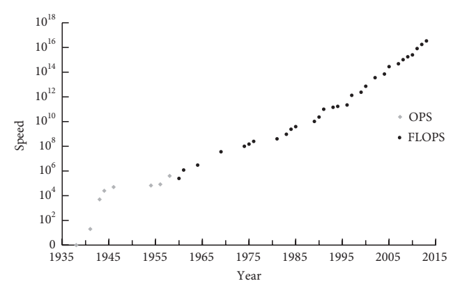
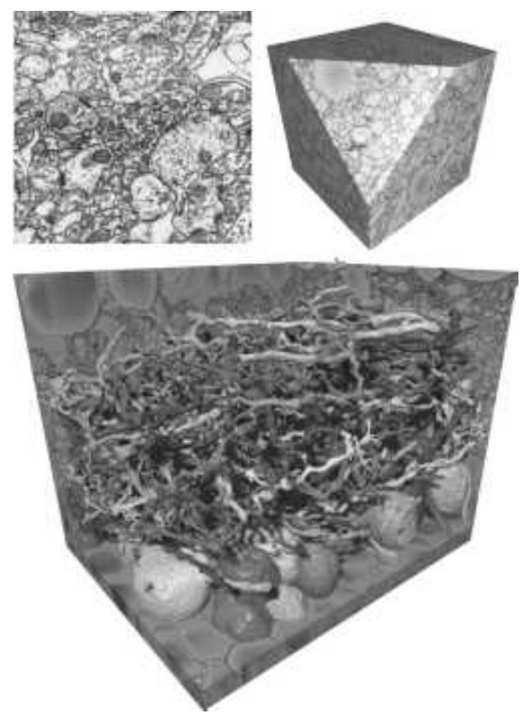
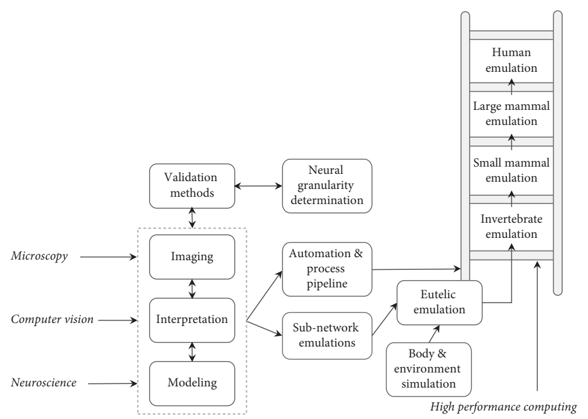
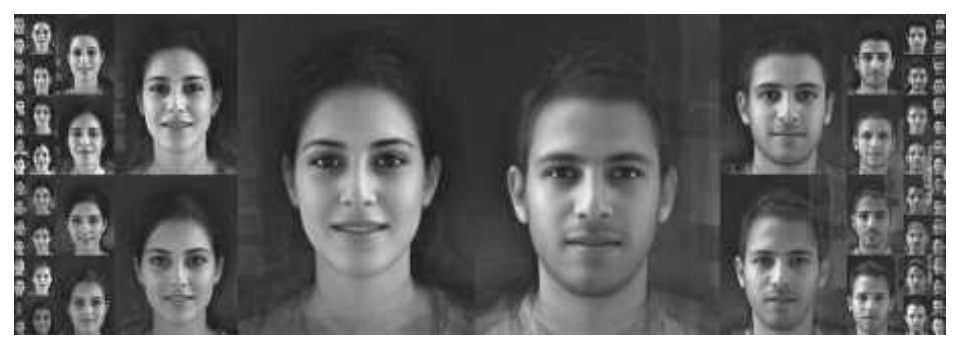

# Chapter 2｜第二章

# Paths to superintelligence
# 通往超級智慧的路徑

Nick Bostrom 著｜英繁對照翻譯初稿

> 編排說明：本章的「目前」、技術可行性與時間預測，均依 2014 年原著保留。英文在前、繁體中文在後；跨頁段落接回。表 4、6 改為分組條目，完整保留原表資訊；表 5 保留表格。四幅原圖取自 PDF，另附中文圖說或標籤對照。

**English**

Machines are currently far inferior to humans in general intelligence. Yet one day (we have suggested) they will be superintelligent. How do we get from here to there? This chapter explores several conceivable technological paths. We look at artificial intelligence, whole brain emulation, biological cognition, and human–machine interfaces, as well as networks and organizations. We evaluate their different degrees of plausibility as pathways to superintelligence. The existence of multiple paths increases the probability that the destination can be reached via at least one of them.

**繁體中文**

目前，機器的通用智慧遠遠不及人類。然而，正如我們所提出的，有一天，它們將具有超級智慧。我們要如何從現在走到那裡？本章探討幾條可以設想的技術路徑，包括人工智慧、全腦模擬、生物認知、人機介面，以及網路與組織。我們將評估它們作為通往超級智慧之路，各有多大可能。多條路徑並存，提高了至少經由其中一條抵達目的地的機率。

---

**English**

We can tentatively define a superintelligence as any intellect that greatly exceeds the cognitive performance of humans in virtually all domains of interest.〔[註 1](./02-第二章-註釋-英繁對照.md#note-1)〕 We will have more to say about the concept of superintelligence in the next chapter, where we will subject it to a kind of spectral analysis to distinguish some different possible forms of superintelligence. But for now, the rough characterization just given will suffice. Note that the definition is noncommittal about how the superintelligence is implemented. It is also noncommittal regarding qualia: whether a superintelligence would have subjective conscious experience might matter greatly for some questions (in particular for some moral questions), but our primary focus here is on the causal antecedents and consequences of superintelligence, not on the metaphysics of mind.〔[註 2](./02-第二章-註釋-英繁對照.md#note-2)〕

**繁體中文**

我們可以暫時把超級智慧定義為：在幾乎所有我們關心的領域中，認知表現都遠遠超越人類的任何智慧體。〔[註 1](./02-第二章-註釋-英繁對照.md#note-1)〕 下一章會進一步討論超級智慧的概念，對它進行某種「光譜分析」，區分它可能具有的不同形式。不過，目前上述粗略描述已經足夠。請注意，這個定義不預設超級智慧以什麼方式實現，也不對感質（qualia）作出承諾。超級智慧是否具有主觀意識經驗，對某些問題——尤其是某些道德問題——可能極其重要；但此處我們主要關注超級智慧的成因與後果，而非心靈的形上學。〔[註 2](./02-第二章-註釋-英繁對照.md#note-2)〕

---

**English**

The chess program Deep Fritz is not a superintelligence on this definition, since Fritz is only smart within the narrow domain of chess. Certain kinds of domain-specific superintelligence could, however, be important. When referring to superintelligent performance limited to a particular domain, we will note the restriction explicitly. For instance, an “engineering superintelligence” would be an intellect that vastly outperforms the best current human minds in the domain of engineering. Unless otherwise noted, we use the term to refer to systems that have a superhuman level of general intelligence.

**繁體中文**

依照這個定義，西洋棋程式 Deep Fritz 並不是超級智慧，因為它只在西洋棋這個狹窄領域中聰明。不過，某些特定領域的超級智慧，仍可能很重要。當我們提到局限於特定領域的超級智慧表現時，會明確標示這項限制。例如，「工程超級智慧」就是在工程領域中，遠遠勝過當今最優秀人類心智的智慧體。除非另有說明，我們使用「超級智慧」一詞時，指的是具有超越人類水準通用智慧的系統。

---

**English**

But how might we create superintelligence? Let us examine some possible paths.

**繁體中文**

那麼，我們可能如何創造超級智慧？讓我們檢視幾條可能的路徑。

---

## Artificial intelligence｜人工智慧

---

**English**

Readers of this chapter must not expect a blueprint for programming an artificial general intelligence. No such blueprint exists yet, of course. And had I been in possession of such a blueprint, I most certainly would not have published it in a book. (If the reasons for this are not immediately obvious, the arguments in subsequent chapters will make them clear.)

**繁體中文**

閱讀本章的人，不應期待在這裡找到通用人工智慧的程式設計藍圖。當然，這樣的藍圖尚不存在。而即使我手中有一份，我也絕對不會把它發表在書裡。（如果原因並非一目了然，後面幾章的論證將會說明。）

---

**English**

We can, however, discern some general features of the kind of system that would be required. It now seems clear that a capacity to learn would be an integral feature of the core design of a system intended to attain general intelligence, not something to be tacked on later as an extension or an afterthought. The same holds for the ability to deal effectively with uncertainty and probabilistic information. Some faculty for extracting useful concepts from sensory data and internal states, and for leveraging acquired concepts into flexible combinatorial representations for use in logical and intuitive reasoning, also likely belong among the core design features in a modern AI intended to attain general intelligence.

**繁體中文**

不過，我們仍可以辨識這類系統所需具備的一些一般特徵。如今似乎已很清楚：對於意圖達成通用智慧的系統，學習能力應是核心設計不可分割的一部分，而不是事後才加上的延伸功能或補充。同樣地，有效處理不確定性與機率資訊的能力，也應如此。能從感官資料與內部狀態提取有用概念，並運用已獲得的概念形成靈活的組合式表徵，以供邏輯與直覺推理使用，這些能力很可能也屬於現代通用 AI 的核心設計。

---

**English**

The early Good Old-Fashioned Artificial Intelligence systems did not, for the most part, focus on learning, uncertainty, or concept formation, perhaps because techniques for dealing with these dimensions were poorly developed at the time. This is not to say that the underlying ideas are all that novel. The idea of using learning as a means of bootstrapping a simpler system to human-level intelligence can be traced back at least to Alan Turing’s notion of a “child machine,” which he wrote about in 1950:

**繁體中文**

早期的老派人工智慧系統，大多沒有把重點放在學習、不確定性或概念形成上，或許因為當時處理這些面向的技術還不成熟。但這並不表示背後的想法有多麼新穎。透過學習，使較簡單的系統逐步發展到人類水準智慧的構想，至少可以追溯到 Alan Turing 在 1950 年提出的「兒童機器」（child machine）：

---

**English**

Instead of trying to produce a programme to simulate the adult mind, why not rather try to produce one which simulates the child’s? If this were then subjected to an appropriate course of education one would obtain the adult brain.〔[註 3](./02-第二章-註釋-英繁對照.md#note-3)〕

**繁體中文**

與其試著編寫模擬成人心智的程式，何不試著編寫模擬兒童心智的程式？如果接著讓它接受適當的教育，就能得到成人的大腦。〔[註 3](./02-第二章-註釋-英繁對照.md#note-3)〕

---

**English**

Turing envisaged an iterative process to develop such a child machine:

**繁體中文**

Turing 設想透過反覆迭代的過程，發展這樣的兒童機器：

---

**English**

We cannot expect to find a good child machine at the first attempt. One must experiment with teaching one such machine and see how well it learns. One can then try another and see if it is better or worse. There is an obvious connection between this process and evolution. . . . One may hope, however, that this process will be more expeditious than evolution. The survival of the fittest is a slow method for measuring advantages. The experimenter, by the exercise of intelligence, should be able to speed it up. Equally important is the fact that he is not restricted to random mutations. If he can trace a cause for some weakness he can probably think of the kind of mutation which will improve it.〔[註 4](./02-第二章-註釋-英繁對照.md#note-4)〕

**繁體中文**

我們不能期待第一次嘗試就找到一部好的兒童機器。必須試著教導某一部這樣的機器，觀察它學得如何；接著再試另一部，看看它更好還是更差。這個過程與演化之間，有著明顯的關聯……不過，我們可以希望這個過程比演化更迅速。適者生存是一種衡量優勢的緩慢方法。實驗者運用智慧，應能加快這個過程。同樣重要的是，他不必受限於隨機突變。如果能找出某項弱點的成因，他很可能就能想到哪一種變異可以改善它。〔[註 4](./02-第二章-註釋-英繁對照.md#note-4)〕

---

**English**

We know that blind evolutionary processes can produce human-level general intelligence, since they have already done so at least once. Evolutionary processes with foresight—that is, genetic programs designed and guided by an intelligent human programmer—should be able to achieve a similar outcome with far greater efficiency. This observation has been used by some philosophers and scientists, including David Chalmers and Hans Moravec, to argue that human-level AI is not only theoretically possible but feasible within this century.〔[註 5](./02-第二章-註釋-英繁對照.md#note-5)〕 The idea is that we can estimate the relative capabilities of evolution and human engineering to produce intelligence, and find that human engineering is already vastly superior to evolution in some areas and is likely to become superior in the remaining areas before too long. The fact that evolution produced intelligence therefore indicates that human engineering will soon be able to do the same. Thus, Moravec wrote (already back in 1976):

**繁體中文**

我們知道，盲目的演化過程可以產生人類水準的通用智慧，因為它至少已經做到過一次。具有前瞻性的演化過程，也就是由智慧的人類程式設計者設計並引導的遺傳程式，應能以高得多的效率達成類似結果。有些哲學家與科學家，包括 David Chalmers 與 Hans Moravec，曾以這項觀察論證：人類水準的 AI 不僅在理論上可能，而且在本世紀內就能實現。〔[註 5](./02-第二章-註釋-英繁對照.md#note-5)〕 這個想法是，我們可以比較演化與人類工程在創造智慧方面的相對能力，並發現人類工程在某些方面已遠勝演化，而且可能不久後就在其餘方面也超越它。因此，演化創造出智慧這件事，顯示人類工程很快也能做到。Moravec 早在 1976 年就寫道：

---

**English**

The existence of several examples of intelligence designed under these constraints should give us great confidence that we can achieve the same in short order. The situation is analogous to the history of heavier than air flight, where birds, bats and insects clearly demonstrated the possibility before our culture mastered it.〔[註 6](./02-第二章-註釋-英繁對照.md#note-6)〕

**繁體中文**

在這些限制下仍然出現了好幾個智慧的例子，應使我們非常有信心，相信自己能在短時間內做到同樣的事。這就像重於空氣的飛行歷史：在人類文明掌握它之前，鳥、蝙蝠與昆蟲就已清楚展示了它的可能性。〔[註 6](./02-第二章-註釋-英繁對照.md#note-6)〕

---

**English**

One needs to be cautious, though, in what inferences one draws from this line of reasoning. It is true that evolution produced heavier-than-air flight, and that human engineers subsequently succeeded in doing likewise (albeit by means of a very different mechanism). Other examples could also be adduced, such as sonar, magnetic navigation, chemical weapons, photoreceptors, and all kinds of mechanic and kinetic performance characteristics. However, one could equally point to areas where human engineers have thus far failed to match evolution: in morphogenesis, self-repair, and the immune defense, for example, human efforts lag far behind what nature has accomplished. Moravec’s argument, therefore, cannot give us “great confidence” that we can achieve human-level artificial intelligence “in short order.” At best, the evolution of intelligent life places an upper bound on the intrinsic difficulty of designing intelligence. But this upper bound could be quite far above current human engineering capabilities.

**繁體中文**

然而，從這條推理路線作出結論時，必須謹慎。演化確實產生了重於空氣的飛行，人類工程師後來也做到了——儘管採取的是截然不同的機制。也可以再舉出聲納、磁場導航、化學武器、感光受器，以及各式各樣的機械與運動性能等例子。但同樣地，我們也可以指出，人類工程師至今仍未能追上演化的領域：例如形態發生、自我修復與免疫防禦，人類的成果都遠遠落後於自然。因此，Moravec 的論證無法讓我們「非常有信心」，相信能在「短時間內」實現人類水準的人工智慧。充其量，智慧生命的演化只為設計智慧的內在困難程度，設定了一個上限。但這個上限，可能遠高於人類目前的工程能力。

---

**English**

Another way of deploying an evolutionary argument for the feasibility of AI is via the idea that we could, by running genetic algorithms on sufficiently fast computers, achieve results comparable to those of biological evolution. This version of the evolutionary argument thus proposes a specific method whereby intelligence could be produced.

**繁體中文**

另一種以演化論證 AI 可行性的方式，是主張：只要在足夠快速的電腦上執行遺傳演算法，就能取得與生物演化相當的成果。這個版本的演化論證，因此提出了一種產生智慧的具體方法。

---

**English**

But is it true that we will soon have computing power sufficient to recapitulate the relevant evolutionary processes that produced human intelligence? The answer depends both on how much computing technology will advance over the next decades and on how much computing power would be required to run genetic algorithms with the same optimization power as the evolutionary process of natural selection that lies in our past. Although, in the end, the conclusion we get from pursuing this line of reasoning is disappointingly indeterminate, it is instructive to attempt a rough estimate (see Box 3). If nothing else, the exercise draws attention to some interesting unknowns.

**繁體中文**

但我們真的很快就會擁有足夠算力，重現那些產生人類智慧的相關演化過程嗎？答案取決於兩件事：未來幾十年運算技術會進步多少；以及要執行具有與我們過去所經歷的自然選擇過程同等最佳化能力的遺傳演算法，需要多少算力。追索這條推理路線，最後所得的結論雖然令人失望地不確定，但試作粗略估算仍很有啟發性（見專欄 3）。至少，這個練習能讓我們注意到一些值得研究的未知因素。

---

**English**

The upshot is that the computational resources required to simply replicate the relevant evolutionary processes on Earth that produced human-level intelligence are severely out of reach—and will remain so even if Moore’s law were to continue for a century (cf. Figure 3). It is plausible, however, that compared with brute-force replication of natural evolutionary processes, vast efficiency gains are achievable by designing the search process to aim for intelligence, using various obvious improvements over natural selection. Yet it is very hard to bound the magnitude of those attainable efficiency gains. We cannot even say whether they amount to five or to twenty-five orders of magnitude. Absent further elaboration, therefore, evolutionary arguments are not able to meaningfully constrain our expectations of either the difficulty of building human-level machine intelligence or the timescales for such developments.

**繁體中文**

結論是，若只是複製地球上那些產生人類水準智慧的相關演化過程，所需運算資源遠遠超出我們的能力；即使摩爾定律再持續一百年，仍是如此（參見圖 3）。不過，相較於直接以龐大算力重演自然演化，如果把搜尋過程設計成以智慧為目標，採取各種顯而易見、優於自然選擇的改進，確實可能大幅提高效率。然而，這些可達成的效率增益，幅度極難界定。我們甚至無法判斷它們是五個，還是二十五個數量級。因此，在沒有更進一步闡明之前，演化論證無法有意義地縮小我們對建造人類水準機器智慧的難度，或所需時間的預期範圍。

---

## Box 3 What would it take to recapitulate evolution?｜專欄 3　重現演化需要什麼？

---

**English**

Not every feat accomplished by evolution in the course of the development of human intelligence is relevant to a human engineer trying to artificially evolve machine intelligence. Only a small portion of evolutionary selection on Earth has been selection for intelligence. More specifically, the problems that human engineers cannot trivially bypass may have been the target of a very small portion of total evolutionary selection. For example, since we can run our computers on electrical power, we do not have to reinvent the molecules of the cellular energy economy in order to create intelligent machines—yet such molecular evolution of metabolic pathways might have used up a large part of the total amount of selection power that was available to evolution over the course of Earth’s history.〔[註 7](./02-第二章-註釋-英繁對照.md#note-7)〕

**繁體中文**

對試圖以人工方式演化出機器智慧的人類工程師而言，演化在發展人類智慧過程中完成的成就，並非每一項都相關。地球上所有演化選擇中，只有一小部分是針對智慧的選擇。更具體地說，人類工程師無法輕易繞過的那些問題，可能只占整體演化選擇極小的一部分。例如，既然電腦可以靠電力運作，我們就不必為了創造智慧機器，重新發明細胞能量運作所需的分子；但代謝路徑的這類分子演化，可能耗用了地球歷史中演化可用選擇力量的一大部分。〔[註 7](./02-第二章-註釋-英繁對照.md#note-7)〕

---

**English**

One might argue that the key insights for AI are embodied in the structure of nervous systems, which came into existence less than a billion years ago.〔[註 8](./02-第二章-註釋-英繁對照.md#note-8)〕 If we take that view, then the number of relevant “experiments” available to evolution is drastically curtailed. There are some 4–6×10³⁰ prokaryotes in the world today, but only 10¹⁹ insects, and fewer than 10¹⁰ humans (while pre-agricultural populations were orders of magnitude smaller).〔[註 9](./02-第二章-註釋-英繁對照.md#note-9)〕 These numbers are only moderately intimidating.

**繁體中文**

有人可能主張，AI 的關鍵洞見體現在神經系統的結構中，而神經系統出現至今不到十億年。〔[註 8](./02-第二章-註釋-英繁對照.md#note-8)〕 如果採取這個觀點，演化可進行的相關「實驗」數量就會大幅縮減。如今世界上約有 4–6 × 10³⁰ 個原核生物，但昆蟲只有 10¹⁹ 隻，人類不到 10¹⁰ 人；農業出現以前的人口，還要少好幾個數量級。〔[註 9](./02-第二章-註釋-英繁對照.md#note-9)〕 這些數字看來就沒有那麼令人望而生畏了。

---

**English**

Evolutionary algorithms, however, require not only variations to select among but also a fitness function to evaluate variants, and this is typically the most computationally expensive component. A fitness function for the evolution of artificial intelligence plausibly requires simulation of neural development, learning, and cognition to evaluate fitness. We might thus do better not to look at the raw number of organisms with complex nervous systems, but instead to attend to the number of neurons in biological organisms that we might need to simulate to mimic evolution’s fitness function. We can make a crude estimate of that latter quantity by considering insects, which dominate terrestrial animal biomass (with ants alone estimated to contribute some 15–20%).〔[註 10](./02-第二章-註釋-英繁對照.md#note-10)〕 Insect brain size varies substantially, with large and social insects sporting larger brains: a honeybee brain has just under 10⁶ neurons, a fruit fly brain has 10⁵ neurons, and ants are in between with 250,000 neurons.〔[註 11](./02-第二章-註釋-英繁對照.md#note-11)〕 The majority of smaller insects may have brains of only a few thousand neurons. Erring on the side of conservatively high, if we assigned all 10¹⁹ insects fruit-fly numbers of neurons, the total would be 10²⁴ insect neurons in the world. This could be augmented with an additional order of magnitude to account for aquatic copepods, birds, reptiles, mammals, etc., to reach 10²⁵. (By contrast, in pre-agricultural times there were fewer than 10⁷ humans, with under 10¹¹ neurons each: thus fewer than 10¹⁸ human neurons in total, though humans have a higher number of synapses per neuron.)

**繁體中文**

然而，演化演算法不只需要可供選擇的變體，也需要適應度函數來評估它們，而這通常是最耗費運算的部分。用來演化人工智慧的適應度函數，很可能需要模擬神經發育、學習與認知，才能評估適應度。因此，與其只看具備複雜神經系統的生物數量，或許更應關注：為了模仿演化的適應度函數，我們需要模擬多少生物神經元。我們可以從昆蟲作粗略估計，因為牠們占陸生動物生物量的大宗，估計光螞蟻就占約 15–20%。〔[註 10](./02-第二章-註釋-英繁對照.md#note-10)〕 昆蟲腦的大小差異很大，大型與社會性昆蟲的腦較大：蜜蜂腦有略少於 10⁶ 個神經元，果蠅腦有 10⁵ 個，螞蟻則介於兩者之間，約有 250,000 個。〔[註 11](./02-第二章-註釋-英繁對照.md#note-11)〕 大部分較小昆蟲的腦，可能只有幾千個神經元。為了保守地向高處估算，如果把全部 10¹⁹ 隻昆蟲都當成具有果蠅那麼多的神經元，全球昆蟲的神經元總數就是 10²⁴ 個。再加上一個數量級，以涵蓋水生橈足類、鳥類、爬蟲類、哺乳類等，便得到 10²⁵ 個。（相比之下，農業出現之前，人類不到 10⁷ 人，每人神經元少於 10¹¹ 個，因此人類神經元總數少於 10¹⁸ 個；不過，人類每個神經元具有較多突觸。）

---

**English**

The computational cost of simulating one neuron depends on the level of detail that one includes in the simulation. Extremely simple neuron models use about 1,000 floating-point operations per second (FLOPS) to simulate one neuron (in real-time). The electrophysiologically realistic Hodgkin–Huxley model uses 1,200,000 FLOPS. A more detailed multi-compartmental model would add another three to four orders of magnitude, while higher-level models that abstract systems of neurons could subtract two to three orders of magnitude from the simple models.〔[註 12](./02-第二章-註釋-英繁對照.md#note-12)〕 If we were to simulate 10²⁵ neurons over a billion years of evolution (longer than the existence of nervous systems as we know them), and we allow our computers to run for one year, these figures would give us a requirement in the range of 10³¹–10⁴⁴ FLOPS. For comparison, China’s Tianhe-2, the world’s most powerful supercomputer as of September 2013, provides only 3.39×10¹⁶ FLOPS. In recent decades, it has taken approximately 6.〔[註 7](./02-第二章-註釋-英繁對照.md#note-7)〕 years for commodity computers to increase in power by one order of magnitude. Even a century of continued Moore’s law would not be enough to close this gap. Running more specialized hardware, or allowing longer run-times, could contribute only a few more orders of magnitude.

**繁體中文**

模擬一個神經元的運算成本，取決於模擬包含多少細節。極簡單的神經元模型，以即時速度模擬一個神經元，大約需要每秒 1,000 次浮點運算（FLOPS）。具有電生理真實性的 Hodgkin–Huxley 模型，需要 1,200,000 FLOPS。更精細的多區室模型，還要再增加三到四個數量級；相反地，把整組神經元抽象化的高階模型，則可以比簡單模型再降低二到三個數量級。〔[註 12](./02-第二章-註釋-英繁對照.md#note-12)〕 如果要模擬 10²⁵ 個神經元經歷十億年的演化——比我們所知神經系統存在的時間還長——並讓電腦執行一年，這些數字就意味著需要 10³¹ 至 10⁴⁴ FLOPS。相比之下，截至 2013 年 9 月，全球最強大的超級電腦中國「天河二號」，只提供 3.39 × 10¹⁶ FLOPS。近幾十年，商用電腦的算力每提升一個數量級，大約需要 6.7 年。即使摩爾定律再延續一個世紀，也不足以彌補差距。採用更專門的硬體，或容許更長的執行時間，也只能再增加幾個數量級。

---

**English**

This figure is conservative in another respect. Evolution achieved human intelligence without aiming at this outcome. In other words, the fitness functions for natural organisms do not select only for intelligence and its precursors.〔[註 13](./02-第二章-註釋-英繁對照.md#note-13)〕 Even environments in which organisms with superior information processing skills reap various rewards may not select for intelligence, because improvements to intelligence can (and often do) impose significant costs, such as higher energy consumption or slower maturation times, and those costs may outweigh whatever benefits are gained from smarter behavior. Excessively deadly environments also reduce the value of intelligence: the shorter one’s expected lifespan, the less time there will be for increased learning ability to pay off. Reduced selective pressure for intelligence slows the spread of intelligence-enhancing innovations, and thus the opportunity for selection to favor subsequent innovations that depend on them. Furthermore, evolution may wind up stuck in local optima that humans would notice and bypass by altering tradeoffs between exploitation and exploration or by providing a smooth progression of increasingly difficult intelligence tests.〔[註 14](./02-第二章-註釋-英繁對照.md#note-14)〕 And as mentioned earlier, evolution scatters much of its selection power on traits that are unrelated to intelligence (such as Red Queen’s races of competitive co-evolution between immune systems and parasites). Evolution continues to waste resources producing mutations that have proved consistently lethal, and it fails to take advantage of statistical similarities in the effects of different mutations. These are all inefficiencies in natural selection (when viewed as a means of evolving intelligence) that it would be relatively easy for a human engineer to avoid while using evolutionary algorithms to develop intelligent software.

**繁體中文**

另一方面，這個數字也是保守的。演化並未以人類智慧為目標，卻產生了人類智慧。換句話說，自然生物的適應度函數，並不只選擇智慧及其前置特徵。〔[註 13](./02-第二章-註釋-英繁對照.md#note-13)〕 即使在資訊處理能力較強的生物可以得到各種好處的環境中，也未必會形成有利於智慧的選擇，因為提升智慧可能——而且往往確實——帶來重大成本，例如更高的能量消耗或更長的成熟時間；這些成本可能超過更聰明行為帶來的益處。過於致命的環境也會降低智慧的價值：預期壽命愈短，增強學習能力可用來回本的時間就愈少。針對智慧的選擇壓力降低，會減慢智慧增強創新的擴散，也減少選擇機制偏好依賴這些創新之後續創新的機會。此外，演化可能困在局部最佳解中；人類卻能察覺這種困境，調整利用既有成果與探索新可能之間的取捨，或提供難度逐步增加、銜接平順的智慧測驗來繞過它。〔[註 14](./02-第二章-註釋-英繁對照.md#note-14)〕 如前所述，演化還把大量選擇力量分散到與智慧無關的特徵上，例如免疫系統與寄生物之間競爭性共同演化的「紅皇后競賽」。演化不斷浪費資源，產生已一再證明致命的突變，也未能善用不同突變效應之間的統計相似性。從演化智慧的角度來看，這些都是自然選擇的低效率之處，而人類工程師以演化演算法開發智慧軟體時，相對容易避免這些問題。

---

**English**

It is plausible that eliminating inefficiencies like those just described would trim many orders of magnitude off the 10³¹–10⁴⁴ FLOPS range calculated earlier. Unfortunately, it is difficult to know how many orders of magnitude. It is difficult even to make a rough estimate—for aught we know, the efficiency savings could be five orders of magnitude, or ten, or twenty-five.〔[註 15](./02-第二章-註釋-英繁對照.md#note-15)〕

**繁體中文**

排除上述低效率，可能讓先前算出的 10³¹ 至 10⁴⁴ FLOPS 需求降低許多個數量級。遺憾的是，很難知道究竟能降低多少；甚至連粗略估計也很困難。就我們所知，效率提升所省下的可能是五個、十個，或二十五個數量級。〔[註 15](./02-第二章-註釋-英繁對照.md#note-15)〕

---

**English**

Figure 3 Supercomputer performance. In a narrow sense, “Moore’s law” refers to the observation that the number of transistors on integrated circuits have for several decades doubled approximately every two years. However, the term is often used to refer to the more general observation that many performance metrics in computing technology have followed a similarly fast exponential trend. Here we plot peak speed of the world’s fastest supercomputer as a function of time (on a logarithmic vertical scale). In recent years, growth in the serial speed of processors has stagnated, but increased use of parallelization has enabled the total number of computations performed to remain on the trend line.〔[註 16](./02-第二章-註釋-英繁對照.md#note-16)〕

**繁體中文**

圖 3　超級電腦效能。狹義的「摩爾定律」，指的是數十年來積體電路上的電晶體數量，大約每兩年倍增一次的觀察。不過，這個詞也經常泛指一項更廣泛的觀察：運算技術的許多效能指標，也呈現類似的快速指數成長。此圖以時間為橫軸，繪出全球最快超級電腦的峰值速度，縱軸採對數尺度。近年，處理器的序列運算速度成長已停滯，但更多地採用平行運算，使總運算量仍能維持在原來的趨勢線上。〔[註 16](./02-第二章-註釋-英繁對照.md#note-16)〕

圖中文字：Speed＝速度；Year＝年份；OPS＝每秒運算次數；FLOPS＝每秒浮點運算次數。縱軸為對數尺度。

---

**English**

There is a further complication with these kinds of evolutionary considerations, one that makes it hard to derive from them even a very loose upper bound on the difficulty of evolving intelligence. We must avoid the error of inferring, from the fact that intelligent life evolved on Earth, that the evolutionary processes involved had a reasonably high prior probability of producing intelligence. Such an inference is unsound because it fails to take account of the observation selection effect that guarantees that all observers will find themselves having originated on a planet where intelligent life arose, no matter how likely or unlikely it was for any given such planet to produce intelligence. Suppose, for example, that in addition to the systematic effects of natural selection it required an enormous amount of lucky coincidence to produce intelligent life—enough so that intelligent life evolves on only one planet out of every 10³⁰ planets on which simple replicators arise. In that case, when we run our genetic algorithms to try to replicate what natural evolution did, we might find that we must run some 10³⁰ simulations before we find one where all the elements come together in just the right way. This seems fully consistent with our observation that life did evolve here on Earth. Only by careful and somewhat intricate reasoning—by analyzing instances of convergent evolution of intelligence-related traits and engaging with the subtleties of observation selection theory—can we partially circumvent this epistemological barrier. Unless one takes the trouble to do so, one is not in a position to rule out the possibility that the alleged “upper bound” on the computational requirements for recapitulating the evolution of intelligence derived in Box 3 might be too low by thirty orders of magnitude (or some other such large number).〔[註 17](./02-第二章-註釋-英繁對照.md#note-17)〕

**繁體中文**

這類演化考量還有另一項複雜因素，使我們甚至難以據此推導演化出智慧的難度上限，即使只是非常寬鬆的上限。我們必須避免以下錯誤：因為地球演化出了智慧生命，就推論相關演化過程原本具有相當高的機率產生智慧。這種推論不成立，因為它忽略了觀察選擇效應（observation selection effect）：無論某顆行星產生智慧的機率多高或多低，所有觀察者都必然發現自己起源於曾產生智慧生命的行星。例如，假設除了自然選擇的系統性作用之外，產生智慧生命還需要極大量的幸運巧合，以至於每 10³⁰ 顆出現簡單複製子的行星，只有一顆會演化出智慧生命。那麼，當我們執行遺傳演算法，嘗試重現自然演化的成果時，可能必須執行約 10³⁰ 次模擬，才找到一次所有條件恰好配合的情況。這與我們觀察到地球確實演化出生命，似乎完全相容。只有透過仔細而頗為繁複的推理——分析與智慧相關特徵的趨同演化實例，並處理觀察選擇理論的細微問題——才能部分繞過這個知識上的障礙。若不費心這樣做，就無法排除：專欄 3 所推導、重現智慧演化所需算力的所謂「上限」，可能低估了三十個數量級，或另一個同樣巨大的數目。〔[註 17](./02-第二章-註釋-英繁對照.md#note-17)〕

---

**English**

Another way of arguing for the feasibility of artificial intelligence is by pointing to the human brain and suggesting that we could use it as a template for a machine intelligence. One can distinguish different versions of this approach based on how closely they propose to imitate biological brain functions. At one extreme—that of very close imitation—we have the idea of whole brain emulation, which we will discuss in the next subsection. At the other extreme are approaches that take their inspiration from the functioning of the brain but do not attempt low-level imitation. Advances in neuroscience and cognitive psychology— which will be aided by improvements in instrumentation—should eventually uncover the general principles of brain function. This knowledge could then guide AI efforts. We have already encountered neural networks as an example of a brain-inspired AI technique. Hierarchical perceptual organization is another idea that has been transferred from brain science to machine learning. The study of reinforcement learning has been motivated (at least in part) by its role in psychological theories of animal cognition, and reinforcement learning techniques (e.g. the “TD-algorithm”) inspired by these theories are now widely used in AI.〔[註 18](./02-第二章-註釋-英繁對照.md#note-18)〕 More cases like these will surely accumulate in the future. Since there is a limited number— perhaps a very small number—of distinct fundamental mechanisms that operate in the brain, continuing incremental progress in brain science should eventually discover them all. Before this happens, though, it is possible that a hybrid approach, combining some brain-inspired techniques with some purely artificial methods, would cross the finishing line. In that case, the resultant system need not be recognizably brain-like even though some brain-derived insights were used in its development.

**繁體中文**

另一種論證人工智慧可行性的方式，是指出人腦的存在，並主張可以把它當成機器智慧的範本。依照打算模仿生物腦功能的程度，可以區分不同版本。一個極端是非常貼近的模仿，也就是下一小節將討論的全腦模擬。另一個極端則是從大腦運作獲取靈感，卻不嘗試低階模仿的方法。神經科學與認知心理學的進展，在儀器改良的協助下，應該最終能揭示腦功能的一般原理。這些知識便可引導 AI 研究。我們已經介紹過神經網路，它就是受大腦啟發的 AI 技術之一。階層式知覺組織，是另一個從腦科學移轉到機器學習的觀念。強化學習的研究，至少部分受到它在動物認知心理學理論中所扮演角色的啟發；由這些理論啟發的強化學習技術，例如「TD 演算法」，如今已廣泛用於 AI。〔[註 18](./02-第二章-註釋-英繁對照.md#note-18)〕 未來，這類例子必定還會增加。由於大腦運作所涉及的不同基本機制數量有限，甚至可能非常少，腦科學持續漸進的發展，應該最終能把它們全部找出來。不過，在那之前，結合部分腦啟發技術與部分純人工方法的混合路線，可能已先抵達終點。若是如此，即使開發過程曾利用來自大腦的洞見，產生的系統也不必明顯像一個大腦。

---

**English**

The availability of the brain as template provides strong support for the claim that machine intelligence is ultimately feasible. This, however, does not enable us to predict when it will be achieved because it is hard to predict the future rate of discoveries in brain science. What we can say is that the further into the future we look, the greater the likelihood that the secrets of the brain’s functionality will have been decoded sufficiently to enable the creation of machine intelligence in this manner.

**繁體中文**

大腦可以作為範本，強力支持了機器智慧最終可行的主張。不過，這並不能讓我們預測何時能達成，因為腦科學未來的發現速度難以預測。我們能說的是：看得愈遠，大腦功能的祕密已被充分解開、足以用這種方式創造機器智慧的可能性，就愈大。

---

**English**

Different people working toward machine intelligence hold different views about how promising neuromorphic approaches are compared with approaches that aim for completely synthetic designs. The existence of birds demonstrated that heavier-than-air flight was physically possible and prompted efforts to build flying machines. Yet the first functioning airplanes did not flap their wings. The jury is out on whether machine intelligence will be like flight, which humans achieved through an artificial mechanism, or like combustion, which we initially mastered by copying naturally occurring fires.

**繁體中文**

致力於機器智慧的研究者，對神經形態方法（neuromorphic approaches）相較於完全人工設計的方法有多大前景，各有不同看法。鳥類的存在證明，重於空氣的飛行在物理上可行，也促使人們建造飛行器。然而，最早成功飛行的飛機並沒有拍動翅膀。機器智慧究竟會像飛行，由人類透過人工機制達成；還是像燃燒，我們最初靠模仿自然界的火而掌握，仍無定論。

---

**English**

Turing’s idea of designing a program that acquires most of its content by learning, rather than having it pre-programmed at the outset, can apply equally to neuromorphic and synthetic approaches to machine intelligence.

**繁體中文**

Turing 主張設計一種程式，主要透過學習取得內容，而不是一開始就預先寫入。這個想法同樣適用於機器智慧的神經形態路線與人工設計路線。

---

**English**

A variation on Turing’s conception of a child machine is the idea of a “seed AI.”〔[註 19](./02-第二章-註釋-英繁對照.md#note-19)〕 Whereas a child machine, as Turing seems to have envisaged it, would have a relatively fixed architecture that simply develops its inherent potentialities by accumulating content, a seed AI would be a more sophisticated artificial intelligence capable of improving its own architecture. In the early stages of a seed AI, such improvements might occur mainly through trial and error, information acquisition, or assistance from the programmers. At its later stages, however, a seed AI should be able to understand its own workings sufficiently to engineer new algorithms and computational structures to bootstrap its cognitive performance. This needed understanding could result from the seed AI reaching a sufficient level of general intelligence across many domains, or from crossing some threshold in a particularly relevant domain such as computer science or mathematics.

**繁體中文**

「種子 AI」（seed AI）是 Turing 兒童機器構想的一種變體。〔[註 19](./02-第二章-註釋-英繁對照.md#note-19)〕 Turing 所設想的兒童機器，似乎具有相對固定的架構，僅靠累積內容來發展其內在潛能；種子 AI 則是更精密、能改進自身架構的人工智慧。早期的改進可能主要來自試誤、獲取資訊，或程式設計者的協助。但到了後期，種子 AI 應能充分理解自身運作，設計新的演算法與運算結構，藉此提升認知表現。這種必要的理解，可能來自它在許多領域達到足夠高的通用智慧，也可能來自它在電腦科學或數學等特別相關的領域跨越某個門檻。

---

**English**

This brings us to another important concept, that of “recursive self-improvement.” A successful seed AI would be able to iteratively enhance itself: an early version of the AI could design an improved version of itself, and the improved version—being smarter than the original—might be able to design an even smarter version of itself, and so forth.〔[註 20](./02-第二章-註釋-英繁對照.md#note-20)〕 Under some conditions, such a process of recursive self-improvement might continue long enough to result in an intelligence explosion—an event in which, in a short period of time, a system’s level of intelligence increases from a relatively modest endowment of cognitive capabilities (perhaps sub-human in most respects, but with a domain-specific talent for coding and AI research) to radical superintelligence. We will return to this important possibility in Chapter 4, where the dynamics of such an event will be analyzed more closely. Note that this model suggests the possibility of surprises: attempts to build artificial general intelligence might fail pretty much completely until the last missing critical component is put in place, at which point a seed AI might become capable of sustained recursive self-improvement.

**繁體中文**

這把我們帶到另一個重要概念：「遞迴式自我改進」（recursive self-improvement）。成功的種子 AI 能反覆增強自身：早期版本設計出更好的自身版本，而改良版因為比原版聰明，或許又能設計出更聰明的版本，如此類推。〔[註 20](./02-第二章-註釋-英繁對照.md#note-20)〕 在某些條件下，這個過程可能持續足夠久，導致智慧爆炸：系統在短時間內，從相對有限的認知能力——大部分方面也許不及人類，但在程式設計與 AI 研究上具有特定領域的天賦——躍升為極強的超級智慧。我們將在第四章回到這個重要可能性，更仔細分析其動態。請注意，這個模型暗示了突如其來的轉變：建造通用人工智慧的嘗試，可能一直近乎全面失敗，直到最後一個缺少的關鍵元件就位，種子 AI 才突然有能力持續進行遞迴式自我改進。

---

**English**

Before we end this subsection, there is one more thing that we should emphasize, which is that an artificial intelligence need not much resemble a human mind. AIs could be—indeed, it is likely that most will be—extremely alien. We should expect that they will have very different cognitive architectures than biological intelligences, and in their early stages of development they will have very different profiles of cognitive strengths and weaknesses (though, as we shall later argue, they could eventually overcome any initial weakness). Furthermore, the goal systems of AIs could diverge radically from those of human beings. There is no reason to expect a generic AI to be motivated by love or hate or pride or other such common human sentiments: these complex adaptations would require deliberate expensive effort to recreate in AIs. This is at once a big problem and a big opportunity.

**繁體中文**

結束這一小節之前，還要強調一點：人工智慧不必很像人類心智。AI 可能——而且多半很可能——與我們極其不同。我們應預期，它們的認知架構將與生物智慧大異其趣；在發展初期，其認知強項與弱項的分布也會非常不同，儘管我們稍後會論證，它們最終可能克服任何起初的弱點。此外，AI 的目標系統也可能與人類根本不同。沒有理由期待一般的 AI 會受到愛、恨、自尊等常見人類情感驅動：要在 AI 中重建這些複雜的適應特徵，需要刻意投入龐大心力。這既是重大問題，也是重大機會。

---

**English**

We will return to the issue of AI motivation in later chapters, but it is so central to the argument in this book that it is worth bearing in mind throughout.

**繁體中文**

我們將在後面幾章回到 AI 動機的問題。不過，它對本書論證如此關鍵，值得我們始終記在心上。

---

## Whole brain emulation｜全腦模擬

---

**English**

In whole brain emulation (also known as “uploading”), intelligent software would be produced by scanning and closely modeling the computational structure of a biological brain. This approach thus represents a limiting case of drawing inspiration from nature: barefaced plagiarism. Achieving whole brain emulation requires the accomplishment of the following steps.

**繁體中文**

全腦模擬（whole brain emulation，也稱「上傳」〔uploading〕），是透過掃描生物腦，並精密建模其運算結構，來產生智慧軟體。因此，這條路線可說是向自然取經的一個極端：公然照抄。要實現全腦模擬，必須完成以下步驟。

---

**English**

First, a sufficiently detailed scan of a particular human brain is created. This might involve stabilizing the brain post-mortem through vitrification (a process that turns tissue into a kind of glass). A machine could then dissect the tissue into thin slices, which could be fed into another machine for scanning, perhaps by an array of electron microscopes. Various stains might be applied at this stage to bring out different structural and chemical properties. Many scanning machines could work in parallel to process multiple brain slices simultaneously.

**繁體中文**

首先，對某個特定人腦進行足夠精細的掃描。這可能涉及在人死亡後，以玻璃化（vitrification）穩定腦組織，也就是把組織轉成某種玻璃狀態。接著，機器把組織切成薄片，送進另一臺機器掃描，可能使用一組電子顯微鏡。這時可以使用各種染色方法，凸顯不同的結構與化學特性。多臺掃描機器能平行運作，同時處理多片腦組織。

---

**English**

Second, the raw data from the scanners is fed to a computer for automated image processing to reconstruct the three-dimensional neuronal network that implemented cognition in the original brain. In practice, this step might proceed concurrently with the first step to reduce the amount of high-resolution image data stored in buffers. The resulting map is then combined with a library of neurocomputational models of different types of neurons or of different neuronal elements (such as particular kinds of synaptic connectors). Figure 4 shows some results of scanning and image processing produced with present-day technology.

**繁體中文**

其次，把掃描器取得的原始資料送入電腦，進行自動影像處理，重建原腦中實現認知的三維神經元網路。實際上，這一步可能與第一步同時進行，以減少緩衝儲存中的高解析度影像資料量。所得圖譜，再與不同神經元類型或神經元元件——例如特定種類的突觸連接元件——的神經運算模型庫結合。圖 4 展示了當今技術產生的一些掃描與影像處理成果。

---

**English**

In the third stage, the neurocomputational structure resulting from the previous step is implemented on a sufficiently powerful computer. If completely successful, the result would be a digital reproduction of the original intellect, with memory and personality intact. The emulated human mind now exists as software on a computer. The mind can either inhabit a virtual reality or interface with the external world by means of robotic appendages.

**繁體中文**

第三階段，是把前一步所得的神經運算結構，實作在足夠強大的電腦上。若完全成功，結果就是原本智慧的數位複製品，記憶與人格都完整保留。被模擬的人類心智，如今以電腦軟體的形式存在。它可以居住在虛擬實境中，也可以透過機械附肢與外在世界互動。

---

**English**

The whole brain emulation path does not require that we figure out how human cognition works or how to program an artificial intelligence. It requires only that we understand the low-level functional characteristics of the basic computational elements of the brain. No fundamental conceptual or theoretical breakthrough is needed for whole brain emulation to succeed.

**繁體中文**

全腦模擬路徑不需要我們弄清楚人類認知如何運作，也不需要知道如何編寫人工智慧。它只需要我們理解：構成大腦基本運算元件的低階功能特性是什麼。全腦模擬若要成功，不需要根本性的概念或理論突破。

---

**English**

Whole brain emulation does, however, require some rather advanced enabling technologies. There are three key prerequisites: (1) scanning: high-throughput microscopy with sufficient resolution and detection of relevant properties; (2) translation: automated image analysis to turn raw scanning data into an interpreted three-dimensional model of relevant neurocomputational elements; and (3) simulation: hardware powerful enough to implement the resultant computational structure (see Table 4). (In comparison with these more challenging steps, the construction of a basic virtual reality or a robotic embodiment with an audiovisual input channel and some simple output channel is relatively easy. Simple yet minimally adequate I/O seems feasible already with present technology.〔[註 23](./02-第二章-註釋-英繁對照.md#note-23)〕)

**繁體中文**

然而，全腦模擬確實需要若干相當先進的支援技術。有三項關鍵前提：（1）掃描：具有足夠解析度、能偵測相關特性的高通量顯微術；（2）轉換：透過自動影像分析，把原始掃描資料轉成經過解讀、包含相關神經運算元件的三維模型；（3）模擬：足以實作所得運算結構的強大硬體（見表 4）。（相較於這些更具挑戰性的步驟，建造具有視聽輸入通道與某種簡單輸出通道的基本虛擬實境或機械身體，相對容易。簡單但勉強足夠的輸入／輸出介面，似乎以現有技術就已可行。〔[註 23](./02-第二章-註釋-英繁對照.md#note-23)〕）

---

**English**

Figure 4 Reconstructing 3D neuroanatomy from electron microscope images. Upper left: A typical electron micrograph showing cross-sections of neuronal matter—dendrites and axons. Upper right: Volume image of rabbit retinal neural tissue acquired by serial block-face scanning electron microscopy.〔[註 21](./02-第二章-註釋-英繁對照.md#note-21)〕 Individual 2D images have been stacked into a cube (with a side of approximately 11 µm). Bottom: Reconstruction of a subset of the neuronal projections filling a volume of neuropil, generated by an automated segmentation algorithm.〔[註 22](./02-第二章-註釋-英繁對照.md#note-22)〕

**繁體中文**

圖 4　從電子顯微鏡影像重建三維神經解剖結構。左上：典型的電子顯微影像，呈現神經組織——樹突與軸突——的橫切面。右上：使用連續區塊表面掃描電子顯微術，取得兔子視網膜神經組織的體積影像。〔[註 21](./02-第二章-註釋-英繁對照.md#note-21)〕 各張二維影像疊成一個邊長約 11 微米的立方體。下方：透過自動分割演算法，重建填滿一塊神經網狀組織空間的部分神經突起。〔[註 22](./02-第二章-註釋-英繁對照.md#note-22)〕

---

**English**

There is good reason to think that the requisite enabling technologies are attainable, though not in the near future. Reasonable computational models of many types of neuron and neuronal processes already exist. Image recognition software has been developed that can trace axons and dendrites through a stack of two-dimensional images (though reliability needs to be improved). And there are imaging tools that provide the necessary resolution—with a scanning tunneling microscope it is possible to “see” individual atoms, which is a far higher resolution than needed. However, although present knowledge and capabilities suggest that there is no in-principle barrier to the development of the requisite enabling technologies, it is clear that a very great deal of incremental technical progress would be needed to bring human whole brain emulation within reach.〔[註 24](./02-第二章-註釋-英繁對照.md#note-24)〕 For example, microscopy technology would need not just sufficient resolution but also sufficient throughput. Using an atomic-resolution scanning tunneling microscope to image the needed surface area would be far too slow to be practicable. It would be more plausible to use a lower-resolution electron microscope, but this would require new methods for preparing and staining cortical tissue to make visible relevant details such as synaptic fine structure. A great expansion of neurocomputational libraries and major improvements in automated image processing and scan interpretation would also be needed.

**繁體中文**

有充分理由認為，所需的支援技術可以實現，儘管不會在近期。許多類型的神經元與神經過程，已有合理的運算模型。影像辨識軟體也已能在一疊二維影像中追蹤軸突與樹突，雖然可靠性仍需提升。具備所需解析度的成像工具同樣存在：掃描穿隧顯微鏡可以「看見」個別原子，解析度遠高於需求。然而，雖然目前的知識與能力顯示，發展這些支援技術原則上沒有障礙，但要讓人類全腦模擬成為可能，顯然仍需要極大量的漸進技術進步。〔[註 24](./02-第二章-註釋-英繁對照.md#note-24)〕 例如，顯微技術不只需要足夠的解析度，也需要足夠的處理通量。使用原子解析度的掃描穿隧顯微鏡，對所需表面積成像，會慢得無法實際採用。使用解析度較低的電子顯微鏡，較有可能；但這需要新的大腦皮質組織製備與染色方法，讓突觸微細結構等相關細節可見。此外，也需要大幅擴充神經運算模型庫，並大幅改善自動影像處理與掃描解讀。

---

## Table 4 Capabilities needed for whole brain emulation｜表 4　全腦模擬所需的能力

---

**English**

Scanning — Pre-processing/fixation: Preparing brains appropriately, retaining relevant microstructure and state. Physical handling: Methods of manipulating fixed brains and tissue pieces before, during, and after scanning. Imaging / Volume: Capability to scan entire brain volumes in reasonable time and expense. Imaging / Resolution: Scanning at sufficient resolution to enable reconstruction. Imaging / Functional information: Ability for scanning to detect the functionally relevant properties of tissue.

**繁體中文**

掃描——前處理／固定：妥善準備腦組織，保留相關微結構與狀態。實體操作：在掃描之前、期間與之後，操作固定後的腦與組織片的方法。成像／體積：以合理時間與費用掃描完整腦體積的能力。成像／解析度：以足以重建的解析度掃描。成像／功能資訊：掃描能偵測組織中與功能相關特性的能力。

---

**English**

Translation — Image processing / Geometric adjustment: Handling distortions due to scanning imperfections. Data interpolation: Handling missing data. Noise removal: Improving scan quality. Tracing: Detecting structure and processing it into a consistent 3D model of the tissue. Scan interpretation / Cell type identification: Identifying cell types. Synapse identification: Identifying synapses and their connectivity. Parameter estimation: Estimating functionally relevant parameters of cells, synapses, and other entities. Databasing: Storing the resulting inventory in an efficient way. Software model of neural system / Mathematical model: Model of entities and their behavior. Efficient implementation: Implementation of model.

**繁體中文**

轉換——影像處理／幾何調整：處理掃描不完美造成的變形。資料內插：處理缺漏資料。去除雜訊：改善掃描品質。追蹤：偵測結構，並將其處理成一致的組織三維模型。掃描解讀／細胞類型辨識：辨識細胞類型。突觸辨識：辨識突觸及其連接關係。參數估計：估計細胞、突觸及其他實體中與功能相關的參數。資料庫建置：有效儲存所得的完整清單。神經系統軟體模型／數學模型：各實體及其行為的模型。高效率實作：將模型實作出來。

---

**English**

Simulation — Storage: Storage of original model and current state. Bandwidth: Efficient interprocessor communication. CPU: Processor power to run simulation. Body simulation: Simulation of body enabling interaction with virtual environment or actual environment via robot. Environment simulation: Virtual environment for virtual body.

**繁體中文**

模擬——儲存：儲存原始模型與目前狀態。頻寬：高效率的處理器間通訊。CPU：執行模擬所需的處理器算力。身體模擬：模擬身體，使其能與虛擬環境互動，或透過機器人與實際環境互動。環境模擬：提供虛擬身體所處的虛擬環境。

---

**English**

In general, whole brain emulation relies less on theoretical insight and more on technological capability than artificial intelligence. Just how much technology is required for whole brain emulation depends on the level of abstraction at which the brain is emulated. In this regard there is a tradeoff between insight and technology. In general, the worse our scanning equipment and the feebler our computers, the less we could rely on simulating low-level chemical and electrophysiological brain processes, and the more theoretical understanding would be needed of the computational architecture that we are seeking to emulate in order to create more abstract representations of the relevant functionalities.〔[註 25](./02-第二章-註釋-英繁對照.md#note-25)〕 Conversely, with sufficiently advanced scanning technology and abundant computing power, it might be possible to brute-force an emulation even with a fairly limited understanding of the brain. In the unrealistic limiting case, we could imagine emulating a brain at the level of its elementary particles using the quantum mechanical Schrödinger equation. Then one could rely entirely on existing knowledge of physics and not at all on any biological model. This extreme case, however, would place utterly impracticable demands on computational power and data acquisition. A far more plausible level of emulation would be one that incorporates individual neurons and their connectivity matrix, along with some of the structure of their dendritic trees and maybe some state variables of individual synapses. Neurotransmitter molecules would not be simulated individually, but their fluctuating concentrations would be modeled in a coarse-grained manner.

**繁體中文**

整體而言，全腦模擬相較於人工智慧，較少倚賴理論洞見，較多倚賴技術能力。究竟需要多少技術，取決於以什麼抽象層次模擬大腦。在這方面，洞見與技術之間存在取捨。一般來說，掃描設備愈差、電腦愈弱，我們就愈不能倚賴低階化學與電生理腦過程的模擬，也就愈需要從理論上理解想模擬的運算架構，才能建立相關功能更抽象的表徵。〔[註 25](./02-第二章-註釋-英繁對照.md#note-25)〕 反過來說，如果掃描技術足夠先進、算力充裕，即使對大腦的理解相當有限，或許仍能靠大量運算完成模擬。以一個不切實際的極端為例，我們可以想像用量子力學的薛丁格方程式，在基本粒子層次模擬一個大腦。如此便能完全倚賴現有物理知識，不必依靠任何生物模型。不過，這種極端情況對算力與資料取得的要求，完全不切實際。合理得多的模擬層次，是納入個別神經元及其連接矩陣，加上一部分樹突樹結構，也許再加上個別突觸的某些狀態變數。神經傳遞物質的分子不必逐一模擬，而可用粗粒化方式，建模其濃度波動。

---

**English**

To assess the feasibility of whole brain emulation, one must understand the criterion for success. The aim is not to create a brain simulation so detailed and accurate that one could use it to predict exactly what would have happened in the original brain if it had been subjected to a particular sequence of stimuli. Instead, the aim is to capture enough of the computationally functional properties of the brain to enable the resultant emulation to perform intellectual work. For this purpose, much of the messy biological detail of a real brain is irrelevant. A more elaborate analysis would distinguish between different levels of emulation success based on the extent to which the information-processing functionality of the emulated brain has been preserved. For example, one could distinguish among (1) a high-fidelity emulation that has the full set of knowledge, skills, capacities, and values of the emulated brain; (2) a distorted emulation whose dispositions are significantly non-human in some ways but which is mostly able to do the same intellectual labor as the emulated brain; and (3) a generic emulation (which might also be distorted) that is somewhat like an infant, lacking the skills or memories that had been acquired by the emulated adult brain but with the capacity to learn most of what a normal human can learn.〔[註 26](./02-第二章-註釋-英繁對照.md#note-26)〕

**繁體中文**

要評估全腦模擬的可行性，必須先了解成功的判準。目標不是建立一個精細準確到能預測原腦接受某一連串刺激時，每個細節究竟會如何發生的腦模擬。相反地，目標是捕捉足夠的腦部運算功能特性，使模擬體能執行智力工作。對這個目的而言，真實大腦許多繁雜的生物細節並不相關。更細緻的分析，可以依模擬腦保留了多少資訊處理功能，區分不同的成功層次。例如：（1）高擬真模擬，保有原腦完整的知識、技能、能力與價值；（2）失真模擬，其傾向在某些方面明顯不像人類，但大致能完成原腦相同的智力勞動；（3）通用型模擬，也可能失真，有點像嬰兒，缺少原本成年大腦所獲得的技能與記憶，但具有學會正常人類大多數可學事物的能力。〔[註 26](./02-第二章-註釋-英繁對照.md#note-26)〕

---

**English**

While it appears ultimately feasible to produce a high-fidelity emulation, it seems quite likely that the first whole brain emulation that we would achieve if we went down this path would be of a lower grade. Before we would get things to work perfectly, we would probably get things to work imperfectly. It is also possible that a push toward emulation technology would lead to the creation of some kind of neuromorphic AI that would adapt some neurocomputational principles discovered during emulation efforts and hybridize them with synthetic methods, and that this would happen before the completion of a fully functional whole brain emulation. The possibility of such a spillover into neuromorphic AI, as we shall see in a later chapter, complicates the strategic assessment of the desirability of seeking to expedite emulation technology.

**繁體中文**

製作高擬真模擬，最終似乎可行；不過，如果沿這條路前進，我們最先得到的全腦模擬，很可能品質較低。在完全成功之前，或許會先取得不完全的成功。推進模擬技術，也可能先創造出某種神經形態 AI：把模擬研究中發現的若干神經運算原理，與人工方法混合，而這可能發生在功能完整的全腦模擬完成之前。這種成果外溢到神經形態 AI 的可能性，正如後面章節將說明的，使「是否應加速模擬技術」的策略評估更為複雜。

---

**English**

How far are we currently from achieving a human whole brain emulation? One recent assessment presented a technical roadmap and concluded that the prerequisite capabilities might be available around mid-century, though with a large uncertainty interval.〔[註 27](./02-第二章-註釋-英繁對照.md#note-27)〕 Figure 5 depicts the major milestones in this roadmap. The apparent simplicity of the map may be deceptive, however, and we should be careful not to understate how much work remains to be done. No brain has yet been emulated. Consider the humble model organism Caenorhabditis elegans, which is a transparent roundworm, about 1 mm in length, with 302 neurons. The complete connectivity matrix of these neurons has been known since the mid-1980s, when it was laboriously mapped out by means of slicing, electron microscopy, and hand-labeling of specimens.〔[註 29](./02-第二章-註釋-英繁對照.md#note-29)〕 But knowing merely which neurons are connected with which is not enough. To create a brain emulation one would also need to know which synapses are excitatory and which are inhibitory; the strength of the connections; and various dynamical properties of axons, synapses, and dendritic trees. This information is not yet available even for the small nervous system of C. elegans (although it may now be within range of a targeted moderately sized research project).〔[註 30](./02-第二章-註釋-英繁對照.md#note-30)〕 Success at emulating a tiny brain, such as that of C. elegans, would give us a better view of what it would take to emulate larger brains.

**繁體中文**

我們目前距離實現人類全腦模擬還有多遠？一項近期評估提出技術路線圖，認為必要能力可能在本世紀中葉前後備齊，但不確定區間很大。〔[註 27](./02-第二章-註釋-英繁對照.md#note-27)〕 圖 5 描繪了這張路線圖的主要里程碑。不過，圖面看來簡單，可能具有誤導性；我們應小心，不要低估尚待完成的工作。目前還沒有任何大腦被完整模擬。以不起眼的模式生物秀麗隱桿線蟲（Caenorhabditis elegans）為例：牠是一種透明線蟲，長約一毫米，只有 302 個神經元。這些神經元的完整連接矩陣，自 1980 年代中期便已知悉，當時研究者費力地透過切片、電子顯微鏡與人工標記標本，完成了圖譜。〔[註 29](./02-第二章-註釋-英繁對照.md#note-29)〕 但只知道哪些神經元彼此相連，還不夠。要建立腦模擬，還需要知道哪些突觸具有興奮性、哪些具有抑制性，連接強度如何，以及軸突、突觸與樹突樹的各種動態特性。即使是秀麗隱桿線蟲這麼小的神經系統，目前也還沒有完整的這些資訊，儘管如今一個有明確目標、規模適中的研究計畫，或許已能取得它們。〔[註 30](./02-第二章-註釋-英繁對照.md#note-30)〕 成功模擬秀麗隱桿線蟲這類微小的腦，將使我們更清楚了解，模擬較大的腦需要什麼。

---

**English**

Figure 5 Whole brain emulation roadmap. Schematic of inputs, activities, and milestones.〔[註 28](./02-第二章-註釋-英繁對照.md#note-28)〕

**繁體中文**

圖 5　全腦模擬技術路線圖。投入、活動與里程碑的示意圖。〔[註 28](./02-第二章-註釋-英繁對照.md#note-28)〕

圖中文字：Microscopy＝顯微術；Computer vision＝電腦視覺；Neuroscience＝神經科學；Imaging＝成像；Interpretation＝解讀；Modeling＝建模；Validation methods＝驗證方法；Neural granularity determination＝確定神經模型的細緻程度；Automation & process pipeline＝自動化與處理流程；Sub-network emulations＝子網路模擬；Body & environment simulation＝身體與環境模擬；Eutelic emulation＝細胞數目固定型生物的模擬；High performance computing＝高效能運算。右側階梯由下而上為：無脊椎動物、小型哺乳動物、大型哺乳動物、人類的模擬。

---

**English**

At some point in the technology development process, once techniques are available for automatically emulating small quantities of brain tissue, the problem reduces to one of scaling. Notice “the ladder” at the right side of Figure 5. This ascending series of boxes represents a final sequence of advances which can commence after preliminary hurdles have been cleared. The stages in this sequence correspond to whole brain emulations of successively more neurologically sophisticated model organisms—for example, C. elegans → honeybee → mouse → rhesus monkey → human. Because the gaps between these rungs—at least after the first step—are mostly quantitative in nature and due mainly (though not entirely) to the differences in size of the brains to be emulated, they should be tractable through a relatively straightforward scale-up of scanning and simulation capacity.〔[註 31](./02-第二章-註釋-英繁對照.md#note-31)〕

**繁體中文**

技術發展到某個階段，一旦有了自動模擬少量腦組織的方法，問題就縮減為擴大規模。請注意圖 5 右側的「梯子」。這串往上排列的方框，代表初步障礙排除後可以展開的最後一系列進展。各階段對應神經系統愈來愈複雜之模式生物的全腦模擬，例如：秀麗隱桿線蟲 → 蜜蜂 → 小鼠 → 恆河猴 → 人類。至少在第一步之後，各級之間的差距主要是量的差異，主要——雖非全部——來自待模擬腦的大小不同，因此應能透過相對直接地擴大掃描與模擬能力來處理。〔[註 31](./02-第二章-註釋-英繁對照.md#note-31)〕

---

**English**

Once we start ascending this final ladder, the eventual attainment of human whole brain emulation becomes more clearly foreseeable.〔[註 32](./02-第二章-註釋-英繁對照.md#note-32)〕 We can thus expect to get some advance warning before arrival at human-level machine intelligence along the whole brain emulation path, at least if the last among the requisite enabling technologies to reach sufficient maturity is either high-throughput scanning or the computational power needed for real-time simulation. If, however, the last enabling technology to fall into place is neurocomputational modeling, then the transition from unimpressive prototypes to a working human emulation could be more abrupt. One could imagine a scenario in which, despite abundant scanning data and fast computers, it is proving difficult to get our neuronal models to work right. When finally the last glitch is ironed out, what was previously a completely dysfunctional system—analogous perhaps to an unconscious brain undergoing a grand mal seizure—might snap into a coherent wakeful state. In this case, the key advance would not be heralded by a series of functioning animal emulations of increasing magnitude (provoking newspaper headlines of correspondingly escalating font size). Even for those paying attention it might be difficult to tell in advance of success just how many flaws remained in the neurocomputational models at any point and how long it would take to fix them, even up to the eve of the critical breakthrough. (Once a human whole brain emulation has been achieved, further potentially explosive developments would take place; but we postpone discussion of this until Chapter 4.)

**繁體中文**

一旦開始攀登最後這段梯子，最終達成人類全腦模擬，就更清楚地可以預見。〔[註 32](./02-第二章-註釋-英繁對照.md#note-32)〕 因此，沿著全腦模擬路徑抵達人類水準機器智慧之前，我們可以預期得到一些預警；至少，當最後成熟的必要支援技術，是高通量掃描或即時模擬所需算力時，應是如此。但如果最後就位的是神經運算建模，從不起眼的原型轉變成能運作的人類模擬體，就可能更加突然。可以想像一種情境：儘管已有大量掃描資料與快速電腦，我們仍很難讓神經元模型正確運作。等最後一個缺陷終於排除，原本完全失能的系統——也許像是處於癲癇大發作中的無意識大腦——可能一下子轉入協調一致的清醒狀態。此時，關鍵進展之前，不會先出現一連串規模愈來愈大、能正常運作的動物模擬體，也不會先出現字體隨之愈來愈大的新聞標題。即使一直關注此事的人，也可能在成功之前，甚至在關鍵突破前夕，都很難判斷神經運算模型還剩多少缺陷、需要多久才能修好。（達成人類全腦模擬後，還會出現其他可能爆發式發展的變化；但我們留待第四章討論。）

---

**English**

Surprise scenarios are thus imaginable for whole brain emulation even if all the relevant research were conducted in the open. Nevertheless, compared with the AI path to machine intelligence, whole brain emulation is more likely to be preceded by clear omens since it relies more on concrete observable technologies and is not wholly based on theoretical insight. We can also say, with greater confidence than for the AI path, that the emulation path will not succeed in the near future (within the next fifteen years, say) because we know that several challenging precursor technologies have not yet been developed. By contrast, it seems likely that somebody could in principle sit down and code a seed AI on an ordinary present-day personal computer; and it is conceivable—though unlikely—that somebody somewhere will get the right insight for how to do this in the near future.

**繁體中文**

因此，即使所有相關研究都公開進行，全腦模擬仍可能出現令人措手不及的情境。然而，相較於通往機器智慧的 AI 路線，全腦模擬更可能在成功前出現明確徵兆，因為它較多倚賴具體可見的技術，而非完全建立於理論洞見。我們也能比對 AI 路線更有把握地說，全腦模擬近期內不會成功，例如未來十五年內；因為我們知道，好幾項困難的前置技術尚未發展出來。相較之下，原則上似乎有人可以坐下來，在一臺當今普通的個人電腦上寫出種子 AI；也可以想像，某地的某個人在近期就會得到正確洞見，知道該怎麼做，雖然這不太可能。

---

## Biological cognition｜生物認知

---

**English**

A third path to greater-than-current-human intelligence is to enhance the functioning of biological brains. In principle, this could be achieved without technology, through selective breeding. Any attempt to initiate a classical large-scale eugenics program, however, would confront major political and moral hurdles. Moreover, unless the selection were extremely strong, many generations would be required to produce substantial results. Long before such an initiative would bear fruit, advances in biotechnology will allow much more direct control of human genetics and neurobiology, rendering otiose any human breeding program. We will therefore focus on methods that hold the potential to deliver results faster, on the timescale of a few generations or less.

**繁體中文**

第三條通往超越當今人類智慧的路徑，是增強生物腦的功能。原則上，不靠技術，透過選擇性繁殖也可以做到。不過，任何啟動傳統大規模優生計畫的嘗試，都會面臨重大的政治與道德障礙。而且，除非選擇極其強烈，否則需要許多代才會有顯著成果。早在這類計畫開花結果之前，生物技術的進展就會讓人類更直接控制自身遺傳與神經生物學，使人類繁殖計畫變得多餘。因此，我們將聚焦於可能更快產生成果的方法，時間尺度為幾個世代或更短。

---

**English**

Our individual cognitive capacities can be strengthened in various ways, including by such traditional methods as education and training. Neurological development can be promoted by low-tech interventions such as optimizing maternal and infant nutrition, removing lead and other neurotoxic pollutants from the environment, eradicating parasites, ensuring adequate sleep and exercise, and preventing diseases that affect the brain.〔[註 33](./02-第二章-註釋-英繁對照.md#note-33)〕 Improvements in cognition can certainly be obtained through each of these means, though the magnitudes of the gains are likely to be modest, especially in populations that are already reasonably well-nourished and -schooled. We will certainly not achieve superintelligence by any of these means, but they might help on the margin, particularly by lifting up the deprived and expanding the catchment of global talent. (Lifelong depression of intelligence due to iodine deficiency remains widespread in many impoverished inland areas of the world—an outrage given that the condition can be prevented by fortifying table salt at a cost of a few cents per person and year.〔[註 34](./02-第二章-註釋-英繁對照.md#note-34)〕) Biomedical enhancements could give bigger boosts. Drugs already exist that are alleged to improve memory, concentration, and mental energy in at least some subjects.〔[註 35](./02-第二章-註釋-英繁對照.md#note-35)〕 (Work on this book was fueled by coffee and nicotine chewing gum.) While the efficacy of the present generation of smart drugs is variable, marginal, and generally dubious, future nootropics might offer clearer benefits and fewer side effects.〔[註 36](./02-第二章-註釋-英繁對照.md#note-36)〕 However, it seems implausible, on both neurological and evolutionary grounds, that one could by introducing some chemical into the brain of a healthy person spark a dramatic rise in intelligence.〔[註 37](./02-第二章-註釋-英繁對照.md#note-37)〕 The cognitive functioning of a human brain depends on a delicate orchestration of many factors, especially during the critical stages of embryo development—and it is much more likely that this self-organizing structure, to be enhanced, needs to be carefully balanced, tuned, and cultivated rather than simply flooded with some extraneous potion.

**繁體中文**

個人的認知能力可以透過多種方式增強，包括教育與訓練等傳統方法。低技術門檻的介入也能促進神經發育，例如改善孕婦與嬰兒的營養、去除環境中的鉛與其他神經毒性污染物、根除寄生蟲、確保充足睡眠與運動，以及預防影響大腦的疾病。〔[註 33](./02-第二章-註釋-英繁對照.md#note-33)〕 每一種方法當然都能改善認知，但增益幅度可能有限，尤其對營養與教育已相當良好的人群而言。我們肯定無法靠這些方法達成超級智慧，但它們可能提供邊際幫助，尤其能改善弱勢者的處境，擴大全球人才的來源。（因缺碘造成的終身智力降低，在世界許多貧困內陸地區仍很普遍；考慮到每人每年只需幾美分，在食鹽中加碘就能預防，這種情況實在令人憤慨。〔[註 34](./02-第二章-註釋-英繁對照.md#note-34)〕）生物醫學增強可能帶來更大提升。已有藥物宣稱，至少對部分使用者能改善記憶、專注力與精神活力。〔[註 35](./02-第二章-註釋-英繁對照.md#note-35)〕（本書的寫作，就靠咖啡與尼古丁口香糖助力。）目前這一代益智藥物的效果不一、幅度有限，而且普遍值得懷疑；但未來的促智藥物（nootropics）可能提供更明確的益處、更少副作用。〔[註 36](./02-第二章-註釋-英繁對照.md#note-36)〕 然而，從神經科學與演化的角度看，往健康人的腦中加入某種化學物質，就能引發智慧劇增，似乎不太可信。〔[註 37](./02-第二章-註釋-英繁對照.md#note-37)〕 人腦的認知功能，倚賴許多因素精密協調，尤其在胚胎發育的關鍵階段。若要增強這種自我組織的結構，更可能需要仔細平衡、調整與培育，而非單純灌入某種外來藥劑。

---

**English**

Manipulation of genetics will provide a more powerful set of tools than psychopharmacology. Consider again the idea of genetic selection: instead of trying to implement a eugenics program by controlling mating patterns, one could use selection at the level of embryos or gametes.〔[註 38](./02-第二章-註釋-英繁對照.md#note-38)〕 Pre-implantation genetic diagnosis has already been used during in vitro fertilization procedures to screen embryos produced for monogenic disorders such as Huntington’s disease and for predisposition to some late-onset diseases such as breast cancer. It has also been used for sex selection and for matching human leukocyte antigen type with that of a sick sibling, who can then benefit from a cord-blood stem cell donation when the new baby is born.〔[註 39](./02-第二章-註釋-英繁對照.md#note-39)〕 The range of traits that can be selected for or against will expand greatly over the next decade or two. A strong driver of progress in behavioral genetics is the rapidly falling cost of genotyping and gene sequencing. Genome-wide complex trait analysis, using studies with vast numbers of subjects, is just now starting to become feasible and will greatly increase our knowledge of the genetic architectures of human cognitive and behavioral traits.〔[註 40](./02-第二章-註釋-英繁對照.md#note-40)〕 Any trait with a non-negligible heritability—including cognitive capacity—could then become susceptible to selection.〔[註 41](./02-第二章-註釋-英繁對照.md#note-41)〕 Embryo selection does not require a deep understanding of the causal pathways by which genes, in complicated interplay with environments, produce phenotypes: it requires only (lots of) data on the genetic correlates of the traits of interest.

**繁體中文**

遺傳操作將提供比精神藥理學更有力的工具。再來考慮遺傳選擇：與其控制配偶組合來實施優生計畫，不如在胚胎或配子層次進行篩選。〔[註 38](./02-第二章-註釋-英繁對照.md#note-38)〕 體外受精（in vitro fertilization，IVF）療程已使用胚胎植入前遺傳診斷，篩檢亨丁頓舞蹈症等單基因疾病，以及乳癌等晚發疾病的易感性。這項技術也曾用於選擇性別，或讓新生兒的人類白血球抗原型別與患病手足相配，好在孩子出生時，以臍帶血幹細胞捐贈協助手足。〔[註 39](./02-第二章-註釋-英繁對照.md#note-39)〕 未來一、二十年間，可用來選入或排除的特徵範圍將大幅擴展。推動行為遺傳學進展的一大力量，是基因分型與定序成本迅速降低。運用龐大受試者樣本的全基因組複雜性狀分析，正開始變得可行，將大幅增加我們對人類認知與行為特徵之遺傳架構的了解。〔[註 40](./02-第二章-註釋-英繁對照.md#note-40)〕 任何遺傳率不可忽略的特徵，包括認知能力，之後都可能成為可篩選的對象。〔[註 41](./02-第二章-註釋-英繁對照.md#note-41)〕 胚胎篩選不需要深入理解基因如何與環境複雜交互作用，進而產生表現型的因果路徑；它只需要大量關於目標特徵之遺傳相關因素的資料。

---

**English**

It is possible to calculate some rough estimates of the magnitude of the gains obtainable in different selection scenarios.〔[註 42](./02-第二章-註釋-英繁對照.md#note-42)〕 Table 5 shows expected increases in intelligence resulting from various amounts of selection, assuming complete information about the common additive genetic variants underlying the narrow-sense heritability of intelligence. (With partial information, the effectiveness of selection would be reduced, though not quite to the extent one might naively  expect.〔[註 44](./02-第二章-註釋-英繁對照.md#note-44)〕) Unsurprisingly, selecting between larger numbers of embryos produces larger gains, but there are steeply diminishing returns: selection between 100 embryos does not produce a gain anywhere near fifty times as large as that which one would get from selection between 2 embryos.〔[註 45](./02-第二章-註釋-英繁對照.md#note-45)〕

**繁體中文**

我們可以粗略估計不同篩選情境可得到的增益幅度。〔[註 42](./02-第二章-註釋-英繁對照.md#note-42)〕 表 5 顯示，在不同篩選強度下，預期可增加多少智慧；前提是完整掌握構成智慧之狹義遺傳率的常見加性遺傳變異資訊。（如果資訊不完整，篩選效果會降低，但不會像直覺上想的那麼多。〔[註 44](./02-第二章-註釋-英繁對照.md#note-44)〕）不出所料，從更多胚胎中選擇，增益較大，但報酬會快速遞減：從一百個胚胎中篩選所得到的增益，遠遠不到從兩個胚胎中篩選的五十倍。〔[註 45](./02-第二章-註釋-英繁對照.md#note-45)〕

---

## Table 5 Maximum IQ gains from selecting among a set of embryos〔[註 43](./02-第二章-註釋-英繁對照.md#note-43)〕｜表 5　從一組胚胎中篩選所能獲得的最大智商增益〔[註 43](./02-第二章-註釋-英繁對照.md#note-43)〕

| Selection / 篩選方式 | IQ points gained / 智商增益點數 |
|---|---|
| 1 in 2 / 二選一 | 4.2 |
| 1 in 10 / 十選一 | 11.5 |
| 1 in 100 / 百選一 | 18.8 |
| 1 in 1000 / 千選一 | 24.3 |
| 5 generations of 1 in 10 / 連續五代十選一 | < 65 (b/c diminishing returns) / 小於 65（因報酬遞減） |
| 10 generations of 1 in 10 / 連續十代十選一 | < 130 (b/c diminishing returns) / 小於 130（因報酬遞減） |
| Cumulative limits (additive variants optimized for cognition) / 累積上限（將加性變異針對認知最佳化） | 100+ (< 300 (b/c diminishing returns)) / 100 以上，但小於 300（因報酬遞減） |

---

**English**

Interestingly, the diminishment of returns is greatly abated when the selection is spread over multiple generations. Thus, repeatedly selecting the top 1 in 10 over ten generations (where each new generation consists of the offspring of those selected in the previous generation) will produce a much greater increase in the trait value than a one-off selection of 1 in 100. The problem with sequential selection, of course, is that it takes longer. If each generational step takes twenty or thirty years, then even just five successive generations would push us well into the twenty-second century. Long before then, more direct and powerful modes of genetic engineering (not to mention machine intelligence) will most likely be available.

**繁體中文**

有趣的是，把篩選分散到多個世代，報酬遞減就會大幅緩和。因此，連續十代都選出前十分之一，而且每一代都是上一代入選者的後代，所帶來的性狀增益，會遠大於一次性的百選一。當然，連續世代篩選的問題，是花費更久。如果每代需要二十或三十年，哪怕只有五代，也會把時間推到二十二世紀相當往後的時候。早在那之前，更直接、更強大的基因工程方式，很可能已經出現，更不用說機器智慧了。

---

**English**

There is, however, a complementary technology, one which, once it has been developed for use in humans, would greatly potentiate the enhancement power of pre-implantation genetic screening: namely, the derivation of viable sperm and eggs from embryonic stem cells.〔[註 46](./02-第二章-註釋-英繁對照.md#note-46)〕 The techniques for this have already been used to produce fertile offspring in mice and gamete-like cells in humans. Substantial scientific challenges remain, however, in translating the animal results to humans and in avoiding epigenetic abnormalities in the derived stem cell lines. According to one expert, these challenges might put human application “10 or even 50 years in the future.”〔[註 47](./02-第二章-註釋-英繁對照.md#note-47)〕

**繁體中文**

不過，有一種互補技術，一旦發展到可用於人類，就能大幅增強胚胎植入前遺傳篩檢的增強能力：從胚胎幹細胞衍生出具有功能的精子與卵子。〔[註 46](./02-第二章-註釋-英繁對照.md#note-46)〕 這類技術已用來產生可繁殖的小鼠後代，也已產生人類的類配子細胞。然而，將動物成果轉用於人類，以及避免衍生幹細胞株的表觀遺傳異常，仍有重大科學挑戰。一位專家認為，這些挑戰可能讓人類應用仍需等待「十年，甚至五十年」。〔[註 47](./02-第二章-註釋-英繁對照.md#note-47)〕

---

**English**

With stem cell-derived gametes, the amount of selection power available to a couple could be greatly increased. In current practice, an in vitro fertilization procedure typically involves the creation of fewer than ten embryos. With stem cell-derived gametes, a few donated cells might be turned into a virtually unlimited number of gametes that could be combined to produce embryos, which could then be genotyped or sequenced, and the most promising one chosen for implantation. Depending on the cost of preparing and screening each individual embryo, this technology could yield a severalfold increase in the selective power available to couples using in vitro fertilization.

**繁體中文**

使用幹細胞衍生配子，可以大幅增加一對伴侶可運用的篩選力量。目前，體外受精通常產生不到十個胚胎。有了幹細胞衍生配子，少量捐出的細胞就可能變成幾乎無限量的配子，結合成胚胎後，再做基因分型或定序，選出最有潛力的一個植入。視每個胚胎製備與篩檢的成本而定，這項技術可能讓採用體外受精的伴侶，可用的篩選力量增加數倍。

---

**English**

More importantly still, stem cell-derived gametes would allow multiple generations of selection to be compressed into less than a human maturation period, by enabling iterated embryo selection. This is a procedure that would consist of the following steps:48

**繁體中文**

更重要的是，幹細胞衍生配子能讓多世代篩選壓縮在短於人類成熟所需的時間內完成，方法是反覆胚胎篩選（iterated embryo selection）。這個程序包含以下步驟：〔[註 48](./02-第二章-註釋-英繁對照.md#note-48)〕

---

**English**

Genotype and select a number of embryos that are higher in desired genetic characteristics.

**繁體中文**

1. 對一批胚胎進行基因分型，挑選所欲遺傳特徵較佳的胚胎。

---

**English**

Extract stem cells from those embryos and convert them to sperm and ova, maturing within six months or less.〔[註 49](./02-第二章-註釋-英繁對照.md#note-49)〕

**繁體中文**

2. 從這些胚胎提取幹細胞，轉成精子與卵子，並在六個月或更短時間內成熟。〔[註 49](./02-第二章-註釋-英繁對照.md#note-49)〕

---

**English**

Cross the new sperm and ova to produce embryos.

**繁體中文**

3. 讓新產生的精子與卵子結合，產生胚胎。

---

**English**

Repeat until large genetic changes have been accumulated.

**繁體中文**

4. 重複進行，直到累積大量遺傳變化。

---

**English**

In this manner, it would be possible to accomplish ten or more generations of selection in just a few years. (The procedure would be time-consuming and expensive; however, in principle, it would need to be done only once rather than repeated for each birth. The cell lines established at the end of the procedure could be used to generate very large numbers of enhanced embryos.) As Table 5 indicates, the average level of intelligence among individuals conceived in this manner could be very high, possibly equal to or somewhat above that of the most intelligent individual in the historical human population. A world that had a large population of such individuals might (if it had the culture, education, communications infrastructure, etc., to match) constitute a collective superintelligence.

**繁體中文**

如此便可能在短短幾年內，完成十代甚至更多代的篩選。（程序耗時而昂貴；但原則上只需做一次，不必每次生育都重新進行。最終建立的細胞株，可以用來產生極大量的增強胚胎。）如表 5 所示，以這種方式孕育的個體，其平均智慧可能極高，可能等於或略高於歷史上人類群體中最聰明的個體。如果世界上有大量這樣的人，而且文化、教育、通訊基礎建設等也能配合，便可能構成一種集體超級智慧。

---

**English**

The impact of this technology will be dampened and delayed by several factors. There is the unavoidable maturational lag while the finally selected embryos grow into adult human beings: at least twenty years before an enhanced child reaches full productivity, longer still before such children come to constitute a substantial segment of the labor force. Furthermore, even after the technology has been perfected, adoption rates will probably start out low. Some countries might prohibit its use altogether, on moral or religious grounds.〔[註 50](./02-第二章-註釋-英繁對照.md#note-50)〕 Even where selection is allowed, many couples will prefer the natural way of conceiving. Willingness to use IVF, however, would increase if there were clearer benefits associated with the procedure— such as a virtual guarantee that the child would be highly talented and free from genetic predispositions to disease. Lower health care costs and higher expected lifetime earnings would also argue in favor of genetic selection. As use of the procedure becomes more common, particularly among social elites, there might be a cultural shift toward parenting norms that present the use of selection as the thing that responsible enlightened couples do. Many of the initially reluctant might join the bandwagon in order to have a child that is not at a disadvantage relative to the enhanced children of their friends and colleagues. Some countries might offer inducements to encourage their citizens to take advantage of genetic selection in order to increase the country’s stock of human capital, or to increase long-term social stability by selecting for traits like docility, obedience, submissiveness, conformity, risk-aversion, or cowardice, outside of the ruling clan.

**繁體中文**

這項技術的影響，會受到幾個因素削弱與延後。最後選出的胚胎長成成人，必然需要時間：增強兒童至少二十年後才能充分發揮生產力，要成為勞動人口中的重要部分，還需更久。此外，即使技術已臻完善，初期採用率也很可能偏低。有些國家可能基於道德或宗教理由完全禁止。〔[註 50](./02-第二章-註釋-英繁對照.md#note-50)〕 即使允許篩選，許多伴侶仍會偏好自然受孕。不過，如果療程帶來更明確的好處，例如幾乎保證孩子天賦極高，而且沒有疾病的遺傳易感性，使用 IVF 的意願就會提高。較低的醫療成本與較高的預期終身收入，也會構成支持遺傳篩選的理由。當這種做法愈來愈普遍，尤其在社會菁英之間普及時，育兒規範可能發生文化轉變，把使用篩選視為負責任、開明伴侶應做的事。許多起初不願接受的人，也可能跟進，免得自己的孩子比朋友和同事經過增強的孩子處於劣勢。有些國家可能提供誘因，鼓勵公民利用遺傳篩選，增加國家的人力資本；或者在統治家族以外的人口中，篩選溫順、服從、順從、從眾、避險或怯懦等特徵，以提高長期社會穩定性。

---

**English**

Effects on intellectual capacity would also depend on the extent to which the available selection power would be used for enhancing cognitive traits (Table 6). Those who do opt to use some form of embryo selection would have to choose how to allocate the selection power at their disposal, and intelligence would to some extent be in competition with other desired attributes, such as health, beauty, personality, or athleticism. Iterated embryo selection, by offering such a large amount of selection power, would alleviate some of these tradeoffs, enabling simultaneous strong selection for multiple traits. However, this procedure would tend to disrupt the normal genetic relationship between parents and child, something that could negatively affect demand in many cultures.〔[註 51](./02-第二章-註釋-英繁對照.md#note-51)〕

**繁體中文**

對智力的影響，也取決於可用篩選力量有多少用於增強認知特徵（表 6）。選擇採用某種胚胎篩選的人，必須決定如何分配手中的篩選力量；智慧在一定程度上，會與健康、美貌、人格或運動能力等其他理想屬性競爭。反覆胚胎篩選提供大量篩選力量，能減輕其中部分取捨，讓多項特徵同時受到強力選擇。不過，這個程序往往會打亂父母與子女之間正常的遺傳關係，在許多文化中可能降低需求。〔[註 51](./02-第二章-註釋-英繁對照.md#note-51)〕

---

## Table 6 Possible impacts from genetic selection in different scenarios〔[註 52](./02-第二章-註釋-英繁對照.md#note-52)〕｜表 6　不同情境下遺傳篩選可能造成的影響〔[註 52](./02-第二章-註釋-英繁對照.md#note-52)〕

---

**English**

Adoption / technology. “IVF+”: Selection of 1 of 2 embryos [4 points]. “Aggressive IVF”: Selection of 1 of 10 embryos [12 points]. “In vitro egg”: Selection of 1 of 100 embryos [19 points]. “Iterated embryo selection”: [100+ points].

**繁體中文**

採用程度／技術。「IVF+」：胚胎二選一〔增加 4 點〕。「積極 IVF」：胚胎十選一〔增加 12 點〕。「體外卵子」：胚胎百選一〔增加 19 點〕。「反覆胚胎篩選」：〔增加 100 點以上〕。

---

**English**

“Marginal fertility practice” — ~0.25% adoption. IVF+: Socially negligible over one generation. Effects of social controversy more important than direct impacts. Aggressive IVF: Socially negligible over one generation. Effects of social controversy more important than direct impacts. In vitro egg: Enhanced contingent form noticeable minority in highly cognitively selective positions. Iterated embryo selection: Selected dominate ranks of elite scientists, attorneys, physicians, engineers. Intellectual Renaissance?

**繁體中文**

「邊緣性生殖做法」——採用率約 0.25%。IVF+：一個世代內的社會影響可忽略，社會爭議的影響比直接效果更重要。積極 IVF：一個世代內的社會影響可忽略，社會爭議的影響比直接效果更重要。體外卵子：在認知能力篩選極嚴格的職位中，增強者成為可明顯察覺的少數。反覆胚胎篩選：經篩選者占據頂尖科學家、律師、醫師與工程師群體的主導地位。智識的文藝復興？

---

**English**

“Elite advantage” — 10% adoption. IVF+: Slight cognitive impact in 1st generation, combines with selection for non-cognitive traits to perceptibly advantage a minority. Aggressive IVF: Large fraction of Harvard undergraduates enhanced. 2nd generation dominate cognitively demanding professions. In vitro egg: Selected dominate ranks of scientists, attorneys, physicians, engineers in 1st generation. Iterated embryo selection: “Posthumanity”.〔[註 53](./02-第二章-註釋-英繁對照.md#note-53)〕

**繁體中文**

「菁英優勢」——採用率 10%。IVF+：第一代有輕微認知影響，結合對非認知特徵的篩選，使少數人獲得可察覺的優勢。積極 IVF：哈佛大學部學生有很大一部分經過增強；第二代在認知要求高的專業中居於主導地位。體外卵子：第一代經篩選者，就在科學家、律師、醫師與工程師群體中居於主導地位。反覆胚胎篩選：「後人類」。〔[註 53](./02-第二章-註釋-英繁對照.md#note-53)〕

---

**English**

“New normal” — >90% adoption. IVF+: Learning disability much less frequent among children. In 2nd generation, population above high IQ thresholds more than doubled. Aggressive IVF: Substantial growth in educational attainment, income. 2nd generation manyfold increase at right tail. In vitro egg: Raw IQs typical for eminent scientists 10+ times as common in 1st generation. Thousands of times in 2nd generation. Iterated embryo selection: “Posthumanity”.

**繁體中文**

「新常態」——採用率超過 90%。IVF+：兒童的學習障礙大幅減少；到了第二代，超過高智商門檻的人口增加到兩倍以上。積極 IVF：教育成就與收入顯著增加；第二代在分布右尾的人數增加數倍。體外卵子：第一代具有傑出科學家典型原始智商水準的人，普遍程度增至十倍以上；第二代達到數千倍。反覆胚胎篩選：「後人類」。

---

**English**

With further advances in genetic technology, it may become possible to synthesize genomes to specification, obviating the need for large pools of embryos. DNA synthesis is already a routine and largely automated biotechnology, though it is not yet feasible to synthesize an entire human genome that could be used in a reproductive context (not least because of still-unresolved difficulties in getting the epigenetics right).〔[註 54](./02-第二章-註釋-英繁對照.md#note-54)〕 But once this technology has matured, an embryo could be designed with the exact preferred combination of genetic inputs from each parent. Genes that are present in neither of the parents could also be spliced in, including alleles that are present with low frequency in the population but which may have significant positive effects on cognition.〔[註 55](./02-第二章-註釋-英繁對照.md#note-55)〕

**繁體中文**

隨著遺傳技術進一步發展，或許能依規格合成基因組，不再需要龐大的胚胎庫。DNA 合成已是常規且大致自動化的生物技術，但目前仍無法合成可用於生殖的完整人類基因組，表觀遺傳問題尚未解決，是其中一大障礙。〔[註 54](./02-第二章-註釋-英繁對照.md#note-54)〕 不過，一旦技術成熟，就能讓胚胎具有精確符合偏好的父母遺傳組合。也可以接入雙方父母都沒有的基因，包括在人群中比例很低，卻可能對認知具有顯著正面效果的等位基因。〔[註 55](./02-第二章-註釋-英繁對照.md#note-55)〕

---

**English**

One intervention that becomes possible when human genomes can be synthesized is genetic “spell-checking” of an embryo. (Iterated embryo selection might also allow an approximation of this.) Each of us currently carries a mutational load, with perhaps hundreds of mutations that reduce the efficiency of various cellular processes.〔[註 56](./02-第二章-註釋-英繁對照.md#note-56)〕 Each individual mutation has an almost negligible effect (whence it is only slowly removed from the gene pool), yet in combination such mutations may exact a heavy toll on our functioning.〔[註 57](./02-第二章-註釋-英繁對照.md#note-57)〕 Individual differences in intelligence might to a significant extent be attributable to variations in the number and nature of such slightly deleterious alleles that each of us carries. With gene synthesis we could take the genome of an embryo and construct a version of that genome free from the genetic noise of accumulated mutations. If one wished to speak provocatively, one could say that individuals created from such proofread genomes might be “more human” than anybody currently alive, in that they would be less distorted expressions of human form. Such people would not all be carbon copies, because humans vary genetically in ways other than by carrying different deleterious mutations. But the phenotypical manifestation of a proofread genome may be an exceptional physical and mental constitution, with elevated functioning in polygenic trait dimensions like intelligence, health, hardiness, and appearance.〔[註 58](./02-第二章-註釋-英繁對照.md#note-58)〕 (A loose analogy could be made with composite faces, in which the defects of the superimposed individuals are averaged out: see Figure 6.)

**繁體中文**

當人類基因組可以合成，一種可能的介入就是為胚胎做遺傳「拼字檢查」。（反覆胚胎篩選也許能達到近似效果。）目前我們每個人都帶有突變負荷（mutational load），可能包含數百個降低各種細胞過程效率的突變。〔[註 56](./02-第二章-註釋-英繁對照.md#note-56)〕 每個突變單獨的效果幾乎可以忽略，因此從基因庫中被淘汰得很慢；但合在一起，可能對我們的功能造成沉重負擔。〔[註 57](./02-第二章-註釋-英繁對照.md#note-57)〕 個體間的智慧差異，可能有相當部分來自每人所帶這類輕微有害等位基因的數量與性質不同。有了基因合成，我們可以取一個胚胎的基因組，製作出沒有累積突變之遺傳雜訊的版本。如果要說得挑釁一些，可以說，由這類校訂過的基因組創造的個體，可能比當今任何人都「更像人」，因為他們是較少失真的人類形態表現。這些人不會全都一模一樣，因為人類的遺傳差異並非只有攜帶不同有害突變這一種。然而，校訂過的基因組在表現型上，可能呈現非凡的身心素質，在智慧、健康、強健程度與外貌等多基因特徵上，具有更高的功能水準。〔[註 58](./02-第二章-註釋-英繁對照.md#note-58)〕（可以用合成人臉作粗略類比：將不同個體的臉疊合後，個別缺陷會被平均掉，見圖 6。）

---

**English**

Figure 6 Composite faces as a metaphor for spell-checked genomes. Each of the central pictures was produced by superimposing photographs of sixteen different individuals (residents of Tel Aviv). Composite faces are often judged to be more beautiful than any of the individual faces of which they are composed, as idiosyncratic imperfections are averaged out. Analogously, by removing individual mutations, proofread genomes may produce people closer to “Platonic ideals.” Such individuals would not all be genetically identical, because many genes come in multiple equally functional alleles. Proofreading would only eliminate variance arising from deleterious mutations.〔[註 59](./02-第二章-註釋-英繁對照.md#note-59)〕

**繁體中文**

圖 6　以合成人臉比喻經過拼字檢查的基因組。中央每張圖片，都是把十六位特拉維夫居民的照片疊合而成。由於個別的不完美被平均掉，合成人臉往往被評為比構成它的任何一張個人面孔更美。同樣地，去除個體突變、校訂基因組，可能產生更接近「柏拉圖式理想型」的人。這些個體的基因不會全都相同，因為許多基因本來就有多種功能同樣健全的等位基因。校訂只會去除有害突變造成的變異。〔[註 59](./02-第二章-註釋-英繁對照.md#note-59)〕

---

**English**

Other potential biotechnological techniques might also be relevant. Human reproductive cloning, once achieved, could be used to replicate the genome of exceptionally talented individuals. Uptake would be limited by the preference of most prospective parents to be biologically related to their children, yet the practice could nevertheless come to have non-negligible impact because (1) even a relatively small increase in the number of exceptionally talented people might have a significant effect; and (2) it is possible that some state would embark on a larger-scale eugenics program, perhaps by paying surrogate mothers. Other kinds of genetic engineering—such as the design of novel synthetic genes or insertion into the genome of promoter regions and other elements to control gene expression— might also become important over time. Even more exotic possibilities may exist, such as vats full of complexly structured cultured cortical tissue, or “uplifted” transgenic animals (perhaps some large-brained mammal such as the whale or elephant, enriched with human genes). These latter ones are wholly speculative, but over a longer time frame they perhaps cannot be completely discounted.

**繁體中文**

其他潛在的生物技術也可能相關。人類生殖性複製一旦實現，就能用來複製天賦非凡者的基因組。多數準父母希望與子女有生物學關係，會限制採用；但它仍可能產生不可忽略的影響，因為：（1）即使天賦非凡者的數量只增加一點，也可能產生重大效果；（2）某個國家可能展開更大規模的優生計畫，例如付費招募代理孕母。其他基因工程形式，例如設計新的合成基因，或把啟動子區域與其他調控基因表現的元件插入基因組，隨時間推移也可能變得重要。甚至可能還有更奇異的選擇，例如裝滿複雜結構之培養皮質組織的大桶，或經過「智慧提升」的基因轉殖動物——也許是鯨或象這類大腦較大的哺乳動物，加入人類基因。後面這些完全屬於推測，但在較長的時間尺度上，或許也不能徹底排除。

---

**English**

So far we have discussed germline interventions, ones that would be done on gametes or embryos. Somatic gene enhancements, by bypassing the generation cycle, could in principle produce impacts more quickly. However, they are technologically much more challenging. They require that the modified genes be inserted into a large number of cells in the living body—including, in the case of cognitive enhancement, the brain. Selecting among existing egg cells or embryos, in contrast, requires no gene insertion. Even such germline therapies as do involve modifying the genome (such as proofreading the genome or splicing in rare alleles) are far easier to implement at the gamete or the embryo stage, where one is dealing with a small number of cells. Furthermore, germline interventions on embryos can probably achieve greater effects than somatic interventions on adults, because the former would be able to shape early brain development whereas the latter would be limited to tweaking an existing structure. (Some of what could be done through somatic gene therapy might also be achievable by pharmacological means.)

**繁體中文**

到目前為止，我們討論的是生殖系介入（germline interventions），也就是對配子或胚胎進行操作。體細胞基因增強（somatic gene enhancements）可以繞過世代週期，原則上更快產生影響，但技術難度高得多。它需要把修改後的基因送入活體的大量細胞中；若是認知增強，還包括大腦細胞。相較之下，在既有卵細胞或胚胎之間作選擇，不需要插入基因。即使是涉及修改基因組的生殖系療法，例如校訂基因組或接入罕見等位基因，在配子或胚胎階段也容易得多，因為要處理的細胞很少。此外，對胚胎的生殖系介入，可能比對成人的體細胞介入產生更大效果，因為前者能塑造早期腦發育，後者則只能微調既有結構。（有些體細胞基因療法能做到的事，可能也能以藥物達成。）

---

**English**

Focusing therefore on germline interventions, we must take into account the generational lag delaying any large impact on the world.〔[註 60](./02-第二章-註釋-英繁對照.md#note-60)〕 Even if the technology were perfected today and immediately put to use, it would take more than two decades for a genetically enhanced brood to reach maturity. Furthermore, with human applications there is normally a delay of at least one decade between proof of concept in the laboratory and clinical application, because of the need for extensive studies to determine safety. The simplest forms of genetic selection, however, could largely abrogate the need for such testing, since they would use standard fertility treatment techniques and genetic information to choose between embryos that might otherwise have been selected by chance.

**繁體中文**

因此，把焦點放在生殖系介入時，必須考慮世代時滯：它會延後對世界的重大影響。〔[註 60](./02-第二章-註釋-英繁對照.md#note-60)〕 即使技術今天就已完善、立刻使用，這一批經遺傳增強的孩子，也要二十多年才能成熟。此外，由於必須進行廣泛的安全研究，人類應用從實驗室概念驗證到臨床使用，通常至少相隔十年。不過，最簡單的遺傳篩選，大致可以免去這類測試需求，因為它只是用標準生殖療程與遺傳資訊，從原本可能隨機挑選的胚胎之間作選擇。

---

**English**

Delays could also result from obstacles rooted not in a fear of failure (demand for safety testing) but in fear of success—demand for regulation driven by concerns about the moral permissibility of genetic selection or its wider social implications. Such concerns are likely to be more influential in some countries than in others, owing to differing cultural, historical, and religious contexts. Post-war Germany, for example, has chosen to give a wide berth to any reproductive practices that could be perceived to be even in the remotest way aimed at enhancement, a stance that is understandable given the particularly dark history of atrocities connected to the eugenics movement in that country. Other Western countries are likely to take a more liberal approach. And some countries—perhaps China or Singapore, both of which have long-term population policies—might not only permit but actively promote the use of genetic selection and genetic engineering to enhance the intelligence of their populations once the technology to do so is available.

**繁體中文**

延遲也可能來自另一種障礙：不是害怕失敗、要求安全測試，而是害怕成功——因擔憂遺傳篩選在道德上是否可接受，或它更廣泛的社會影響，而要求監管。文化、歷史與宗教背景不同，使這類疑慮在某些國家可能比其他國家更有影響。例如，戰後德國選擇遠離任何可能被認為哪怕只與增強略有關聯的生殖做法；考慮到該國優生運動相關暴行的格外黑暗歷史，這種立場可以理解。其他西方國家可能採取較寬鬆的方式。某些國家，例如都具有長期人口政策的中國或新加坡，則可能在技術可行後，不只允許，還會積極推動以遺傳篩選與基因工程增強人口智慧。

---

**English**

Once the example has been set, and the results start to show, holdouts will have strong incentives to follow suit. Nations would face the prospect of becoming cognitive backwaters and losing out in economic, scientific, military, and prestige contests with competitors that embrace the new human enhancement technologies. Individuals within a society would see places at elite schools being filled with genetically selected children (who may also on average be prettier, healthier, and more conscientious) and will want their own offspring to have the same advantages. There is some chance that a large attitudinal shift could take place over a relatively short time, perhaps in as little as a decade, once the technology is proven to work and to provide a substantial benefit. Opinion surveys in the United States reveal a dramatic shift in public approval of in vitro fertilization after the birth of the first “test tube baby,” Louise Brown, in 1978. A few years earlier, only 18% of Americans said they would personally use IVF to treat infertility; yet in a poll taken shortly after the birth of Louise Brown, 53% said they would do so, and the number has continued to rise.〔[註 61](./02-第二章-註釋-英繁對照.md#note-61)〕 (For comparison, in a poll taken in 2004, 28% of Americans approved of embryo selection for “strength or intelligence,” 58% approved of it for avoiding adult-onset cancer, and 68% approved of it to avoid fatal childhood disease.〔[註 62](./02-第二章-註釋-英繁對照.md#note-62)〕)

**繁體中文**

一旦先例建立、成果開始顯現，仍在觀望者就會有強烈誘因跟進。國家會面臨淪為認知落後地區的前景，在經濟、科學、軍事與聲望競爭中，輸給擁抱人類增強技術的對手。社會中的個人會看到菁英學校的名額被經遺傳篩選的孩子占據——這些孩子平均而言也可能更好看、更健康、更盡責——因而希望自己的後代擁有同樣優勢。一旦技術證明有效且益處顯著，社會態度可能在相對短的時間內大幅轉變，甚至只需十年。美國民調顯示，在第一個「試管嬰兒」Louise Brown 於 1978 年出生之後，大眾對體外受精的支持急遽改變。幾年前，只有 18% 的美國人表示，自己願意以 IVF 治療不孕；但在她出生後不久的民調中，已有 53% 願意，此後比例持續上升。〔[註 61](./02-第二章-註釋-英繁對照.md#note-61)〕（作為比較，2004 年的民調中，28% 的美國人支持為了「力量或智慧」進行胚胎篩選，58% 支持用來避免成年後發病的癌症，68% 支持用來避免致命的兒童疾病。〔[註 62](./02-第二章-註釋-英繁對照.md#note-62)〕）

---

**English**

If we add up the various delays—say five to ten years to gather the information needed for significantly effective selection among a set of IVF embryos (possibly much longer before stem cell-derived gametes are available for use in human reproduction), ten years to build significant uptake, and twenty to twenty-five years for the enhanced generation to reach an age where they start becoming productive, we find that germline enhancements are unlikely to have a significant impact on society before the middle of this century. From that point onward, however, the intelligence of significant segments of the adult population may begin to be boosted by genetic enhancements. The speed of the ascent would then greatly accelerate as cohorts conceived using more powerful next-generation genetic technologies (in particular stem cell-derived gametes and iterative embryo selection) enter the labor force.

**繁體中文**

如果把各項延遲相加——例如花五到十年取得足以在一組 IVF 胚胎中有效篩選的資訊，幹細胞衍生配子能用於人類生殖則可能還要久得多；花十年讓採用率顯著增加；再花二十到二十五年讓增強世代長到開始具備生產力的年齡——就會發現，生殖系增強不太可能在本世紀中葉之前，對社會造成重大影響。但從那時起，成年人口中相當大一部分的智慧，可能開始因遺傳增強而提升。之後，當使用更強大的下一代遺傳技術，尤其是幹細胞衍生配子與反覆胚胎篩選所孕育的人群進入勞動市場，提升速度會大幅加快。

---

**English**

With the full development of the genetic technologies described above (setting aside the more exotic possibilities such as intelligence in cultured neural tissue), it might be possible to ensure that new individuals are on average smarter than any human who has yet existed, with peaks that rise higher still. The potential of biological enhancement is thus ultimately high, probably sufficient for the attainment of at least weak forms of superintelligence. This should not be surprising. After all, dumb evolutionary processes have dramatically amplified the intelligence in the human lineage even compared with our close relatives the great apes and our own humanoid ancestors; and there is no reason to suppose Homo sapiens to have reached the apex of cognitive effectiveness attainable in a biological system. Far from being the smartest possible biological species, we are probably better thought of as the stupidest possible biological species capable of starting a technological civilization—a niche we filled because we got there first, not because we are in any sense optimally adapted to it.

**繁體中文**

如果上述遺傳技術充分發展——暫且不考慮培養神經組織中的智慧等更奇異的可能性——也許可以確保新生個體平均比歷來任何人都聰明，而其中頂尖者又更高。因此，生物增強最終的潛力很大，可能足以達到至少較弱形式的超級智慧。這不應令人意外。畢竟，盲目的演化已使人類譜系的智慧大幅提升，即使與近親大型類人猿及我們自己的人類祖先相比也是如此；沒有理由認為智人已抵達生物系統所能達成的認知效能頂峰。我們遠非可能存在的最聰明生物物種；也許更適合把自己理解為：能開創科技文明的最不聰明生物物種。我們占據這個位置，是因為最先抵達，而不是因為在任何意義上都最適合它。

---

**English**

Progress along the biological path is clearly feasible. The generational lag in germline interventions means that progress could not be nearly as sudden and abrupt as in scenarios involving machine intelligence. (Somatic gene therapies and pharmacological interventions could theoretically skip the generational lag, but they seem harder to perfect and are less likely to produce dramatic effects.) The ultimate potential of machine intelligence is, of course, vastly greater than that of organic intelligence. (One can get some sense of the magnitude of the gap by considering the speed differential between electronic components and nerve cells: even today’s transistors operate on a timescale ten million times shorter than that of biological neurons.) However, even comparatively moderate enhancements of biological cognition could have important consequences. In particular, cognitive enhancement could accelerate science and technology, including progress toward more potent forms of biological intelligence amplification and machine intelligence. Consider how the rate of progress in the field of artificial intelligence would change in a world where Average Joe is an intellectual peer of Alan Turing or John von Neumann, and where millions of people tower far above any intellectual giant of the past.〔[註 63](./02-第二章-註釋-英繁對照.md#note-63)〕

**繁體中文**

沿生物路徑前進，顯然可行。生殖系介入的世代時滯，意味著進展不可能像某些機器智慧情境那麼突然急遽。（體細胞基因療法與藥物介入，理論上能跳過世代時滯，但似乎更難完善，也較不可能產生劇烈效果。）當然，機器智慧的最終潛力，遠大於有機智慧。（比較電子元件與神經細胞的速度，就能略知差距之大：即使今日的電晶體，其運作時間尺度也比生物神經元短一千萬倍。）然而，即使生物認知只得到相對溫和的增強，也可能產生重要後果。尤其是，認知增強可能加速科學與技術，包括更強的生物智慧增幅與機器智慧。試想一個世界：普通人的智力已與 Alan Turing 或 John von Neumann 相當，還有數百萬人遠遠超過歷史上的任何智力巨擘；在那裡，人工智慧領域的進步速度會如何改變？〔[註 63](./02-第二章-註釋-英繁對照.md#note-63)〕

---

**English**

A discussion of the strategic implications of cognitive enhancement will have to await a later chapter. But we can summarize this section by noting three conclusions: (1) at least weak forms of superintelligence are achievable by means of biotechnological enhancements; (2) the feasibility of cognitively enhanced humans adds to the plausibility that advanced forms of machine intelligence are feasible—because even if we were fundamentally unable to create machine intelligence (which there is no reason to suppose), machine intelligence might still be within reach of cognitively enhanced humans; and (3) when we consider scenarios stretching significantly into the second half of this century and beyond, we must take into account the probable emergence of a generation of genetically enhanced populations—voters, inventors, scientists—with the magnitude of enhancement escalating rapidly over subsequent decades.

**繁體中文**

認知增強的策略意涵，留待後面章節討論。不過，這一節可以歸納為三點：（1）生物技術增強至少能實現較弱形式的超級智慧；（2）認知增強人類的可行性，使先進機器智慧可行的主張更可信——即使我們根本無法創造機器智慧，目前並無理由如此認為，經認知增強的人類仍可能做到；（3）當我們考慮深入本世紀下半葉及更遠未來的情境時，必須把新一代遺傳增強人口可能出現這件事納入考量，包括選民、發明家與科學家，而且其增強幅度會在接下來的幾十年迅速攀升。

---

## Brain–computer interfaces｜腦機介面

---

**English**

It is sometimes proposed that direct brain–computer interfaces, particularly implants, could enable humans to exploit the fortes of digital computing—perfect recall, speedy and accurate arithmetic calculation, and high-bandwidth data transmission—enabling the resulting hybrid system to radically outperform the unaugmented brain.〔[註 64](./02-第二章-註釋-英繁對照.md#note-64)〕 But although the possibility of direct connections between human brains and computers has been demonstrated, it seems unlikely that such interfaces will be widely used as enhancements any time soon.〔[註 65](./02-第二章-註釋-英繁對照.md#note-65)〕

**繁體中文**

有時有人提出，直接腦機介面（brain–computer interfaces），尤其是植入裝置，可以讓人類利用數位運算的強項：完美記憶、快速準確的算術，以及高頻寬資料傳輸，使這種混合系統遠遠超越未經增強的大腦。〔[註 64](./02-第二章-註釋-英繁對照.md#note-64)〕 然而，雖然人腦與電腦直接連接的可能性已被展示，這類介面似乎不太可能在近期廣泛用於增強。〔[註 65](./02-第二章-註釋-英繁對照.md#note-65)〕

---

**English**

To begin with, there are significant risks of medical complications—including infections, electrode displacement, hemorrhage, and cognitive decline—when implanting electrodes in the brain. Perhaps the most vivid illustration to date of the benefits that can be obtained through brain stimulation is the treatment of patients with Parkinson’s disease. The Parkinson’s implant is relatively simple: it does not really communicate with the brain but simply supplies a stimulating electric current to the subthalamic nucleus. A demonstration video shows a subject slumped in a chair, completely immobilized by the disease, then suddenly springing to life when the current is switched on: the subject now moves his arms, stands up and walks across the room, turns around and performs a pirouette. Yet even behind this especially simple and almost miraculously successful procedure, there lurk negatives. One study of Parkinson patients who had received deep brain implants showed reductions in verbal fluency, selective attention, color naming, and verbal memory compared with controls. Treated subjects also reported more cognitive complaints.〔[註 66](./02-第二章-註釋-英繁對照.md#note-66)〕 Such risks and side effects might be tolerable if the procedure is used to alleviate severe disability. But in order for healthy subjects to volunteer themselves for neurosurgery, there would have to be some very substantial enhancement of normal functionality to be gained.

**繁體中文**

首先，往腦內植入電極有重大的醫療併發症風險，包括感染、電極移位、出血與認知衰退。迄今腦刺激益處最鮮明的例子，或許是帕金森氏症治療。這種植入裝置相對簡單：它並不真正與大腦溝通，只向丘腦底核提供刺激電流。一段示範影片中，患者癱坐椅上，因疾病完全無法動彈；電流一開，卻突然活了過來：他移動手臂、站起、走過房間，轉身，還做了一個旋轉動作。然而，即使這個特別簡單、成效近乎奇蹟的程序，背後也有負面影響。一項研究發現，接受深腦植入裝置的帕金森氏症患者，相較於對照組，在語詞流暢度、選擇性注意力、顏色命名與語文記憶方面都有下降，也回報較多認知方面的困擾。〔[註 66](./02-第二章-註釋-英繁對照.md#note-66)〕 若用來緩解嚴重障礙，這些風險與副作用或許可以接受。但要讓健康人自願接受神經外科手術，就必須能帶來非常顯著的正常功能增強。

---

**English**

This brings us to the second reason to doubt that superintelligence will be achieved through cyborgization, namely that enhancement is likely to be far more difficult than therapy. Patients who suffer from paralysis might benefit from an implant that replaces their severed nerves or activates spinal motion pattern generators.〔[註 67](./02-第二章-註釋-英繁對照.md#note-67)〕 Patients who are deaf or blind might benefit from artificial cochleae and retinas.〔[註 68](./02-第二章-註釋-英繁對照.md#note-68)〕 Patients with Parkinson’s disease or chronic pain might benefit from deep brain stimulation that excites or inhibits activity in a particular area of the brain.〔[註 69](./02-第二章-註釋-英繁對照.md#note-69)〕 What seems far more difficult to achieve is a high-bandwidth direct interaction between brain and computer to provide substantial increases in intelligence of a form that could not be more readily attained by other means.

**繁體中文**

這帶出第二個理由，讓人懷疑能否透過人機混合化達成超級智慧：增強很可能比治療困難得多。癱瘓患者可能受益於替代中斷神經、或啟動脊髓運動模式產生器的植入裝置。〔[註 67](./02-第二章-註釋-英繁對照.md#note-67)〕 失聰或失明者可能受益於人工耳蝸與視網膜。〔[註 68](./02-第二章-註釋-英繁對照.md#note-68)〕 帕金森氏症或慢性疼痛患者，可能受益於刺激或抑制特定腦區活動的深腦刺激。〔[註 69](./02-第二章-註釋-英繁對照.md#note-69)〕 困難得多的，似乎是讓大腦與電腦直接進行高頻寬互動，以某種無法透過其他方式更輕易達成的形式，大幅提升智慧。

---

**English**

Most of the potential benefits that brain implants could provide in healthy subjects could be obtained at far less risk, expense, and inconvenience by using our regular motor and sensory organs to interact with computers located outside of our bodies. We do not need to plug a fiber optic cable into our brains in order to access the Internet. Not only can the human retina transmit data at an impressive rate of nearly 10 million bits per second, but it comes pre-packaged with a massive amount of dedicated wetware, the visual cortex, that is highly adapted to extracting meaning from this information torrent and to interfacing with other brain areas for further processing.〔[註 70](./02-第二章-註釋-英繁對照.md#note-70)〕 Even if there were an easy way of pumping more information into our brains, the extra data inflow would do little to increase the rate at which we think and learn unless all the neural machinery necessary for making sense of the data were similarly upgraded. Since this includes almost all of the brain, what would really be needed is a “whole brain prosthesis”—which is just another way of saying artificial general intelligence. Yet if one had a human-level AI, one could dispense with neurosurgery: a computer might as well have a metal casing as one of bone. So this limiting case just takes us back to the AI path, which we have already examined.

**繁體中文**

腦植入裝置可能為健康人帶來的大部分好處，其實可以用正常的運動與感覺器官，和體外電腦互動，以低得多的風險、費用與不便取得。上網不需要把光纖插進腦裡。人類視網膜不只具有每秒近一千萬位元的驚人傳輸速度，還自帶大量專用的生物硬體——視覺皮質——高度擅長從這股資訊洪流中提取意義，並和其他腦區銜接，進一步處理。〔[註 70](./02-第二章-註釋-英繁對照.md#note-70)〕 即使有簡單方法把更多資訊灌進大腦，除非解讀資料所需的全部神經機制也同步升級，額外資料對思考與學習速度幫助仍很有限。既然這幾乎涉及整個大腦，真正需要的就是「全腦義體」——這其實只是通用人工智慧的另一種說法。但如果已有一個人類水準的 AI，就不必做神經外科手術：電腦用金屬外殼，與用骨頭外殼同樣可以。所以，這個極端情境又把我們帶回已經討論過的 AI 路徑。

---

**English**

Brain–computer interfacing has also been proposed as a way to get information out of the brain, for purposes of communicating with other brains or with machines.〔[註 71](./02-第二章-註釋-英繁對照.md#note-71)〕 Such uplinks have helped patients with locked-in syndrome to communicate with the outside world by enabling them to move a cursor on a screen by thought.〔[註 72](./02-第二章-註釋-英繁對照.md#note-72)〕 The bandwidth attained in such experiments is low: the patient painstakingly types out one slow letter after another at a rate of a few words per minute. One can readily imagine improved versions of this technology—perhaps a next-generation implant could plug into Broca’s area (a region in the frontal lobe involved in language production) and pick up internal speech.〔[註 73](./02-第二章-註釋-英繁對照.md#note-73)〕 But whilst such a technology might assist some people with disabilities induced by stroke or muscular degeneration, it would hold little appeal for healthy subjects. The functionality it would provide is essentially that of a microphone coupled with speech recognition software, which is already commercially available—minus the pain, inconvenience, expense, and risks associated with neurosurgery (and minus at least some of the hyper-Orwellian overtones of an intracranial listening device).

**繁體中文**

也有人提出用腦機介面從腦中擷取資訊，與其他大腦或機器溝通。〔[註 71](./02-第二章-註釋-英繁對照.md#note-71)〕 這類上行連接已幫助閉鎖症候群患者，靠意念移動螢幕游標，與外界交流。〔[註 72](./02-第二章-註釋-英繁對照.md#note-72)〕 這些實驗的頻寬很低：患者艱難而緩慢地逐字輸入，每分鐘只有幾個詞。不難想像改良版本，例如下一代植入裝置接入布洛卡區——額葉中參與語言產生的區域——讀取內在言語。〔[註 73](./02-第二章-註釋-英繁對照.md#note-73)〕 但這種技術或許能協助中風或肌肉退化造成障礙的人，對健康人卻沒有多大吸引力。它提供的功能，本質上就是麥克風加語音辨識軟體；這已經可以買到，而且沒有神經外科手術的疼痛、不便、費用與風險，也少了顱內竊聽裝置至少一部分超乎歐威爾式監控的意味。

---

**English**

Keeping our machines outside of our bodies also makes upgrading easier.

**繁體中文**

把機器留在體外，也更容易升級。

---

**English**

But what about the dream of bypassing words altogether and establishing a connection between two brains that enables concepts, thoughts, or entire areas of expertise to be “downloaded” from one mind to another? We can download large files to our computers, including libraries with millions of books and articles, and this can be done over the course of seconds: could something similar be done with our brains? The apparent plausibility of this idea probably derives from an incorrect view of how information is stored and represented in the brain. As noted, the rate-limiting step in human intelligence is not how fast raw data can be fed into the brain but rather how quickly the brain can extract meaning and make sense of the data. Perhaps it will be suggested that we transmit meanings directly, rather than package them into sensory data that must be decoded by the recipient.

**繁體中文**

那麼，完全繞過語言，在兩個大腦之間建立連接，讓概念、思想甚至整個專業領域，從一個心智「下載」到另一個心智的夢想呢？我們可以在幾秒內把大型檔案下載到電腦，包括收錄數百萬本書與文章的資料庫；大腦能不能也這麼做？這個想法看似合理，可能源自對大腦如何儲存與表徵資訊的誤解。如前所述，人類智慧的速度瓶頸，不是原始資料能多快送入大腦，而是大腦能多快從中提取意義、理解資料。也許有人會提議直接傳遞意義，不必先把它包裝成接收者還得解碼的感官資料。

---

**English**

There are two problems with this. The first is that brains, by contrast to the kinds of program we typically run on our computers, do not use standardized data storage and representation formats. Rather, each brain develops its own idiosyncratic representations of higher-level content. Which particular neuronal assemblies are recruited to represent a particular concept depends on the unique experiences of the brain in question (along with various genetic factors and stochastic physiological processes). Just as in artificial neural nets, meaning in biological neural networks is likely represented holistically in the structure and activity patterns of sizeable overlapping regions, not in discrete memory cells laid out in neat arrays.〔[註 74](./02-第二章-註釋-英繁對照.md#note-74)〕 It would therefore not be possible to establish a simple mapping between the neurons in one brain and those in another in such a way that thoughts could automatically slide over from one to the other. In order for the thoughts of one brain to be intelligible to another, the thoughts need to be decomposed and packaged into symbols according to some shared convention that allows the symbols to be correctly interpreted by the receiving brain. This is the job of language.

**繁體中文**

這有兩個問題。第一，大腦不像我們通常在電腦上執行的程式，不使用標準化的資料儲存與表徵格式。相反地，每個大腦都會為高階內容發展自己的獨特表徵。哪些神經元群被用來代表某個概念，取決於這個大腦獨有的經驗，以及各種遺傳因素與隨機生理過程。如同人工神經網路，生物神經網路中的意義，很可能整體地表現在大片彼此重疊區域的結構與活動模式中，而不是整齊排列、各自獨立的記憶格。〔[註 74](./02-第二章-註釋-英繁對照.md#note-74)〕 因此，不可能只在兩個大腦的神經元之間建立簡單對應，就讓思想自動從一邊滑到另一邊。要讓另一個大腦理解，思想必須先拆解，依照共同約定包裝成符號，使接收者能正確解讀。這正是語言的工作。

---

**English**

In principle, one could imagine offloading the cognitive work of articulation and interpretation to an interface that would somehow read out the neural states in the sender’s brain and somehow feed in a bespoke pattern of activation to the receiver’s brain. But this brings us to the second problem with the cyborg scenario. Even setting aside the (quite immense) technical challenge of how to reliably read and write simultaneously from perhaps billions of individually addressable neurons, creating the requisite interface is probably an AI-complete problem. The interface would need to include a component able (in real-time) to map firing patterns in one brain onto semantically equivalent firing patterns in the other brain. The detailed multilevel understanding of the neural computation needed to accomplish such a task would seem to directly enable neuromorphic AI.

**繁體中文**

原則上，可以想像把表達與解讀的認知工作交給介面：它以某種方式讀出發送者腦中的神經狀態，再把量身打造的活化模式輸入接收者腦中。但這帶出人機混合情境的第二個問題。即使暫且不談如何可靠地同時讀寫數十億個可個別定址的神經元——這本身就是極大的技術挑戰——建立所需介面，很可能是一個 AI 完全問題。介面必須有一個元件，能即時把一個腦的放電模式，映射成另一個腦中語意相等的放電模式。完成這項任務所需、對神經運算多層次而詳盡的理解，似乎已能直接使神經形態 AI 成為可能。

---

**English**

Despite these reservations, the cyborg route toward cognitive enhancement is not entirely without promise. Impressive work on the rat hippocampus has demonstrated the feasibility of a neural prosthesis that can enhance performance in a simple working-memory task.〔[註 75](./02-第二章-註釋-英繁對照.md#note-75)〕 In its present version, the implant collects input from a dozen or two electrodes located in one area (“CA3”) of the hippocampus and projects onto a similar number of neurons in another area (“CA1”). A microprocessor is trained to discriminate between two different firing patterns in the first area (corresponding to two different memories, “right lever” or “left lever”) and to learn how these patterns are projected into the second area. This prosthesis can not only restore function when the normal neural connection between the two neural areas is blockaded, but by sending an especially clear token of a particular memory pattern to the second area it can enhance the performance on the memory task beyond what the rat is normally capable of. While a technical tour de force by contemporary standards, the study leaves many challenging questions unanswered: How well does the approach scale to greater numbers of memories? How well can we control the combinatorial explosion that otherwise threatens to make learning the correct mapping infeasible as the number of input and output neurons is increased? Does the enhanced performance on the test task come at some hidden cost, such as reduced ability to generalize from the particular stimulus used in the experiment, or reduced ability to unlearn the association when the environment changes? Would the test subjects still somehow benefit even if—unlike rats—they could avail themselves of external memory aids such as pen and paper? And how much harder would it be to apply a similar method to other parts of the brain? Whereas the present prosthesis takes advantage of the relatively simple feed-forward structure of parts of the hippocampus (basically serving as a unidirectional bridge between areas CA〔[註 3](./02-第二章-註釋-英繁對照.md#note-3)〕 and CA〔[註 1](./02-第二章-註釋-英繁對照.md#note-1)〕), other structures in the cortex involve convoluted feedback loops which greatly increase the complexity of the wiring diagram and, presumably, the difficulty of deciphering the functionality of any embedded group of neurons.

**繁體中文**

儘管有這些保留，人機混合的認知增強路線，並非全無希望。針對大鼠海馬迴的出色研究，已展示神經義體可在簡單工作記憶任務上增強表現。〔[註 75](./02-第二章-註釋-英繁對照.md#note-75)〕 目前的植入裝置，從海馬迴一個區域「CA3」中的十幾到二十幾個電極收集輸入，再投射到另一區域「CA1」中數量相近的神經元。微處理器經過訓練，辨識第一區域的兩種放電模式——對應「右槓桿」與「左槓桿」兩種記憶——並學習它們如何投射到第二區域。這種義體不只在兩區正常神經連接被阻斷時恢復功能，也能把某種記憶模式的一個格外清晰的實例送往第二區，讓記憶任務表現超過大鼠平常的能力。以當今標準而言，這是技術上的傑作，卻仍留下許多困難問題：增加記憶數量後，方法還有效嗎？當輸入與輸出神經元增多，組合爆炸可能讓正確映射的學習變得不可行，我們能控制得多好？測試任務上的提升，是否有隱藏代價，例如降低從實驗中特定刺激作一般化的能力，或降低環境改變後解除已學聯結的能力？如果受試者不像大鼠，而能使用紙筆等外部記憶工具，是否仍有好處？把類似方法用到其他腦區，又會困難多少？目前的義體利用海馬迴部分區域相對簡單的前饋結構，基本上充當 CA3 與 CA1 之間的單向橋梁；皮質中的其他結構，卻含有錯綜複雜的回饋迴路，大幅增加連線圖的複雜度，想必也增加了破解其中任何神經元群功能的難度。

---

**English**

One hope for the cyborg route is that the brain, if permanently implanted with a device connecting it to some external resource, would over time learn an effective mapping between its own internal cognitive states and the inputs it receives from, or the outputs accepted by, the device. Then the implant itself would not need to be intelligent; rather, the brain would intelligently adapt to the interface, much as the brain of an infant gradually learns to interpret the signals arriving from receptors in its eyes and ears.〔[註 76](./02-第二章-註釋-英繁對照.md#note-76)〕 But here again one must question how much would really be gained. Suppose that the brain’s plasticity were such that it could learn to detect patterns in some new input stream arbitrary projected onto some part of the cortex by means of a brain–computer interface: why not project the same information onto the retina instead, as a visual pattern, or onto the cochlea as sounds? The low-tech alternative avoids a thousand complications, and in either case the brain could deploy its pattern-recognition mechanisms and plasticity to learn to make sense of the information.

**繁體中文**

人機混合路線的一項希望是：如果長期植入一個把大腦連到外部資源的裝置，大腦或許會隨時間學會有效對應自身內部認知狀態，與裝置送來的輸入或接受的輸出。如此，植入物本身不必具有智慧；是大腦聰明地適應介面，就像嬰兒的腦逐漸學會解讀眼睛與耳朵受器送來的訊號。〔[註 76](./02-第二章-註釋-英繁對照.md#note-76)〕 但仍必須問，真正能增加多少？假設大腦可塑性足以讓它學會辨識某種新輸入串流，而腦機介面把這些輸入任意投射到某處皮質：為何不直接把相同資訊以視覺圖樣投射到視網膜，或以聲音送入耳蝸？低技術門檻的方法免去千百種麻煩；而無論哪種方式，大腦都能運用模式辨識機制與可塑性，學習理解資訊。

---

## Networks and organizations｜網路與組織

---

**English**

Another conceivable path to superintelligence is through the gradual enhancement of networks and organizations that link individual human minds with one another and with various artifacts and bots. The idea here is not that this would enhance the intellectual capacity of individuals enough to make them superintelligent, but rather that some system composed of individuals thus networked and organized might attain a form of superintelligence—what in the next chapter we will elaborate as “collective superintelligence.”〔[註 77](./02-第二章-註釋-英繁對照.md#note-77)〕

**繁體中文**

另一條可以設想的超級智慧路徑，是逐漸增強把各個人類心智彼此連接，並與各種人工製品及軟體機器人連接的網路與組織。重點不是把每個人的智力增強到超級智慧，而是由這些彼此連網、組織起來的個體所構成的系統，可能達到某種超級智慧；下一章將進一步說明，稱為「集體超級智慧」（collective superintelligence）。〔[註 77](./02-第二章-註釋-英繁對照.md#note-77)〕

---

**English**

Humanity has gained enormously in collective intelligence over the course of history and prehistory. The gains come from many sources, including innovations in communications technology, such as writing and printing, and above all the introduction of language itself; increases in the size of the world population and the density of habitation; various improvements in organizational techniques and epistemic norms; and a gradual accumulation of institutional capital.

**繁體中文**

在人類歷史與史前時期，集體智慧已大幅增長。來源很多，包括書寫與印刷等通訊技術創新，尤其是語言本身的出現；全球人口與居住密度增加；組織技術與知識規範的各種改善；以及制度資本的逐步累積。

---

**English**

In general terms, a system’s collective intelligence is limited by the abilities of its member minds, the overheads in communicating relevant information between them, and the various distortions and inefficiencies that pervade human organizations. If communication overheads are reduced (including not only equipment costs but also response latencies, time and attention burdens, and other factors), then larger and more densely connected organizations become feasible. The same could happen if fixes are found for some of the bureaucratic deformations that warp organizational life—wasteful status games, mission creep, concealment or falsification of information, and other agency problems. Even partial solutions to these problems could pay hefty dividends for collective intelligence.

**繁體中文**

一般而言，系統的集體智慧，受限於成員心智的能力、彼此傳達相關資訊的成本，以及人類組織中普遍存在的各種扭曲與低效率。若通訊成本降低——不只設備費用，還包括回應延遲、時間與注意力負擔等——更大、連接更密集的組織就會變得可行。如果找到了方法，修正某些扭曲組織生活的官僚病態，例如浪費資源的地位競逐、任務範圍不斷擴張、隱瞞或偽造資訊，以及其他代理問題，也可能產生相同效果。即使只部分解決，也可能為集體智慧帶來豐厚收益。

---

**English**

The technological and institutional innovations that could contribute to the growth of our collective intelligence are many and various. For example, subsidized prediction markets might foster truth-seeking norms and improve forecasting on contentious scientific and social issues.〔[註 78](./02-第二章-註釋-英繁對照.md#note-78)〕 Lie detectors (should it prove feasible to make ones that are reliable and easy to use) could reduce the scope for deception in human affairs.〔[註 79](./02-第二章-註釋-英繁對照.md#note-79)〕 Self-deception detectors might be even more powerful.〔[註 80](./02-第二章-註釋-英繁對照.md#note-80)〕 Even without newfangled brain technologies, some forms of deception might become harder to practice thanks to increased availability of many kinds of data, including reputations and track records, or the promulgation of strong epistemic norms and rationality culture. Voluntary and involuntary surveillance will amass vast amounts of information about human behavior. Social networking sites are already used by over a billion people to share personal details: soon, these people might begin uploading continuous life recordings from microphones and video cameras embedded in their smart phones or eyeglass frames. Automated analysis of such data streams will enable many new applications (sinister as well as benign, of course).〔[註 81](./02-第二章-註釋-英繁對照.md#note-81)〕

**繁體中文**

有助於集體智慧成長的技術與制度創新，多種多樣。例如，受到補助的預測市場，可能促進求真規範，並改善有爭議的科學與社會議題的預測。〔[註 78](./02-第二章-註釋-英繁對照.md#note-78)〕 如果能製造可靠、易用的測謊器，就能縮小人類事務中的欺騙空間。〔[註 79](./02-第二章-註釋-英繁對照.md#note-79)〕 自我欺騙偵測器，可能更有力量。〔[註 80](./02-第二章-註釋-英繁對照.md#note-80)〕 即使沒有新奇的腦科技，隨著各種資料更容易取得，包括聲譽與過往紀錄，或隨著有力的知識規範與理性文化傳播，某些欺騙也可能變得更難。自願與非自願的監控，將累積大量人類行為資訊。社群網站已有超過十億人分享個人細節；不久，這些人可能開始透過智慧型手機或眼鏡框內的麥克風與攝影機，持續上傳生活紀錄。自動分析這些資料串流，將帶來許多新應用，當然既有良善，也有邪惡的用途。〔[註 81](./02-第二章-註釋-英繁對照.md#note-81)〕

---

**English**

Growth in collective intelligence may also come from more general organizational and economic improvements, and from enlarging the fraction of the world’s population that is educated, digitally connected, and integrated into global intellectual culture.〔[註 82](./02-第二章-註釋-英繁對照.md#note-82)〕

**繁體中文**

集體智慧的增長，也可能來自更普遍的組織與經濟改善，以及全球人口中受過教育、數位連網並融入全球智識文化者的比例提高。〔[註 82](./02-第二章-註釋-英繁對照.md#note-82)〕

---

**English**

The Internet stands out as a particularly dynamic frontier for innovation and experimentation. Most of its potential may still remain unexploited. Continuing development of an intelligent Web, with better support for deliberation, de-biasing, and judgment aggregation, might make large contributions to increasing the collective intelligence of humanity as a whole or of particular groups.

**繁體中文**

網際網路是創新與實驗特別活躍的前沿，大部分潛力可能仍未開發。持續發展能更好支援審議、減少偏差與彙整判斷的智慧網路，可能大幅提升全人類或特定群體的集體智慧。

---

**English**

But what of the seemingly more fanciful idea that the Internet might one day “wake up”? Could the Internet become something more than just the backbone of a loosely integrated collective superintelligence—something more like a virtual skull housing an emerging unified super-intellect? (This was one of the ways that superintelligence could arise according to Vernor Vinge’s influential 1993 essay, which coined the term “technological singularity.”〔[註 83](./02-第二章-註釋-英繁對照.md#note-83)〕) Against this one could object that machine intelligence is hard enough to achieve through arduous engineering, and that it is incredible to suppose that it will arise spontaneously. However, the story need not be that some future version of the Internet suddenly becomes superintelligent by mere happenstance. A more plausible version of the scenario would be that the Internet accumulates improvements through the work of many people over many years—work to engineer better search and information filtering algorithms, more powerful data representation formats, more capable autonomous software agents, and more efficient protocols governing the interactions between such bots—and that myriad incremental improvements eventually create the basis for some more unified form of web intelligence. It seems at least conceivable that such a web-based cognitive system, supersaturated with computer power and all other resources needed for explosive growth save for one crucial ingredient, could, when the final missing constituent is dropped into the cauldron, blaze up with superintelligence. This type of scenario, though, converges into another possible path to superintelligence, that of artificial general intelligence, which we have already discussed.

**繁體中文**

但是，網際網路有一天可能「醒來」這個看似更異想天開的想法呢？網際網路能否不只是鬆散整合的集體超級智慧之骨幹，而更像一個虛擬頭顱，容納正在形成的統一超級心智？（Vernor Vinge 在 1993 年那篇影響深遠、提出「科技奇點」一詞的文章中，把這列為超級智慧可能出現的一種方式。〔[註 83](./02-第二章-註釋-英繁對照.md#note-83)〕）反對者可能指出，透過艱苦工程都已難以實現機器智慧，卻假設它會自發出現，未免難以置信。不過，情節不必是未來某個版本的網際網路，純靠偶然就突然變成超級智慧。較合理的版本是：許多人多年來持續改進網際網路，打造更好的搜尋與資訊過濾演算法、更強的資料表徵格式、更有能力的自主軟體行動者，以及更有效率、規範這些軟體機器人互動的協定；無數漸進改良最終建立起某種更統一的網路智慧基礎。至少可以想像，這種以網路為基礎的認知系統，已過度飽和地充滿算力及爆發式成長所需的其他資源，只缺一項關鍵成分；當最後缺少的材料投入鍋中，它就燃起超級智慧的火焰。但這類情境，最後又匯入我們已討論的另一條路徑：通用人工智慧。

---

## Summary｜小結

---

**English**

The fact that there are many paths that lead to superintelligence should increase our confidence that we will eventually get there. If one path turns out to be blocked, we can still progress.

**繁體中文**

通往超級智慧有多條路徑，應增加我們最終能抵達的信心。即使一條路被堵住，仍可繼續前進。

---

**English**

That there are multiple paths does not entail that there are multiple destinations. Even if significant intelligence amplification were first achieved along one of the non-machine-intelligence paths, this would not render machine intelligence irrelevant. Quite the contrary: enhanced biological or organizational intelligence would accelerate scientific and technological developments, potentially hastening the arrival of more radical forms of intelligence amplification such as whole brain emulation and AI.

**繁體中文**

有多條路徑，不代表有多個目的地。即使先經由某條非機器智慧路徑，達成顯著的智慧增幅，也不會使機器智慧變得無關緊要。恰恰相反，增強的生物或組織智慧，將加速科學與技術發展，可能促使全腦模擬與 AI 等更劇烈的智慧增幅形式更早到來。

---

**English**

This is not to say that it is a matter of indifference how we get to machine superintelligence. The path taken to get there could make a big difference to the eventual outcome. Even if the ultimate capabilities that are obtained do not depend much on the trajectory, how those capabilities will be used—how much control we humans have over their disposition—might well depend on details of our approach. For example, enhancements of biological or organizational intelligence might increase our ability to anticipate risk and to design machine superintelligence that is safe and beneficial. (A full strategic assessment involves many complexities, and will have to await Chapter 14.)

**繁體中文**

這並不是說，如何抵達機器超級智慧無關緊要。所採取的路徑，可能對最終結果造成巨大差異。即使最終取得的能力不太取決於發展軌跡，這些能力如何被使用，以及人類對其運用能掌握多少控制，卻很可能取決於路線的細節。例如，生物或組織智慧的增強，可能提高我們預見風險、設計安全而有益之機器超級智慧的能力。（完整的策略評估包含許多複雜因素，留待第十四章。）

---

**English**

True superintelligence (as opposed to marginal increases in current levels of intelligence) might plausibly first be attained via the AI path. There are, however, many fundamental uncertainties along this path. This makes it difficult to rigorously assess how long the path is or how many obstacles there are along the way.

**繁體中文**

真正的超級智慧，而非現有智慧水準的邊際提升，可能最先經由 AI 路徑實現。不過，這條路有許多根本的不確定性，使我們難以嚴謹評估路有多長、途中有多少障礙。

---

**English**

The whole brain emulation path also has some chance of being the quickest route to superintelligence. Since progress along this path requires mainly incremental technological advances rather than theoretical breakthroughs, a strong case can be made that it will eventually succeed. It seems fairly likely, however, that even if progress along the whole brain emulation path is swift, artificial intelligence will nevertheless be first to cross the finishing line: this is because of the possibility of neuromorphic AIs based on partial emulations.

**繁體中文**

全腦模擬也有一定機會，成為通往超級智慧最快的路徑。由於它的進展主要需要漸進技術改良，而非理論突破，有很強的理由相信它最終會成功。不過，即使全腦模擬進展迅速，人工智慧仍頗有可能先抵達終點，因為局部模擬可能先產生神經形態 AI。

---

**English**

Biological cognitive enhancements are clearly feasible, particularly ones based on genetic selection. Iterated embryo selection currently seems like an especially promising technology. Compared with possible breakthroughs in machine intelligence, however, biological enhancements would be relatively slow and gradual. They would, at best, result in relatively weak forms of superintelligence (more on this shortly).

**繁體中文**

生物認知增強顯然可行，尤其是基於遺傳篩選的方法。反覆胚胎篩選目前看來格外有前景。然而，相較於機器智慧可能出現的突破，生物增強會相對緩慢、漸進。它充其量只能帶來較弱形式的超級智慧，稍後將進一步說明。

---

**English**

The clear feasibility of biological enhancement should increase our confidence that machine intelligence is ultimately achievable, since enhanced human scientists and engineers will be able to make more and faster progress than their au naturel counterparts. Especially in scenarios in which machine intelligence is delayed beyond mid-century, the increasingly cognitively enhanced cohorts coming onstage will play a growing role in subsequent developments.

**繁體中文**

生物增強的明確可行性，應增加我們對機器智慧最終可實現的信心，因為增強後的人類科學家與工程師，能比天然、未經增強的同行取得更多、更快的進展。尤其在機器智慧延遲到本世紀中葉以後的情境中，陸續登場、認知能力愈來愈強的新世代，將在後續發展中扮演愈來愈重要的角色。

---

**English**

Brain–computer interfaces look unlikely as a source of superintelligence.

**繁體中文**

腦機介面看來不太可能成為超級智慧的來源。

---

**English**

Improvements in networks and organizations might result in weakly superintelligent forms of collective intelligence in the long run; but more likely, they will play an enabling role similar to that of biological cognitive enhancement, gradually increasing humanity’s effective ability to solve intellectual problems. Compared with biological enhancements, advances in networks and organization will make a difference sooner—in fact, such advances are occurring continuously and are having a significant impact already. However, improvements in networks and organizations may yield narrower increases in our problem-solving capacity than will improvements in biological cognition—boosting “collective intelligence” rather than “quality intelligence,” to anticipate a distinction we are about to introduce in the next chapter.

**繁體中文**

網路與組織的改善，長期或許會產生略具超級智慧的集體智慧形式；但更可能的是，它們扮演與生物認知增強相似的促成角色，逐步提高人類實際解決智力問題的能力。相較於生物增強，網路與組織的進步會更早發揮影響；事實上，這類進步一直持續發生，而且已產生重大效果。然而，相較於生物認知的改善，網路與組織的改進可能只在較狹窄的面向提高問題解決能力。預先借用下一章即將介紹的區分來說，它們提升的是「集體智慧」，而非「品質智慧」（quality intelligence）。

---

[第二章原作者註釋：英繁對照](./02-第二章-註釋-英繁對照.md)

來源定位：原書印刷頁 22–51（PDF 第 39–68 頁）。圖表依完整段落的閱讀順序作鄰近調整。表格中各項預測與估計均為原作者論述，不是今日實證結論。
