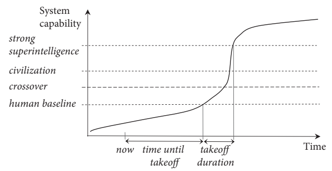
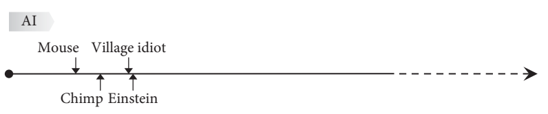
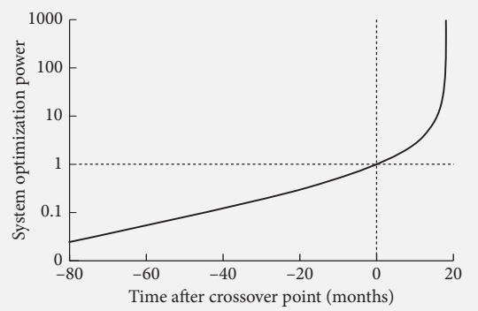

# Chapter 4｜第四章

# The kinetics of an intelligence explosion
# 智慧爆炸的動態

Nick Bostrom 著｜英繁對照翻譯初稿

> 編排說明：保留 2014 年原著的技術現況與推測。跨頁段落接回；圖 7–9 取自 PDF，附中文圖說與標籤對照。專欄 4 的公式依 PDF 重建，以 O 表示最佳化力量，以 ℜ 表示抗改進性；公式在英繁段落之後共用。專欄移至被其分隔的正文段落之後，以利連續閱讀。

**English**

Once machines attain some form of human-equivalence in general reasoning ability, how long will it then be before they attain radical superintelligence? Will this be a slow, gradual, protracted transition? Or will it be sudden, explosive? This chapter analyzes the kinetics of the transition to superintelligence as a function of optimization power and system recalcitrance. We consider what we know or may reasonably surmise about the behavior of these two factors in the neighborhood of human-level general intelligence.

**繁體中文**

一旦機器在通用推理能力上達到某種與人類相當的水準，還要多久才會獲得遠遠超越人類的超級智慧？這會是緩慢、漸進而漫長的轉變，還是突然、爆發式的轉變？本章把轉向超級智慧的動態，視為最佳化力量（optimization power）與系統抗改進性（recalcitrance）的函數，並加以分析。我們將考察：在接近人類水準通用智慧的區域，對於這兩項因素的變化，我們知道什麼，又能合理推測些什麼。

---

## Timing and speed of the takeoff
## 起飛的時點與速度

**English**

Given that machines will eventually vastly exceed biology in general intelligence, but that machine cognition is currently vastly narrower than human cognition, one is led to wonder how quickly this usurpation will take place. The question we are asking here must be sharply distinguished from the question we considered in Chapter 1 about how far away we currently are from developing a machine with human-level general intelligence. Here the question is instead, if and when such a machine is developed, how long will it be from then until a machine becomes radically superintelligent? Note that one could think that it will take quite a long time until machines reach the human baseline, or one might be agnostic about how long that will take, and yet have a strong view that once this happens, the further ascent into strong superintelligence will be very rapid.

**繁體中文**

既然機器最終會在通用智慧上遠遠超過生物，而機器目前的認知範圍又比人類狹窄得多，我們自然會問：這場取代將以多快的速度發生？這裡的問題，必須與第一章討論的問題明確區分：第一章問的是，我們距離開發出具有人類水準通用智慧的機器，還有多遠；這裡問的則是，假如且當這種機器被開發出來，從那時起，還要多久才會有機器成為遠遠超越人類的超級智慧？請注意，一個人可以認為機器要達到人類基準還需很長時間，或對此保持不確定，同時又強烈認為，一旦到了那一步，接下來邁向強超級智慧的攀升就會非常迅速。

---

**English**

It can be helpful to think about these matters schematically, even though doing so involves temporarily ignoring some qualifications and complicating details. Consider, then, a diagram that plots the intellectual capability of the most advanced machine intelligence system as a function of time (Figure 7).

**繁體中文**

即使必須暫時忽略一些限定條件與複雜細節，以示意方式思考這些問題仍可能有幫助。那麼，請考慮一張圖：以時間為橫軸，描繪最先進機器智慧系統的智力能力（圖 7）。

---

圖中文字對照：System capability＝系統能力；strong superintelligence＝強超級智慧；civilization＝文明；crossover＝交越點；human baseline＝人類基準；now＝現在；time until takeoff＝距離起飛的時間；takeoff duration＝起飛歷時；Time＝時間。

**English**

Figure 7 Shape of the takeoff. It is important to distinguish between these questions: “Will a takeoff occur, and if so, when?” and “If and when a takeoff does occur, how steep will it be?” One might hold, for example, that it will be a very long time before a takeoff occurs, but that when it does it will proceed very quickly. Another relevant question (not illustrated in this figure) is, “How large a fraction of the world economy will participate in the takeoff?” These questions are related but distinct.

**繁體中文**

圖 7　起飛的形態。必須區分下列問題：「起飛會發生嗎？如果會，何時發生？」以及「假如且當起飛發生時，它會有多陡峭？」例如，一個人可以認為，還要過很久才會起飛，但一旦發生，進程就會非常迅速。另一個相關問題是：「世界經濟中有多大比例會參與起飛？」本圖未呈現這個問題。這些問題彼此相關，但並不相同。

---

**English**

A horizontal line labeled “human baseline” represents the effective intellectual capabilities of a representative human adult with access to the information sources and technological aids currently available in developed countries. At present, the most advanced AI system is far below the human baseline on any reasonable metric of general intellectual ability. At some point in future, a machine might reach approximate parity with this human baseline (which we take to be fixed—anchored to the year 2014, say, even if the capabilities of human individuals should have increased in the intervening years): this would mark the onset of the takeoff. The capabilities of the system continue to grow, and at some later point the system reaches parity with the combined intellectual capability of all of humanity (again anchored to the present): what we may call the “civilization baseline”. Eventually, if the system’s abilities continue to grow, it attains “strong superintelligence”—a level of intelligence vastly greater than contemporary humanity’s combined intellectual wherewithal. The attainment of strong superintelligence marks the completion of the takeoff, though the system might continue to gain in capacity thereafter. Sometime during the takeoff phase, the system may pass a landmark which we can call “the crossover”, a point beyond which the system’s further improvement is mainly driven by the system’s own actions rather than by work performed upon it by others.〔[註 1](./04-第四章-註釋-英繁對照.md#note-1)〕 (The possible existence of such a crossover will become important in the subsection on optimization power and explosivity, later in this chapter.)

**繁體中文**

標示為「人類基準」（human baseline）的水平線，代表一位具代表性的成年人，在能使用已開發國家目前可取得之資訊來源與技術輔助的條件下，所具備的實際智力能力。目前，以任何合理的通用智力指標衡量，最先進的 AI 系統都遠低於人類基準。未來某個時點，機器可能大致達到這條人類基準；我們將基準視為固定不變，例如錨定在 2014 年，即使其間人類個體的能力有所提升，也不改變基準。這將標誌著起飛（takeoff）的開始。系統的能力持續增長，到了稍後某個時點，便與全人類合起來的智力能力相當；這同樣以當下為基準，我們可以稱為「文明基準」（civilization baseline）。如果能力繼續增長，系統最終就會達到「強超級智慧」（strong superintelligence）：其智慧程度，遠遠超過當代全人類的智力總和。達到強超級智慧，標誌著起飛完成，儘管此後系統的能力仍可能繼續增長。在起飛階段的某個時刻，系統可能越過一個里程碑，我們可以稱為「交越點」（crossover）：越過這一點後，系統的進一步改進，主要由它自身的行動推動，而非由其他人對它所做的工作推動。〔[註 1](./04-第四章-註釋-英繁對照.md#note-1)〕本章稍後討論最佳化力量與爆發性的小節中，這種交越點是否存在，將變得十分重要。

---

**English**

With this picture in mind, we can distinguish three classes of transition scenarios—scenarios in which systems progress from human-level intelligence to superintelligence—based on their steepness; that is to say, whether they represent a slow, fast, or moderate takeoff.

**繁體中文**

有了這幅圖像，我們便可依轉變的陡峭程度，把系統從人類水準智慧進展到超級智慧的情境分成三類：緩慢、快速或中等速度的起飛。

---

## Slow
## 緩慢起飛

**English**

A slow takeoff is one that occurs over some long temporal interval, such as decades or centuries. Slow takeoff scenarios offer excellent opportunities for human political processes to adapt and respond. Different approaches can be tried and tested in sequence. New experts can be trained and credentialed. Grassroots campaigns can be mobilized by groups that feel they are being disadvantaged by unfolding developments. If it appears that new kinds of secure infrastructure or mass surveillance of AI researchers is needed, such systems could be developed and deployed. Nations fearing an AI arms race would have time to try to negotiate treaties and design enforcement mechanisms. Most preparations undertaken before onset of the slow takeoff would be rendered obsolete as better solutions would gradually become visible in the light of the dawning era.

**繁體中文**

緩慢起飛發生於較長的時間區間，例如數十年或數百年。緩慢起飛情境為人類政治過程提供了極佳的適應與回應機會。不同的方法可以依序嘗試與測試。可以培訓新的專家，並授予專業資格。認為自己在變局中處於不利地位的群體，可以發動草根運動。若看來需要新型安全基礎設施，或對 AI 研究人員進行大規模監控，就可以開發與部署這些系統。擔心 AI 軍備競賽的國家，會有時間嘗試協商條約、設計執行機制。在緩慢起飛開始前所做的大部分準備，都將隨著新時代逐漸揭示更好的解決辦法，而變得過時。

---

## Fast
## 快速起飛

**English**

A fast takeoff occurs over some short temporal interval, such as minutes, hours, or days. Fast takeoff scenarios offer scant opportunity for humans to deliberate. Nobody need even notice anything unusual before the game is already lost. In a fast takeoff scenario, humanity’s fate essentially depends on preparations previously put in place. At the slowest end of the fast takeoff scenario range, some simple human actions might be possible, analogous to flicking open the “nuclear suitcase”; but any such action would either be elementary or have been planned and preprogrammed in advance.

**繁體中文**

快速起飛發生於很短的時間區間，例如幾分鐘、幾小時或幾天。快速起飛情境幾乎不給人類深思熟慮的機會。甚至可能還沒有人察覺異樣，勝負就已分曉，人類已經輸了。在快速起飛情境中，人類的命運基本上取決於事先完成的準備。在快速起飛這一範圍中相對最慢的情境下，人類或許還能採取某些簡單行動，類似於彈開「核武手提箱」；但這類行動不是極其簡單，就是早已預先規劃並編排好。

---

## Moderate
## 中等速度起飛

**English**

A moderate takeoff is one that occurs over some intermediary temporal interval, such as months or years. Moderate takeoff scenarios give humans some chance to respond but not much time to analyze the situation, to test different approaches, or to solve complicated coordination problems. There is not enough time to develop or deploy new systems (e.g. political systems, surveillance regimes, or computer network security protocols), but extant systems could be applied to the new challenge.

**繁體中文**

中等速度起飛發生於介於兩者之間的時間區間，例如幾個月或幾年。這類情境給人類一些回應機會，卻沒有太多時間分析局勢、測試不同方法，或解決複雜的協調問題。時間不足以開發或部署新系統，例如政治制度、監控體制或電腦網路安全協定，但可以用現有系統應對新的挑戰。

---

**English**

During a slow takeoff, there would be plenty of time for the news to get out. In a moderate takeoff, by contrast, it is possible that developments would be kept secret as they unfold. Knowledge might be restricted to a small group of insiders, as in a covert state-sponsored military research program. Commercial projects, small academic teams, and “nine hackers in a basement” outfits might also be clandestine—though, if the prospect of an intelligence explosion were “on the radar” of state intelligence agencies as a national security priority, then the most promising private projects would seem to have a good chance of being under surveillance. The host state (or a dominant foreign power) would then have the option of nationalizing or shutting down any project that showed signs of commencing takeoff. Fast takeoffs would happen so quickly that there would not be much time for word to get out or for anybody to mount a meaningful reaction if it did. But an outsider might intervene before the onset of the takeoff if they believed a particular project to be closing in on success.

**繁體中文**

緩慢起飛時，消息有充分時間傳開。相較之下，中等速度起飛期間的發展，可能一直處於保密狀態。知情者也許只限於少數內部人士，就像祕密的國家資助軍事研究計畫一樣。商業計畫、小型學術團隊，以及「地下室裡的九名駭客」這類組織，也可能祕密行動；不過，如果情報機構已把智慧爆炸的可能性列入關注範圍，視為國家安全優先事項，那麼，最有希望的私人計畫，似乎很有可能受到監控。所在地國家，或居於支配地位的外國強權，便可選擇將任何顯露起飛跡象的計畫收歸國有，或予以關閉。快速起飛發生得太快，消息幾乎來不及傳開；即使傳開，也幾乎沒有人來得及作出有意義的反應。但如果外部人士認為某項計畫即將成功，仍可能在起飛開始之前介入。

---

**English**

Moderate takeoff scenarios could lead to geopolitical, social, and economic turbulence as individuals and groups jockey to position themselves to gain from the unfolding transformation. Such upheaval, should it occur, might impede efforts to orchestrate a well-composed response; alternatively, it might enable solutions more radical than calmer circumstances would permit. For instance, in a moderate takeoff scenario where cheap and capable emulations or other digital minds gradually flood labor markets over a period of years, one could imagine mass protests by laid-off workers pressuring governments to increase unemployment benefits or institute a living wage guarantee to all human citizens, or to levy special taxes or impose minimum wage requirements on employers who use emulation workers. In order for any relief derived from such policies to be more than fleeting, support for them would somehow have to be cemented into permanent power structures. Similar issues can arise if the takeoff is slow rather than moderate, but the disequilibrium and rapid change in moderate scenarios may present special opportunities for small groups to wield disproportionate influence.

**繁體中文**

中等速度起飛情境可能引發地緣政治、社會與經濟動盪，因為個人和群體會競相卡位，爭取在正在展開的轉變中獲益。如果出現這種動盪，它可能妨礙人們協調出周全的回應；也可能讓比平穩環境所容許的更激進方案得以實現。例如，在某種中等速度起飛情境中，廉價而能幹的模擬體或其他數位心智，於數年內逐漸湧入勞動市場。我們可以想像，被裁撤的工人發起大規模抗議，迫使政府提高失業給付、為所有人類公民建立維生工資保障，或向使用模擬體勞工的雇主徵收特別稅、施加最低工資要求。這些政策若要提供不只轉瞬即逝的紓解，就必須以某種方式，把支持它們的力量固定在持久的權力結構中。緩慢起飛也可能出現類似問題；但在中等速度情境下，失衡與迅速變化或許會提供特殊機會，讓小群體發揮不成比例的影響力。

---

**English**

It might appear to some readers that of these three types of scenario, the slow takeoff is the most probable, the moderate takeoff is less probable, and the fast takeoff is utterly implausible. It could seem fanciful to suppose that the world could be radically transformed and humanity deposed from its position as apex cogitator over the course of an hour or two. No change of such moment has ever occurred in human history, and its nearest parallels—the Agricultural and Industrial Revolutions—played out over much longer timescales (centuries to millennia in the former case, decades to centuries in the latter). So the base rate for the kind of transition entailed by a fast or medium takeoff scenario, in terms of the speed and magnitude of the postulated change, is zero: it lacks precedent outside myth and religion.〔[註 2](./04-第四章-註釋-英繁對照.md#note-2)〕

**繁體中文**

某些讀者也許覺得，在這三類情境中，緩慢起飛最可能，中等速度起飛較不可能，快速起飛則完全不可信。認為世界能在一兩個小時內徹底改觀，人類也在同一段時間內失去最高思考者的地位，似乎近乎幻想。人類歷史上從未出現如此重大的變化；最接近的類比——農業革命與工業革命——也都歷經長得多的時間：前者是數百年至數千年，後者是數十年至數百年。因此，就所假定的變化速度與幅度而言，快速或中等速度起飛情境所涉及的轉變，其基準發生率為零：除了神話與宗教之外，毫無先例。〔[註 2](./04-第四章-註釋-英繁對照.md#note-2)〕

---

**English**

Nevertheless, this chapter will present some reasons for thinking that the slow transition scenario is improbable. If and when a takeoff occurs, it will likely be explosive.

**繁體中文**

儘管如此，本章將提出一些理由，說明緩慢轉變情境很可能不會發生。假如且當起飛發生時，它很可能具有爆發性。

---

**English**

To begin to analyze the question of how fast the takeoff will be, we can conceive of the rate of increase in a system’s intelligence as a (monotonically increasing) function of two variables: the amount of “optimization power”, or quality-weighted design effort, that is being applied to increase the system’s intelligence, and the responsiveness of the system to the application of a given amount of such optimization power. We might term the inverse of responsiveness “recalcitrance”, and write:

**繁體中文**

要著手分析起飛究竟會有多快，我們可以把系統智慧的增長速率，視為兩個變數的單調遞增函數：第一，是用來提升系統智慧的「最佳化力量」，也就是依品質加權的設計投入；第二，是系統對一定量最佳化力量所作出的反應程度。我們可以把反應程度的倒數稱為「抗改進性」，並寫成：

---

$$
\text{Rate of change in intelligence}=\frac{\text{Optimization power}}{\text{Recalcitrance}}
$$

智慧變化率＝最佳化力量 ÷ 抗改進性。

**English**

Pending some specification of how to quantify intelligence, design effort, and recalcitrance, this expression is merely qualitative. But we can at least observe that a system’s intelligence will increase rapidly if either a lot of skilled effort is applied to the task of increasing its intelligence and the system’s intelligence is not too hard to increase or there is a non-trivial design effort and the system’s recalcitrance is low (or both). If we know how much design effort is going into improving a particular system, and the rate of improvement this effort produces, we could calculate the system’s recalcitrance.

**繁體中文**

在尚未說明如何量化智慧、設計投入與抗改進性之前，這個式子只具有定性意義。但至少可以看出：如果投入大量熟練的工作來提高系統智慧，而且它的智慧不算太難提升；或投入了不可忽略的設計工作，而系統的抗改進性很低；或兩者兼具，那麼系統的智慧就會迅速增長。如果知道投入多少設計工作來改進某個系統，以及這些投入產生的改進速率，就可以算出系統的抗改進性。

---

**English**

Further, we can observe that the amount of optimization power devoted to improving some system’s performance varies between systems and over time. A system’s recalcitrance might also vary depending on how much the system has already been optimized. Often, the easiest improvements are made first, leading to diminishing returns (increasing recalcitrance) as low-hanging fruits are depleted. However, there can also be improvements that make further improvements easier, leading to improvement cascades. The process of solving a jigsaw puzzle starts out simple—it is easy to find the corners and the edges. Then recalcitrance goes up as subsequent pieces are harder to fit. But as the puzzle nears completion, the search space collapses and the process gets easier again.

**繁體中文**

我們還可以看出，用於改善系統表現的最佳化力量，會因系統而異，也會隨時間改變。系統的抗改進性，也可能取決於它已被最佳化到什麼程度。通常，最容易的改進會先完成；隨著唾手可得的成果被用盡，報酬便遞減，也就是抗改進性上升。然而，也有些改進會使後續改進更容易，形成一連串的改進。拼圖的過程一開始很簡單，因為角落和邊緣很容易找到。之後的拼片比較難放對位置，抗改進性便上升。但當拼圖快完成時，搜尋空間大幅縮小，過程又變得容易了。

---

**English**

To proceed in our inquiry, we must therefore analyze how recalcitrance and optimization power might vary in the critical time periods during the takeoff. This will occupy us over the next few pages.

**繁體中文**

因此，要繼續探究，我們必須分析：在起飛的關鍵時段，抗改進性與最佳化力量可能如何變化。接下來幾頁，我們將處理這個問題。

---

## Recalcitrance
## 抗改進性

**English**

Let us begin with recalcitrance. The outlook here depends on the type of the system under consideration. For completeness, we first cast a brief glance at the recalcitrance that would be encountered along paths to superintelligence that do not involve advanced machine intelligence. We find that recalcitrance along those paths appears to be fairly high. That done, we will turn to the main case, which is that the takeoff involves machine intelligence; and there we find that recalcitrance at the critical juncture seems low.

**繁體中文**

先從抗改進性談起。這方面的前景，取決於所考察的系統類型。為求完整，我們先簡短看看：沿著不涉及先進機器智慧的路徑邁向超級智慧，會遇到怎樣的抗改進性。我們發現，這些路徑的抗改進性似乎相當高。之後，我們會轉向主要情況，也就是涉及機器智慧的起飛；在那裡，我們發現關鍵時刻的抗改進性似乎很低。

---

## Non-machine intelligence paths
## 非機器智慧的路徑

**English**

Cognitive enhancement via improvements in public health and diet has steeply diminishing returns.〔[註 3](./04-第四章-註釋-英繁對照.md#note-3)〕 Big gains come from eliminating severe nutritional deficiencies, and the most severe deficiencies have already been largely eliminated in all but the poorest countries. Only girth is gained by increasing an already adequate diet. Education, too, is now probably subject to diminishing returns. The fraction of talented individuals in the world who lack access to quality education is still substantial, but declining.

**繁體中文**

透過改善公共衛生與飲食來增強認知，會遇到急遽遞減的報酬。〔[註 3](./04-第四章-註釋-英繁對照.md#note-3)〕重大收益來自消除嚴重營養缺乏，而除了最貧窮的國家之外，最嚴重的營養缺乏大多已經消除。對已經足夠的飲食繼續加量，增加的只是腰圍。教育如今很可能也面臨報酬遞減。全球有才華卻無法獲得優質教育的人，所占比例仍然可觀，但正在下降。

---

**English**

Pharmacological enhancers might deliver some cognitive gains over the coming decades. But after the easiest fixes have been accomplished—perhaps sustainable increases in mental energy and ability to concentrate, along with better control over the rate of long-term memory consolidation—subsequent gains will be increasingly hard to come by. Unlike diet and public health approaches, however, improving cognition through smart drugs might get easier before it gets harder. The field of neuropharmacology still lacks much of the basic knowledge that would be needed to competently intervene in the healthy brain. Neglect of enhancement medicine as a legitimate area of research may be partially to blame for this current backwardness. If neuroscience and pharmacology continue to progress for a while longer without focusing on cognitive enhancement, then maybe there would be some relatively easy gains to be had when at last the development of nootropics becomes a serious priority.〔[註 4](./04-第四章-註釋-英繁對照.md#note-4)〕

**繁體中文**

藥理增強劑可能在未來幾十年帶來一些認知增益。但在最容易的改善完成後——也許包括持續提升心智能量與專注能力，以及更好地控制長期記憶鞏固的速率——後續增益將越來越難取得。不過，與飲食和公共衛生方法不同，以促智藥物改善認知，可能先變容易，再變困難。神經藥理學仍缺少許多必要的基礎知識，尚不足以妥善介入健康大腦。增強醫學未被當作正當研究領域而受到忽視，可能是目前這種落後狀態的部分原因。如果神經科學與藥理學在尚未聚焦認知增強的情況下繼續進步一段時間，那麼，等到促智藥物（nootropics）的開發終於成為真正的優先事項時，也許就會有一些相對容易取得的成果。〔[註 4](./04-第四章-註釋-英繁對照.md#note-4)〕

---

**English**

Genetic cognitive enhancement has a U-shaped recalcitrance profile similar to that of nootropics, but with larger potential gains. Recalcitrance starts out high while the only available method is selective breeding sustained over many generations, something that is obviously difficult to accomplish on a globally significant scale. Genetic enhancement will get easier as technology is developed for cheap and effective genetic testing and selection (and particularly when iterated embryo selection becomes feasible in humans). These new techniques will make it possible to tap the pool of existing human genetic variation for intelligence-enhancing alleles. As the best existing alleles get incorporated into genetic enhancement packages, however, further gains will get harder to come by. The need for more innovative approaches to genetic modification may then increase recalcitrance.

**繁體中文**

遺傳性的認知增強，具有與促智藥物相似的 U 形抗改進性曲線，但潛在增益更大。起初，唯一可用的方法是持續許多世代的選擇性繁殖，抗改進性因此很高；顯然，要在足以影響全球的規模上做到這一點，極其困難。隨著廉價而有效的基因檢測與篩選技術發展，遺傳增強將變得容易，尤其當人類的反覆胚胎篩選成為可行之時。這些新技術將使我們能從現有人類遺傳變異庫中，挑選增強智慧的等位基因。然而，隨著現存最好的等位基因被納入遺傳增強方案，後續增益就會越來越難取得。屆時，因為需要更創新的基因改造方法，抗改進性可能上升。

---

**English**

There are limits to how quickly things can progress along the genetic enhancement path, most notably the fact that germline interventions are subject to an inevitable maturational lag: this strongly counteracts the possibility of a fast or moderate takeoff.〔[註 5](./04-第四章-註釋-英繁對照.md#note-5)〕 That embryo selection can only be applied in the context of in vitro fertilization will slow its rate of adoption: another limiting factor.

**繁體中文**

遺傳增強路徑的進展速度受到限制，其中最顯著的一點，是生殖系介入不可避免地受制於成熟所需的等待期（maturational lag）：這會強烈抑制快速或中等速度起飛的可能性。〔[註 5](./04-第四章-註釋-英繁對照.md#note-5)〕胚胎篩選只能配合體外受精使用，會減慢其普及速度；這是另一項限制。

---

**English**

The recalcitrance along the brain–computer path seems initially very high. In the unlikely event that it somehow becomes easy to insert brain implants and to achieve high-level functional integration with the cortex, recalcitrance might plummet. In the long run, the difficulty of making progress along this path would be similar to that involved in improving emulations or AIs, since the bulk of the brain–computer system’s intelligence would eventually reside in the computer part.

**繁體中文**

腦機結合路徑的抗改進性，起初似乎非常高。在一種不太可能的情況下，如果植入腦部裝置，並使其與皮質達到高層次功能整合，不知怎地變得容易，抗改進性就可能驟降。長期來看，這條路徑的進展難度，會與改善模擬體或 AI 的難度相似，因為腦機系統的大部分智慧，最終會存在於電腦那一側。

---

**English**

The recalcitrance for making networks and organizations in general more efficient is high. A vast amount of effort is going into overcoming this recalcitrance, and the result is an annual improvement of humanity’s total capacity by perhaps no more than a couple of percent.〔[註 6](./04-第四章-註釋-英繁對照.md#note-6)〕 Furthermore, shifts in the internal and external environment mean that organizations, even if efficient at one time, soon become ill-adapted to their new circumstances. Ongoing reform effort is thus required even just to prevent deterioration. A step change in the rate of gain in average organizational efficiency is perhaps conceivable, but it is hard to see how even the most radical scenario of this kind could produce anything faster than a slow takeoff, since organizations operated by humans are confined to work on human timescales. The Internet continues to be an exciting frontier with many opportunities for enhancing collective intelligence, with a recalcitrance that seems at the moment to be in the moderate range—progress is somewhat swift but a lot of effort is going into making this progress happen. It may be expected to increase as low-hanging fruits (such as search engines and email) are depleted.

**繁體中文**

要普遍提高網絡與組織的效率，抗改進性很高。人們投入大量心力克服這種抗改進性，結果卻可能只是讓人類整體能力每年提高百分之幾。〔[註 6](./04-第四章-註釋-英繁對照.md#note-6)〕此外，內外環境的變動，意味著組織即使一度有效率，也很快會變得不適應新情況。因此，即使只是防止退步，也需要持續改革。平均組織效率的提升速率出現階躍式變化，也許可以想像；但即使是最激進的這類情境，也很難看出它如何帶來比緩慢起飛更快的進程，因為人類運作的組織，只能在人類的時間尺度上工作。網際網路仍是令人振奮的前沿，有許多增強集體智慧的機會；它的抗改進性目前似乎居中——進步頗快，但也投入了大量心力。隨著搜尋引擎、電子郵件等容易取得的成果被用盡，抗改進性可能會提高。

---

## Emulation and AI paths
## 模擬體與 AI 的路徑

**English**

The difficulty of advancing toward whole brain emulation is difficult to estimate. Yet we can point to a specific future milestone: the successful emulation of an insect brain. That milestone stands on a hill, and its conquest would bring into view much of the terrain ahead, allowing us to make a decent guess at the recalcitrance of scaling up the technology to human whole brain emulation. (A successful emulation of a small-mammal brain, such as that of a mouse, would give an even better vantage point that would allow the distance remaining to a human whole brain emulation to be estimated with a high degree of precision.) The path toward artificial intelligence, by contrast, may feature no such obvious milestone or early observation point. It is entirely possible that the quest for artificial intelligence will appear to be lost in dense jungle until an unexpected breakthrough reveals the finishing line in a clearing just a few short steps away.

**繁體中文**

通往全腦模擬的進展有多困難，很難估計。不過，我們可以指出未來的一個具體里程碑：成功模擬昆蟲大腦。這個里程碑立在山丘上，攻下它，就能看見前方大片地形，讓我們對把技術擴展到人類全腦模擬的抗改進性，作出相當合理的估計。（如果成功模擬小型哺乳動物，例如老鼠的大腦，就能站在更好的觀察點，以很高的精確度估計距離人類全腦模擬還有多遠。）相較之下，通往人工智慧的路上，可能沒有這麼明顯的里程碑或早期觀察點。完全可能發生這樣的情況：人工智慧的探索看似迷失於密林之中，直到某個出乎意料的突破，才發現終點線就在空地上，僅僅幾步之遙。

---

**English**

Recall the distinction between these two questions: How hard is it to attain roughly human levels of cognitive ability? And how hard is it to get from there to superhuman levels? The first question is mainly relevant for predicting how long it will be before the onset of a takeoff. It is the second question that is key to assessing the shape of the takeoff, which is our aim here. And though it might be tempting to suppose that the step from human level to superhuman level must be the harder one—this step, after all, takes place “at a higher altitude” where capacity must be superadded to an already quite capable system—this would be a very unsafe assumption. It is quite possible that recalcitrance falls when a machine reaches human parity.

**繁體中文**

請記住兩個問題的差別：達到大致相當於人類的認知能力有多難？從那裡再進展到超人類水準，又有多難？第一個問題主要關係到預測還要多久才會開始起飛；第二個問題，才是評估起飛形態的關鍵，也正是這裡的目的。我們也許很容易認為，從人類水準跨到超人類水準，必然是比較難的一步——畢竟這一步發生在「更高的海拔」，必須為已經相當能幹的系統增添更多能力——但這個假設很不可靠。機器一旦與人類並駕齊驅，抗改進性完全可能下降。

---

**English**

Consider first whole brain emulation. The difficulties involved in creating the first human emulation are of a quite different kind from those involved in enhancing an existing emulation. Creating a first emulation involves huge technological challenges, particularly in regard to developing the requisite scanning and image interpretation capabilities. This step might also require considerable amounts of physical capital—an industrial-scale machine park with hundreds of high-throughput scanning machines is not implausible. By contrast, enhancing the quality of an existing emulation involves tweaking algorithms and data structures: essentially a software problem, and one that could turn out to be much easier than perfecting the imaging technology needed to create the original template. Programmers could easily experiment with tricks like increasing the neuron count in different cortical areas to see how it affects performance.〔[註 7](./04-第四章-註釋-英繁對照.md#note-7)〕 They also could work on code optimization and on finding simpler computational models that preserve the essential functionality of individual neurons or small networks of neurons. If the last technological prerequisite to fall into place is either scanning or translation, with computing power being relatively abundant, then not much attention might have been given during the development phase to implementational efficiency, and easy opportunities for computational efficiency savings might be available. (More fundamental architectural reorganization might also be possible, but that takes us off the emulation path and into AI territory.)

**繁體中文**

先考慮全腦模擬。創造第一個人類模擬體的困難，與增強既有模擬體的困難，性質相當不同。創造第一個模擬體涉及巨大的技術挑戰，尤其是開發所需的掃描與影像解讀能力。這一步也可能需要相當多的實體資本——一處擁有數百部高吞吐量掃描機器的工業規模設備群，並非不可想像。相較之下，提升既有模擬體的品質，需要調整演算法與資料結構，本質上是軟體問題；這可能比完善用來建立原始範本的成像技術容易得多。程式設計師可以輕易試驗各種手法，例如增加不同皮質區域的神經元數量，看看如何影響表現。〔[註 7](./04-第四章-註釋-英繁對照.md#note-7)〕他們也可以最佳化程式碼，尋找更簡單、卻保留個別神經元或小型神經網絡基本功能的運算模型。如果最後到位的技術前提是掃描或轉換，而運算能力相對充裕，那麼開發階段可能沒有太重視實作效率，因此可能存在容易取得的運算效率改善空間。（也可能進行更根本的架構重組，但那就離開了模擬路徑，進入 AI 的領域。）

---

**English**

Another way to improve the code base once the first emulation has been produced is to scan additional brains with different or superior skills and talents.

**繁體中文**

第一個模擬體產生後，另一種改善程式碼基礎的方式，是掃描更多擁有不同或更優越技能與天賦的大腦。

---

**English**

Productivity growth would also occur as a consequence of adapting organizational structures and workflows to the unique attributes of digital minds. Since there is no precedent in the human economy of a worker who can be literally copied, reset, run at different speeds, and so forth, managers of the first emulation cohort would find plenty of room for innovation in managerial practices.

**繁體中文**

調整組織結構與工作流程，使其適應數位心智的獨特屬性，也會帶來生產力增長。在人類經濟中，從來沒有勞工能真正被複製、重設，或以不同速度運作。因此，管理第一批模擬體的人，會發現管理實務上有大量創新空間。

---

**English**

After initially plummeting when human whole brain emulation becomes possible, recalcitrance may rise again. Sooner or later, the most glaring implementational inefficiencies will have been optimized away, the most promising algorithmic variations will have been tested, and the easiest opportunities for organizational innovation will have been exploited. The template library will have expanded so that acquiring more brain scans would add little benefit over working with existing templates. Since a template can be multiplied, each copy can be individually trained in a different field, and this can be done at electronic speed, it might be that the number of brains that would need to be scanned in order to capture most of the potential economic gains is small. Possibly a single brain would suffice.

**繁體中文**

當人類全腦模擬成為可能時，抗改進性起初會驟降，之後卻可能再度上升。遲早，最明顯的實作效率問題會被消除，最有希望的演算法變體會被測試，最容易的組織創新機會也會被利用。範本庫將不斷擴大，直到掃描更多大腦，相較於繼續利用現有範本，已幾乎沒有額外收益。範本既然能大量複製，每個複本又能個別在不同領域受訓，而且能以電子速度完成，那麼，要取得大部分潛在經濟收益，所需掃描的大腦數量也許很少。甚至可能只要一個大腦就夠了。

---

**English**

Another potential cause of escalating recalcitrance is the possibility that emulations or their biological supporters will organize to support regulations restricting the use of emulation workers, limiting emulation copying, prohibiting certain kinds of experimentation with digital minds, instituting workers’ rights and a minimum wage for emulations, and so forth. It is equally possible, however, that political developments would go in the opposite direction, contributing to a fall in recalcitrance. This might happen if initial restraint in the use of emulation labor gives way to unfettered exploitation as competition heats up and the economic and strategic costs of occupying the moral high ground become clear.

**繁體中文**

另一個可能使抗改進性升高的原因，是模擬體或其生物支持者可能組織起來，支持限制模擬體勞工使用、限制模擬體複製、禁止對數位心智進行某些實驗、為模擬體建立勞工權利與最低工資等規範。不過，政治發展也同樣可能走向反方向，使抗改進性下降。如果競爭加劇，而堅守道德高地的經濟與策略代價逐漸明朗，使用模擬體勞工時最初的克制，可能讓位給不受約束的剝削，便會出現這種情況。

---

**English**

As for artificial intelligence (non-emulation machine intelligence), the difficulty of lifting a system from human-level to superhuman intelligence by means of algorithmic improvements depends on the attributes of the particular system. Different architectures might have very different recalcitrance.

**繁體中文**

至於人工智慧，也就是非模擬型機器智慧，透過演算法改進，把系統從人類水準提升到超人類智慧有多困難，取決於該系統的屬性。不同架構的抗改進性可能相差極大。

---

**English**

In some situations, recalcitrance could be extremely low. For example, if human-level AI is delayed because one key insight long eludes programmers, then when the final breakthrough occurs, the AI might leapfrog from below to radically above human level without even touching the intermediary rungs. Another situation in which recalcitrance could turn out to be extremely low is that of an AI system that can achieve intelligent capability via two different modes of processing. To illustrate this possibility, suppose an AI is composed of two subsystems, one possessing domain-specific problem-solving techniques, the other possessing general-purpose reasoning ability. It could then be the case that while the second subsystem remains below a certain capacity threshold, it contributes nothing to the system’s overall performance, because the solutions it generates are always inferior to those generated by the domain-specific subsystem. Suppose now that a small amount of optimization power is applied to the general-purpose subsystem and that this produces a brisk rise in the capacity of that subsystem. At first, we observe no increase in the overall system’s performance, indicating that recalcitrance is high. Then, once the capacity of the general-purpose subsystem crosses the threshold where its solutions start to beat those of the domain-specific subsystem, the overall system’s performance suddenly begins to improve at the same brisk pace as the general-purpose subsystem, even as the amount of optimization power applied stays constant: the system’s recalcitrance has plummeted.

**繁體中文**

在某些情況下，抗改進性可能極低。例如，如果人類水準 AI 遲遲未能實現，只是因為程式設計師長久以來始終未能掌握某個關鍵見解，那麼當最後的突破出現時，AI 可能直接從低於人類水準，躍升到遠遠高於人類水準，甚至完全略過中間各級。另一種抗改進性可能極低的情況，是 AI 系統能透過兩種不同的處理模式取得智慧能力。為了說明這種可能，假設 AI 由兩個子系統組成：一個具備特定領域的解題技術，另一個具備通用推理能力。那麼，只要第二個子系統尚未跨過某個能力門檻，它可能完全無助於系統的整體表現，因為它提出的解答總不如特定領域子系統的解答。現在假設對通用子系統施加少量最佳化力量，便能使它的能力迅速提升。起初，我們觀察不到整個系統的表現有任何改善，這顯示抗改進性很高。之後，一旦通用子系統跨過門檻，提出的解答開始勝過特定領域子系統，整個系統的表現就會突然以同樣迅速的速度改善，儘管施加的最佳化力量仍然不變：系統的抗改進性已經驟降。

---

**English**

It is also possible that our natural tendency to view intelligence from an anthropocentric perspective will lead us to underestimate improvements in sub-human systems, and thus to overestimate recalcitrance. Eliezer Yudkowsky, an AI theorist who has written extensively on the future of machine intelligence, puts the point as follows:

**繁體中文**

我們從以人類為中心的角度看待智慧的自然傾向，也可能使我們低估次人類系統的改善，從而高估抗改進性。AI 理論家 Eliezer Yudkowsky 曾廣泛論述機器智慧的未來，他如此說明這一點：

---

**English**

AI might make an apparently sharp jump in intelligence purely as the result of anthropomorphism, the human tendency to think of “village idiot” and “Einstein” as the extreme ends of the intelligence scale, instead of nearly indistinguishable points on the scale of minds-in-general. Everything dumber than a dumb human may appear to us as simply “dumb”. One imagines the “AI arrow” creeping steadily up the scale of intelligence, moving past mice and chimpanzees, with AIs still remaining “dumb” because AIs cannot speak fluent language or write science papers, and then the AI arrow crosses the tiny gap from infra-idiot to ultra-Einstein in the course of one month or some similarly short period.〔[註 8](./04-第四章-註釋-英繁對照.md#note-8)〕

**繁體中文**

AI 在智慧上出現的急遽躍升，可能純粹是擬人化造成的表象：人類往往把「村裡的傻子」與「愛因斯坦」視為智慧尺度的兩個極端，卻沒有把他們看作整個心智尺度上幾乎無法區分的兩點。凡是比愚笨的人更笨的東西，在我們眼裡可能就只是「笨」。我們可以想像，「AI 箭頭」沿著智慧尺度穩步上移，越過老鼠與黑猩猩；但 AI 仍被視為「笨」，因為它還不能流利運用語言，也不能撰寫科學論文。接著，AI 箭頭卻在一個月或類似的短時間內，跨過從比傻子還差到遠勝愛因斯坦之間，那一小段差距。〔[註 8](./04-第四章-註釋-英繁對照.md#note-8)〕

---

**English**

(See Fig. 8.)

**繁體中文**

（見圖 8。）

---

圖中文字對照：Mouse＝老鼠；Chimp＝黑猩猩；Village idiot＝村裡的傻子；Einstein＝愛因斯坦；AI＝人工智慧。

**English**

Figure 8 A less anthropomorphic scale? The gap between a dumb and a clever person may appear large from an anthropocentric perspective, yet in a less parochial view the two have nearly indistinguishable minds.〔[註 9](./04-第四章-註釋-英繁對照.md#note-9)〕 It will almost certainly prove harder and take longer to build a machine intelligence that has a general level of smartness comparable to that of a village idiot than to improve such a system so that it becomes much smarter than any human.

**繁體中文**

圖 8　一個較少擬人化的尺度？從以人類為中心的角度來看，愚笨與聰明之人的差距可能很大；但採取較不狹隘的觀點，兩者的心智幾乎無法區分。〔[註 9](./04-第四章-註釋-英繁對照.md#note-9)〕打造一個整體聰明程度相當於村裡傻子的機器智慧，幾乎肯定比把這樣的系統改進到遠比任何人類聰明，更加困難、更加耗時。

---

**English**

The upshot of these several considerations is that it is difficult to predict how hard it will be to make algorithmic improvements in the first AI that reaches a roughly human level of general intelligence. There are at least some possible circumstances in which algorithm-recalcitrance is low. But even if algorithm-recalcitrance is very high, this would not preclude the overall recalcitrance of the AI in question from being low. For it might be easy to increase the intelligence of the system in other ways than by improving its algorithms. There are two other factors that can be improved: content and hardware.

**繁體中文**

上述考量所指向的結論是：第一個在通用智慧上大致達到人類水準的 AI，要對它進行演算法改進有多難，很難預測。至少存在某些可能情況，演算法抗改進性會很低。但即使演算法抗改進性非常高，也不排除該 AI 的整體抗改進性很低。因為除了改進演算法以外，也可能容易透過其他方式提高系統智慧。還有兩項因素可以改善：內容與硬體。

---

**English**

First, consider content improvements. By “content” we here mean those parts of a system’s software assets that do not make up its core algorithmic architecture. Content might include, for example, databases of stored percepts, specialized skills libraries, and inventories of declarative knowledge. For many kinds of system, the distinction between algorithmic architecture and content is very unsharp; nevertheless, it will serve as a rough-and-ready way of pointing to one potentially important source of capability gains in a machine intelligence. An alternative way of expressing much the same idea is by saying that a system’s intellectual problem-solving capacity can be enhanced not only by making the system cleverer but also by expanding what the system knows.

**繁體中文**

先考慮內容改善。這裡的「內容」，是指系統軟體資產中，不屬於核心演算法架構的部分。例如，內容可以包括儲存知覺資料的資料庫、專門技能庫，以及陳述性知識的集合。對許多類型的系統而言，演算法架構與內容之間的界線很不清楚；但這個粗略區分，仍能指出機器智慧能力增長的一個潛在重要來源。換一種說法，大致相同的意思是：提高系統運用智力解決問題的能力，不僅可以靠讓它變得更聰明，也可以靠擴大它所知道的事情。

---

**English**

Consider a contemporary AI system such as TextRunner (a research project at the University of Washington) or IBM’s Watson (the system that won the Jeopardy! quiz show). These systems can extract certain pieces of semantic information by analyzing text. Although these systems do not understand what they read in the same sense or to the same extent as a human does, they can nevertheless extract significant amounts of information from natural language and use that information to make simple inferences and answer questions. They can also learn from experience, building up more extensive representations of a concept as they encounter additional instances of its use. They are designed to operate for much of the time in unsupervised mode (i.e. to learn hidden structure in unlabeled data in the absence of error or reward signal, without human guidance) and to be fast and scalable. TextRunner, for instance, works with a corpus of 500 million web pages.〔[註 10](./04-第四章-註釋-英繁對照.md#note-10)〕

**繁體中文**

考慮當代的 AI 系統，例如華盛頓大學的研究計畫 TextRunner，或贏得《Jeopardy!》問答節目的 IBM Watson。這些系統能透過分析文字，擷取某些語意資訊。雖然它們理解所讀內容的方式與程度，和人類並不相同，但仍能從自然語言中擷取大量資訊，並用來作簡單推論、回答問題。它們也能從經驗學習，隨著遇到更多概念的使用實例，建立更豐富的概念表徵。它們的設計目標，是大部分時間以非監督模式運作——也就是在沒有錯誤或獎勵訊號、沒有人工指引的情況下，學習未標記資料中的隱藏結構——並且快速、可擴展。例如，TextRunner 使用的語料包含五億個網頁。〔[註 10](./04-第四章-註釋-英繁對照.md#note-10)〕

---

**English**

Now imagine a remote descendant of such a system that has acquired the ability to read with as much understanding as a human ten-year-old but with a reading speed similar to that of TextRunner. (This is probably an AI-complete problem.) So we are imagining a system that thinks much faster and has much better memory than a human adult, but knows much less, and perhaps the net effect of this is that the system is roughly human-equivalent in its general problem-solving ability. But its content recalcitrance is very low—low enough to precipitate a takeoff. Within a few weeks, the system has read and mastered all the content contained in the Library of Congress. Now the system knows much more than any human being and thinks vastly faster: it has become (at least) weakly superintelligent.

**繁體中文**

現在想像這類系統的一個遙遠後繼者：它已能以人類十歲兒童的理解力閱讀，閱讀速度卻與 TextRunner 相近。（這很可能是一個 AI 完全問題。）也就是說，我們想像的系統，比成年人思考得快得多、記憶力好得多，但知道得少得多；這些因素的淨效果，也許使其通用解題能力大致與人類相當。然而，它的內容抗改進性極低，低到足以引發起飛。幾週之內，系統便已讀完並掌握美國國會圖書館的全部內容。此時，它知道的比任何人都多，思考速度也快得多：它至少已成為弱超級智慧。

---

**English**

A system might thus greatly boost its effective intellectual capability by absorbing pre-produced content accumulated through centuries of human science and civilization: for instance, by reading through the Internet. If an AI reaches human level without previously having had access to this material or without having been able to digest it, then the AI’s overall recalcitrance will be low even if it is hard to improve its algorithmic architecture.

**繁體中文**

因此，系統可以吸收人類科學與文明歷經幾個世紀累積的現成內容，大幅提升其實際智力能力，例如讀遍網際網路。如果 AI 達到人類水準時，先前尚未接觸過這些材料，或尚無法消化它們，那麼，即使改善演算法架構很困難，AI 的整體抗改進性仍會很低。

---

**English**

Content-recalcitrance is a relevant concept for emulations, too. A high-speed emulation has an advantage not only because it can complete the same tasks as biological humans more quickly, but also because it can accumulate more timely content, such as task-relevant skills and expertise. In order to tap the full potential of fast content accumulation, however, a system needs to have a correspondingly large memory capacity. There is little point in reading an entire library if you have forgotten all about the aardvark by the time you get to the abalone. While an AI system is likely to have adequate memory capacity, emulations would inherit some of the capacity limitations of their human templates. They may therefore need architectural enhancements in order to become capable of unbounded learning.

**繁體中文**

內容抗改進性的概念，同樣適用於模擬體。高速模擬體的優勢，不僅在於能比生物人類更快完成相同任務，也在於能及時累積更多內容，例如與任務相關的技能與專業知識。然而，要充分發揮快速累積內容的潛力，系統必須有相應龐大的記憶容量。如果才讀到鮑魚（abalone），就已經把土豚（aardvark）的內容忘光，讀遍整座圖書館也沒什麼意義。AI 系統很可能具備足夠的記憶容量，模擬體卻會繼承其人類範本的某些容量限制。因此，它們可能需要增強架構，才能具備無限持續學習的能力。

---

**English**

So far we have considered the recalcitrance of architecture and of content—that is, how difficult it would be to improve the software of a machine intelligence that has reached human parity. Now let us look at a third way of boosting the performance of machine intelligence: improving its hardware. What would be the recalcitrance for hardware-driven improvements?

**繁體中文**

目前我們考察了架構與內容的抗改進性，也就是：對已達到人類水準的機器智慧而言，改善軟體有多困難。現在來看提升機器智慧表現的第三種方式：改善硬體。由硬體推動的改善，其抗改進性會如何？

---

**English**

Starting with intelligent software (emulation or AI) one can amplify collective intelligence simply by using additional computers to run more instances of the program.〔[註 11](./04-第四章-註釋-英繁對照.md#note-11)〕 One could also amplify speed intelligence by moving the program to faster computers. Depending on the degree to which the program lends itself to parallelization, speed intelligence could also be amplified by running the program on more processors. This is likely to be feasible for emulations, which have a highly parallelized architecture; but many AI programs, too, have important subroutines that can benefit from massive parallelization. Amplifying quality intelligence by increasing computing power might also be possible, but that case is less straightforward.〔[註 12](./04-第四章-註釋-英繁對照.md#note-12)〕

**繁體中文**

以有智慧的軟體——模擬體或 AI——為起點，只要用更多電腦運行更多程式執行個體，就能增強集體智慧。〔[註 11](./04-第四章-註釋-英繁對照.md#note-11)〕把程式移到更快的電腦上，也能增強速度智慧。依程式適合平行化的程度而定，在更多處理器上執行程式，也能增強速度智慧。這對高度平行化架構的模擬體而言，很可能可行；許多 AI 程式也有能從大規模平行化受益的重要子程序。藉由提高運算能力來增強品質智慧，也可能做得到，但情況沒有那麼單純。〔[註 12](./04-第四章-註釋-英繁對照.md#note-12)〕

---

**English**

The recalcitrance for amplifying collective or speed intelligence (and possibly quality intelligence) in a system with human-level software is therefore likely to be low. The only difficulty involved is gaining access to additional computing power.

**繁體中文**

因此，對具有人類水準軟體的系統而言，增強集體智慧或速度智慧，也許還包括品質智慧，其抗改進性很可能很低。唯一的困難，是取得更多運算能力。

---

**English**

There are several ways for a system to expand its hardware base, each relevant over a different timescale.

**繁體中文**

系統可以透過幾種方式擴充硬體資源，每一種都對應不同的時間尺度。

---

**English**

In the short term, computing power should scale roughly linearly with funding: twice the funding buys twice the number of computers, enabling twice as many instances of the software to be run simultaneously. The emergence of cloud computing services gives a project the option to scale up its computational resources without even having to wait for new computers to be delivered and installed, though concerns over secrecy might favor the use of in-house computers. (In certain scenarios, computing power could also be obtained by other means, such as by commandeering botnets.〔[註 13](./04-第四章-註釋-英繁對照.md#note-13)〕) Just how easy it would be to scale the system by a given factor depends on how much computing power the initial system uses. A system that initially runs on a PC could be scaled by a factor of thousands for a mere million dollars. A program that runs on a supercomputer would be far more expensive to scale.

**繁體中文**

短期內，運算能力應大致隨資金線性增加：兩倍資金可以購買兩倍電腦，讓兩倍數量的軟體執行個體同時運行。雲端運算服務的出現，使計畫甚至不必等候新電腦交貨與安裝，就能擴充運算資源；不過，保密考量可能使人偏好使用內部電腦。（某些情境下，也可透過其他手段取得運算能力，例如接管殭屍網路。〔[註 13](./04-第四章-註釋-英繁對照.md#note-13)〕）要把系統擴大某個倍數究竟有多容易，取決於初始系統使用多少運算能力。原本在個人電腦上執行的系統，只需一百萬美元，就能擴大數千倍；原本在超級電腦上執行的程式，擴充成本則高得多。

---

**English**

In the slightly longer term, the cost of acquiring additional hardware may be driven up as a growing portion of the world’s installed capacity is being used to run digital minds. For instance, in a competitive market-based emulation scenario, the cost of running one additional copy of an emulation should rise to be roughly equal to the income generated by the marginal copy, as investors bid up the price for existing computing infrastructure to match the return they expect from their investment (though if only one project has mastered the technology it might gain a degree of monopsony power in the computing power market and therefore pay a lower price).

**繁體中文**

在稍長的時間尺度上，隨著全球已安裝運算容量中越來越大的一部分用來運行數位心智，取得額外硬體的成本可能被推高。例如，在競爭性市場中的模擬體情境下，多運行一個模擬體複本的成本，應會上升到大致等於邊際複本所產生的收入，因為投資者會競相抬高現有運算基礎設施的價格，直到與預期投資報酬相符。不過，如果只有一項計畫掌握技術，它可能在運算能力市場取得某種買方壟斷力量（monopsony power），因而支付較低價格。

---

**English**

Over a somewhat longer timescale, the supply of computing power will grow as new capacity is installed. A demand spike would spur production in existing semiconductor foundries and stimulate the construction of new plants. (A one-off performance boost, perhaps amounting to one or two orders of magnitude, might also be obtainable by using customized microprocessors.〔[註 14](./04-第四章-註釋-英繁對照.md#note-14)〕) Above all, the rising wave of technology improvements will pour increasing volumes of computational power into the turbines of the thinking machines. Historically, the rate of improvement of computing technology has been described by the famous Moore’s law, which in one of its variations states that computing power per dollar doubles every 18 months or so.〔[註 15](./04-第四章-註釋-英繁對照.md#note-15)〕 Although one cannot bank on this rate of improvement continuing up to the development of human-level machine intelligence, yet until fundamental physical limits are reached there will remain room for advances in computing technology.

**繁體中文**

在再長一些的時間尺度上，隨著新容量建置完成，運算能力的供給會增加。需求猛增將刺激既有半導體晶圓廠增產，並促成新廠興建。（使用客製化微處理器，也可能獲得一次性的效能提升，幅度也許有一、兩個數量級。〔[註 14](./04-第四章-註釋-英繁對照.md#note-14)〕）最重要的是，技術改進的浪潮，將把越來越大量的運算能力注入思考機器的渦輪。歷史上，運算技術的改進速率，一直以著名的摩爾定律描述；其中一種說法是，每一美元能買到的運算能力，大約每十八個月就翻倍。〔[註 15](./04-第四章-註釋-英繁對照.md#note-15)〕雖然不能指望這種改進速率會一直持續到人類水準機器智慧出現，但在觸及根本物理極限之前，運算技術仍有進步空間。

---

**English**

There are thus reasons to expect that hardware recalcitrance will not be very high. Purchasing more computing power for the system once it proves its mettle by attaining human-level intelligence might easily add several orders of magnitude of computing power (depending on how hardware-frugal the project was before expansion). Chip customization might add one or two orders of magnitude. Other means of expanding the hardware base, such as building more factories and advancing the frontier of computing technology, take longer—normally several years, though this lag would be radically compressed once machine superintelligence revolutionizes manufacturing and technology development.

**繁體中文**

因此，有理由預期硬體抗改進性不會很高。一旦系統達到人類水準智慧，證明自己的能力，再替它購買更多運算能力，就可能輕易增加數個數量級；具體幅度取決於計畫在擴充之前使用硬體有多節省。晶片客製化可能再增加一、兩個數量級。興建更多工廠、推進運算技術前沿等其他擴充硬體的方法，則需要較長時間，通常是數年；但當機器超級智慧徹底改變製造與技術開發後，這段等待期會大幅縮短。

---

**English**

In summary, we can talk about the likelihood of a hardware overhang: when human-level software is created, enough computing power may already be available to run vast numbers of copies at great speed. Software recalcitrance, as discussed above, is harder to assess but might be even lower than hardware recalcitrance. In particular, there may be content overhang in the form of pre-made content (e.g. the Internet) that becomes available to a system once it reaches human parity. Algorithm overhang—pre-designed algorithmic enhancements—is also possible but perhaps less likely. Software improvements (whether in algorithms or content) might offer orders of magnitude of potential performance gains that could be fairly easily accessed once a digital mind attains human parity, on top of the performance gains attainable by using more or better hardware.

**繁體中文**

總而言之，我們可以談論「硬體儲備餘裕」（hardware overhang）的可能性：當人類水準的軟體被創造出來時，也許已有足夠的運算能力，可以高速運行大量複本。前面討論過，軟體抗改進性更難評估，但可能比硬體抗改進性還低。尤其可能存在「內容儲備餘裕」（content overhang）：一旦系統達到人類水準，就能利用網際網路等現成內容。「演算法儲備餘裕」（algorithm overhang），也就是預先設計好的演算法改進，也有可能存在，但也許較不可能。數位心智一旦達到人類水準，除了使用更多或更好硬體帶來的效能增益外，軟體改善——無論是演算法或內容——還可能提供相當容易取得、幅度達數個數量級的潛在效能增益。

---

## Optimization power and explosivity
## 最佳化力量與爆發性

**English**

Having examined the question of recalcitrance we must now turn to the other half of our schematic equation, optimization power. To recall: Rate of change in Intelligence = Optimization power/Recalcitrance. As reflected in this schematic, a fast takeoff does not require that recalcitrance during the transition phase be low. A fast takeoff could also result if recalcitrance is constant or even moderately increasing, provided the optimization power being applied to improving the system’s performance grows sufficiently rapidly. As we shall now see, there are good grounds for thinking that the applied optimization power will increase during the transition, at least in the absence of a deliberate measures to prevent this from happening.

**繁體中文**

考察過抗改進性之後，現在必須轉向示意方程式的另一半：最佳化力量。回顧一下：智慧變化率＝最佳化力量／抗改進性。這個關係式顯示，快速起飛並不要求轉變階段的抗改進性很低。即使抗改進性保持不變，甚至適度提高，只要用來改善系統表現的最佳化力量增長得夠快，也可能造成快速起飛。如我們接下來將看到的，有充分理由認為，轉變期間施加的最佳化力量會增加，至少在沒有刻意採取措施防止這種情況的前提下是如此。

---

**English**

We can distinguish two phases. The first phase begins with the onset of the takeoff, when the system reaches the human baseline for individual intelligence. As the system’s capability continues to increase, it might use some or all of that capability to improve itself (or to design a successor system—which, for present purposes, comes to the same thing). However, most of the optimization power applied to the system still comes from outside the system, either from the work of programmers and engineers employed within the project or from such work done by the rest of the world as can be appropriated and used by the project.〔[註 16](./04-第四章-註釋-英繁對照.md#note-16)〕 If this phase drags out for any significant period of time, we can expect the amount of optimization power applied to the system to grow. Inputs both from inside the project and from the outside world are likely to increase as the promise of the chosen approach becomes manifest. Researchers may work harder, more researchers may be recruited, and more computing power may be purchased to expedite progress. The increase could be especially dramatic if the development of human-level machine intelligence takes the world by surprise, in which case what was previously a small research project might suddenly become the focus of intense research and development efforts around the world (though some of those efforts might be channeled into competing projects).

**繁體中文**

我們可以區分兩個階段。第一階段從起飛開始，也就是系統達到個體智慧的人類基準時開始。隨著系統能力繼續增長，它可能用其中一部分或全部能力改進自己，或設計後繼系統；就目前的討論而言，兩者是一回事。然而，此時施加於系統的大部分最佳化力量，仍來自系統外部：不是來自計畫內受僱的程式設計師與工程師，就是來自世界其他地方所做、而計畫能取得並利用的工作。〔[註 16](./04-第四章-註釋-英繁對照.md#note-16)〕如果這一階段延續了相當一段時間，我們可以預期，施加於系統的最佳化力量會增長。隨著所選方法的前景變得明朗，計畫內部與外部世界的投入都可能增加。研究人員可能更加努力，計畫可能招募更多研究人員，也可能購買更多運算能力，以加快進展。如果人類水準機器智慧的出現令世界措手不及，增幅可能尤其驚人：原本的小型研究計畫，可能突然成為全球密集研發的焦點，儘管部分努力可能流向競爭計畫。

---

**English**

A second growth phase will begin if at some point the system has acquired so much capability that most of the optimization power exerted on it comes from the system itself (marked by the variable level labeled “crossover” in Figure 7). This fundamentally changes the dynamic, because any increase in the system’s capability now translates into a proportional increase in the amount of optimization power being applied to its further improvement. If recalcitrance remains constant, this feedback dynamic produces exponential growth (see Box 4). The doubling constant depends on the scenario but might be extremely short—mere seconds in some scenarios—if growth is occurring at electronic speeds, which might happen as a result of algorithmic improvements or the exploitation of an overhang of content or hardware.〔[註 17](./04-第四章-註釋-英繁對照.md#note-17)〕 Growth that is driven by physical construction, such as the production of new computers or manufacturing equipment, would require a somewhat longer timescale (but still one that might be very short compared with the current growth rate of the world economy).

**繁體中文**

如果到了某個時點，系統的能力已強大到使施加於它的大部分最佳化力量都來自自身，第二個增長階段便會開始；圖 7 中標為「交越點」的可變水準，標示的就是這一點。這從根本上改變了動態，因為此後系統能力的任何提高，都會轉化為用來進一步改善自身之最佳化力量的同比例增加。如果抗改進性保持不變，這種回饋動態就會產生指數增長，見專欄 4。倍增時間取決於情境，但如果增長以電子速度進行，可能極短，某些情境下甚至只有幾秒。演算法改進，或利用內容、硬體的儲備餘裕，都可能造成這種情況。〔[註 17](./04-第四章-註釋-英繁對照.md#note-17)〕若增長由製造新電腦或生產設備等實體建設推動，所需時間會稍長；但與目前世界經濟的增長速度相比，仍可能非常短。

---

**English**

It is thus likely that the applied optimization power will increase during the transition: initially because humans try harder to improve a machine intelligence that is showing spectacular promise, later because the machine intelligence itself becomes capable of driving further progress at digital speeds. This would create a real possibility of a fast or medium takeoff even if recalcitrance were constant or slightly increasing around the human baseline.〔[註 18](./04-第四章-註釋-英繁對照.md#note-18)〕 Yet we saw in the previous subsection that there are factors that could lead to a big drop in recalcitrance around the human baseline level of capability. These factors include, for example, the possibility of rapid hardware expansion once a working software mind has been attained; the possibility of algorithmic improvements; the possibility of scanning additional brains (in the case of whole brain emulation); and the possibility of rapidly incorporating vast amounts of content by digesting the Internet (in the case of artificial intelligence).〔[註 24](./04-第四章-註釋-英繁對照.md#note-24)〕

**繁體中文**

因此，轉變期間施加的最佳化力量很可能會增加：起初，是因為人類更加努力改善一個顯示出驚人前景的機器智慧；後來，則是機器智慧本身能以數位速度推動進一步進展。即使在人類基準附近，抗改進性保持不變或稍微上升，這也會使快速或中等速度起飛成為切實的可能。〔[註 18](./04-第四章-註釋-英繁對照.md#note-18)〕然而，上一小節已指出，有些因素可能使抗改進性在人類基準能力附近大幅下降。例如，一旦獲得可運作的軟體心智，就可能迅速擴充硬體；可能改進演算法；在全腦模擬的情況下，可能掃描更多大腦；在人工智慧的情況下，則可能藉由消化網際網路，迅速納入大量內容。〔[註 24](./04-第四章-註釋-英繁對照.md#note-24)〕

---

## Box 4｜On the kinetics of an intelligence explosion
## 專欄 4｜論智慧爆炸的動態

**English**

We can write the rate of change in intelligence as the ratio between the optimization power applied to the system and the system’s recalcitrance:

**繁體中文**

我們可以把智慧的變化率，寫成施加於系統的最佳化力量與系統抗改進性的比值：

---

$$
\frac{dI}{dt}=\frac{O}{\mathfrak{R}}.
$$

**English**

The amount of optimization power acting on a system is the sum of whatever optimization power the system itself contributes and the optimization power exerted from without. For example, a seed AI might be improved through a combination of its own efforts and the efforts of a human programming team, and perhaps also the efforts of the wider global community of researchers making continuous advances in the semiconductor industry, computer science, and related fields:〔[註 19](./04-第四章-註釋-英繁對照.md#note-19)〕

**繁體中文**

作用於系統的最佳化力量，是系統自身貢獻的最佳化力量，加上外部施加的最佳化力量。例如，種子 AI 可以透過自身努力與人類程式設計團隊的努力共同改進，也可能受益於更廣大的全球研究社群，在半導體產業、電腦科學與相關領域持續取得的進步：〔[註 19](./04-第四章-註釋-英繁對照.md#note-19)〕

---

$$
O=O_{\mathrm{system}}+O_{\mathrm{project}}+O_{\mathrm{world}}.
$$

**English**

A seed AI starts out with very limited cognitive capacities. At the outset, therefore, O_system is small.〔[註 20](./04-第四章-註釋-英繁對照.md#note-20)〕 What about O_project and O_world? There are cases in which a single project has more relevant capability than the rest of the world combined—the Manhattan project, for instance, brought a very large fraction of the world’s best physicists to Los Alamos to work on the atomic bomb. More commonly, any one project contains only a small fraction of the world’s total relevant research capability. But even when the outside world has a greater total amount of relevant research capability than any one project, O_project may nevertheless exceed O_world, since much of the outside world’s capability is not be focused on the particular system in question. If a project begins to look promising—which will happen when a system passes the human baseline if not before—it might attract additional investment, increasing O_project. If the project’s accomplishments are public, O_world might also rise as the progress inspires greater interest in machine intelligence generally and as various powers scramble to get in on the game. During the transition phase, therefore, total optimization power applied to improving a cognitive system is likely to increase as the capability of the system increases.〔[註 21](./04-第四章-註釋-英繁對照.md#note-21)〕

**繁體中文**

種子 AI 起初的認知能力十分有限，因此，一開始 O_system 很小。〔[註 20](./04-第四章-註釋-英繁對照.md#note-20)〕那麼 O_project 與 O_world 呢？有些情況下，單一計畫的相關能力，會超過世界其他地方的總和；例如，曼哈頓計畫把全球頂尖物理學家中很大一部分，集中到洛斯阿拉莫斯研究原子彈。不過，更常見的情況是，任何單一計畫都只擁有全球相關研究能力的一小部分。但即使外部世界的相關研究能力總量，大於任何單一計畫，O_project 仍可能超過 O_world，因為外部世界的許多能力並沒有用在所討論的特定系統上。如果一項計畫開始顯得很有前景——即使不是更早，系統跨過人類基準時也會如此——它可能吸引更多投資，提高 O_project。如果計畫的成就公開，進展便可能激起人們對機器智慧更廣泛的興趣，各方勢力也會爭相加入，使 O_world 上升。因此，轉變階段中，用於改善認知系統的總最佳化力量，很可能隨系統能力提高而增加。〔[註 21](./04-第四章-註釋-英繁對照.md#note-21)〕

---

**English**

As the system’s capabilities grow, there may come a point at which the optimization power generated by the system itself starts to dominate the optimization power applied to it from outside (across all significant dimensions of improvement):

**繁體中文**

隨著系統能力增長，可能會到達某個時點：在所有重要的改進面向上，系統自身產生的最佳化力量，開始超過外部施加於它的最佳化力量：

---

$$
O_{\mathrm{system}}>O_{\mathrm{project}}+O_{\mathrm{world}}.
$$

**English**

This crossover is significant because beyond this point, further improvement to the system’s capabilities contributes strongly to increasing the total optimization power applied to improving the system. We thereby enter a regime of strong recursive self-improvement. This leads to explosive growth of the system’s capability under a fairly wide range of different shapes of the recalcitrance curve.

**繁體中文**

這個交越點很重要，因為越過它後，系統能力的進一步改善，會強力促進用來改善系統的總最佳化力量增加。我們因此進入強烈的遞迴式自我改進（recursive self-improvement）階段。抗改進性曲線即使呈現相當廣泛的不同形狀，這也會導致系統能力爆發式增長。

---

**English**

To illustrate, consider first a scenario in which recalcitrance is constant, so that the rate of increase in an AI’s intelligence is equal to the optimization power being applied. Assume that all the optimization power that is applied comes from the AI itself and that the AI applies all its intelligence to the task of amplifying its own intelligence, so that O_system = I.〔[註 22](./04-第四章-註釋-英繁對照.md#note-22)〕 We then have

**繁體中文**

為了說明，先考慮抗改進性不變的情境，於是 AI 智慧的增長速率等於施加的最佳化力量。假設所有施加的最佳化力量都來自 AI 自身，而且 AI 把全部智慧都用在增強自身智慧上，因此 O_system＝I。〔[註 22](./04-第四章-註釋-英繁對照.md#note-22)〕那麼便有：

---

$$
\frac{dI}{dt}=\frac{I}{k}.
$$

**English**

Solving this simple differential equation yields the exponential function

**繁體中文**

解這個簡單的微分方程式，可得指數函數：

---

$$
I=Ae^{t/k}.
$$

**English**

But recalcitrance being constant is a rather special case. Recalcitrance might well decline around the human baseline, due to one or more of the factors mentioned in the previous subsection, and remain low around the crossover and some distance beyond (perhaps until the system eventually approaches fundamental physical limits). For example, suppose that the optimization power applied to the system is roughly constant (i.e. O_project + O_world ≈ c) prior to the system becoming capable of contributing substantially to its own design, and that this leads to the system doubling in capacity every 18 months. (This would be roughly in line with historical improvement rates from Moore’s law combined with software advances.〔[註 23](./04-第四章-註釋-英繁對照.md#note-23)〕) This rate of improvement, if achieved by means of roughly constant optimization power, entails recalcitrance declining as the inverse of the system power:

**繁體中文**

然而，抗改進性保持不變，是相當特殊的情況。由於上一小節提到的一項或多項因素，抗改進性很可能在人類基準附近下降，並在交越點附近及其後一段範圍內保持低檔，也許一直到系統最終接近根本物理極限為止。例如，假設在系統有能力大幅參與自身設計之前，施加於它的最佳化力量大致不變，也就是 O_project＋O_world≈c，而這使系統能力每十八個月翻倍。（這大致符合摩爾定律結合軟體進步後的歷史改進速率。〔[註 23](./04-第四章-註釋-英繁對照.md#note-23)〕）如果大致固定的最佳化力量能帶來這樣的改進速率，就意味著抗改進性會隨系統能力的倒數下降：

---

$$
\frac{dI}{dt}=\frac{c}{1/I}=cI.
$$

**English**

If recalcitrance continues to fall along this hyperbolic pattern, then when the AI reaches the crossover point the total amount of optimization power applied to improving the AI has doubled. We then have

**繁體中文**

如果抗改進性繼續沿著這種雙曲線模式下降，那麼，當 AI 到達交越點時，用於改善 AI 的最佳化力量總量已翻倍。於是便有：

---

$$
\frac{dI}{dt}=\frac{c+I}{1/I}=(c+I)I.
$$

**English**

The next doubling occurs 7.5 months later. Within 17.9 months, the system’s capacity has grown a thousandfold, thus obtaining speed superintelligence (Figure 9).

**繁體中文**

再過 7.5 個月，便會下一次翻倍。17.9 個月內，系統能力已增長一千倍，因此取得速度超級智慧，見圖 9。

---

**English**

This particular growth trajectory has a positive singularity at t = 18 months. In reality, the assumption that recalcitrance is constant would cease to hold as the system began to approach the physical limits to information processing, if not sooner.

**繁體中文**

這條特定增長軌跡，在 t＝18 個月時出現正向奇點。實際上，最遲當系統開始接近資訊處理的物理極限時，「抗改進性保持不變」的假設便會失效。

---

> 譯校註：此處原文確實寫作 “recalcitrance is constant”（抗改進性保持不變），但前述模型假設的是抗改進性按 1/I 下降。兩者不一致；以上保留原文，未自行更改。

**English**

These two scenarios are intended for illustration only; many other trajectories are possible, depending on the shape of the recalcitrance curve. The claim is simply that the strong feedback loop that sets in around the crossover point tends strongly to make the takeoff faster than it would otherwise have been.

**繁體中文**

這兩種情境只是用來說明；依抗改進性曲線的形狀不同，還可能有許多其他軌跡。這裡的主張只是：交越點附近形成的強大回饋迴路，會強烈促使起飛比原本更快。

---

圖中文字對照：System optimization power＝系統的最佳化力量；Time after crossover point (months)＝交越點之後的時間（月）。

**English**

Figure 9 One simple model of an intelligence explosion.

**繁體中文**

圖 9　一個簡單的智慧爆炸模型。

---

**專欄 4 結束**

**English**

These observations notwithstanding, the shape of the recalcitrance curve in the relevant region is not yet well characterized. In particular, it is unclear how difficult it would be to improve the software quality of a human-level emulation or AI. The difficulty of expanding the hardware power available to a system is also not clear. Whereas today it would be relatively easy to increase the computing power available to a small project by spending a thousand times more on computing power or by waiting a few years for the price of computers to fall, it is possible that the first machine intelligence to reach the human baseline will result from a large project involving pricey supercomputers, which cannot be cheaply scaled, and that Moore’s law will by then have expired. For these reasons, although a fast or medium takeoff looks more likely, the possibility of a slow takeoff cannot be excluded.〔[註 25](./04-第四章-註釋-英繁對照.md#note-25)〕

**繁體中文**

儘管有上述觀察，我們對相關區域的抗改進性曲線形狀，仍掌握不足。尤其不清楚，提高人類水準模擬體或 AI 的軟體品質，究竟有多困難。擴大系統可用硬體能力的難度，也不明確。今天，要把小型計畫可用的運算能力提高，花上一千倍的錢，或等幾年讓電腦價格下降，相對容易；但第一個達到人類基準的機器智慧，可能來自使用昂貴超級電腦的大型計畫，無法以低成本擴充，而且到那時摩爾定律可能已失效。基於這些理由，雖然快速或中等速度起飛看來較可能，仍不能排除緩慢起飛。〔[註 25](./04-第四章-註釋-英繁對照.md#note-25)〕

---

原文範圍：印刷頁 62–77（PDF 第 79–94 頁）。

[本章原作者註釋 1–25](./04-第四章-註釋-英繁對照.md)
